# Chapter 1: Introduction

## 1.1 Background

MediApp is a mobile-centered healthcare management platform implemented as a Flutter frontend and a Node.js/Express backend. The application domain combines medication adherence, chronic-care monitoring, doctor discovery, appointment booking, caregiver support, messaging, payment handling, QR-based record sharing, and medical data export. This domain is globally significant because outpatient care increasingly depends on continuous patient-generated data rather than isolated clinic visits. Patients and caregivers need reminders, health measurements, symptom evidence, and portable medical summaries, while doctors need verified access to accurate patient histories during consultations.

The inspected repository reflects this multidisciplinary context. The backend exposes modules for users, patients, doctors, medicines, health, bookings, messages, administration, and exports. The frontend contains feature-oriented Flutter folders for shared authentication, patient medication flows, health measurements, doctor discovery, profile management, notification sounds, questionnaire onboarding, and doctor onboarding.

## 1.2 Motivation

The motivation for MediApp is the operational gap between everyday self-care and formal healthcare. A patient may remember medications manually, record blood pressure on paper, contact a doctor through informal messages, book appointments by phone, and ask relatives for help without structured permissions. Such fragmentation causes missed doses, incomplete reports, duplicate communication, and weak continuity of care. MediApp was therefore designed to combine reminders, records, relationships, and appointments in one coherent system.

## 1.3 Problem Statement

Patients with chronic diseases and long-term medications frequently lack a unified digital system for remembering doses, tracking stock, recording symptoms, monitoring vital measurements, involving caregivers, consulting doctors, and sharing medical history. Doctors and caregivers likewise lack controlled access to structured patient data. The central problem is to build a secure, role-aware, mobile healthcare platform that converts fragmented medication and follow-up activities into integrated workflows backed by persistent records, validated APIs, and temporary consent-based sharing.

## 1.4 Importance

The system has societal importance because medication non-adherence, missing health measurements, and poor follow-up can worsen chronic conditions and increase preventable healthcare costs. It has business importance because it can become a foundation for patient engagement, teleconsultation, clinic workflow support, subscription-based medication services, and trusted medical-record portability. The platform also demonstrates academic importance by integrating frontend engineering, backend API design, database modeling, security, external integrations, algorithmic scheduling, and system-design documentation.

## 1.5 Goals

1. Provide patients with medication creation, scheduling, reminders, stock/expiry awareness, dose confirmation, and feedback logging.
2. Enable patients to record and visualize blood pressure, blood sugar, weight, heart rate, symptoms, and daily health notes.
3. Support secure account management through registration, login, e-mail confirmation, OTP, optional 2FA, Google authentication, refresh tokens, and account settings.
4. Allow patients to complete medical profiles, configure caregiver mode, manage caregiver requests, and define emergency contact information.
5. Allow doctors to complete professional profiles, configure clinic location, working days, working hours, appointment types, consultation duration, and license data.
6. Provide doctor discovery, doctor-patient connection workflows, appointment booking, cancellation, rescheduling, payment initiation, and session access.
7. Support medical record portability through health passport export, patient record export, QR token generation, and public shared-record retrieval.
8. Maintain a modular, extensible codebase whose frontend features and backend services can be evolved iteratively using Agile Scrum practices.

## 1.6 Questionnaire

| No. | Survey Question | Rationale |
|---:|---|---|
| Q1 | How many medications do you or the person you care for take each day? | Connects user behavior to medication, caregiver, health, sharing, and support features. |
| Q2 | How do you currently remember medication times and doses? | Connects user behavior to medication, caregiver, health, sharing, and support features. |
| Q3 | Which medication-management challenges occur most often: forgetting doses, stock running out, side effects, or understanding instructions? | Connects user behavior to medication, caregiver, health, sharing, and support features. |
| Q4 | Which health measurements do you need to record regularly? | Connects user behavior to medication, caregiver, health, sharing, and support features. |
| Q5 | Would you share a QR-based medical summary with a trusted doctor during a consultation? | Connects user behavior to medication, caregiver, health, sharing, and support features. |
| Q6 | Which features would make the application more useful: reminders, caregiver mode, chatbot support, telemedicine, payment, or reports? | Connects user behavior to medication, caregiver, health, sharing, and support features. |

### 1.6.1 Interview 1

**Persona:** University student managing a parent’s hypertension medication. **Pain points:** The student is often away from home and cannot confirm whether the parent took medication on time. The student needs caregiver mode, reminders, dose confirmation, low-stock alerts, and a simple interface that an older parent can use.

### 1.6.2 Interview 2

**Persona:** Office worker with a chronic condition and irregular work hours. **Pain points:** The worker forgets midday doses, cannot quickly remember medicine names during doctor visits, and wants local alarms, dose history, QR record sharing, and appointment booking from the same app.

### 1.6.3 Interview 3

**Persona:** Working mother caring for a child and an elderly relative. **Pain points:** She needs to separate multiple medication routines, track symptoms, receive notification sounds, and share accurate logs with physicians without rewriting notes manually.

### 1.6.4 Interview 4

**Persona:** Specialist physician who follows chronic patients remotely. **Pain points:** The physician receives incomplete reports and needs structured medication lists, side effects, vital signs, QR/session-limited access, and consultation scheduling rather than informal fragmented messages.

## 1.7 Surveys

> **Attachment filename note:** The prompt displayed the survey charts as embedded images but did not expose original file names to the execution environment. The Markdown below therefore uses canonical figure filenames so that exported chart files can be saved with matching names. Figure 1.25 and Figure 1.26 were required by the prompt but were not visible in the supplied attachments; they are explicitly marked as unavailable rather than fabricated.

### Figure 1.1: Age distribution

**Extracted data:** 50 responses. The largest group is age 18–24 at 86%. Age 25–34 represents 8%. The chart also shows small minority slices for under 18 and 35–44, while 45–60 and over 60 are shown in the legend without visible percentages.

### Figure 1.2: Chronic disease status

**Extracted data:** 49 responses. Yes: 67.3%. No: 32.7%. This indicates that approximately two thirds of respondents or their relatives have chronic conditions.

### Figure 1.3: Gender

**Extracted data:** 50 responses. Female: 54%. Male: 46%. The sample is relatively balanced, with a slight female majority.

### Figure 1.4: Primary role

**Extracted data:** 50 responses. Patient/self user: 54%. Caregiver or relative of another person: 42%. Doctor or nurse: 4%. The survey therefore mainly represents patient and caregiver needs.

### Figure 1.5: Governorate / residence

**Extracted data:** 50 responses. The chart contains many free-text location variants. Visible examples include Alexandria: 3 (6%), alex: 1 (2%), اسكندرية: 2 (4%), الإسكندرية: 7 (14%), another Alexandria spelling: 8 (16%), a further Alexandria spelling: 6 (12%), الإسكندريه: 8 (16%), and several single-entry locations at 1 (2%) each. The dominant residence cluster is Alexandria with spelling variations.

### Figure 1.6: Current medication tracking method

**Extracted data:** 27 responses. Memory: 70.4%. Mobile alarm: 11.1%. Family members: 18.5%. Smart applications: 0%. Most respondents rely on memory rather than specialized applications.

### Figure 1.7: Medication-management challenges

**Extracted data:** 27 responses; multiple choices allowed. Forgetting doses: 20 (74.1%). Difficulty reading or remembering the exact dose: 9 (33.3%). Medicine running out: 11 (40.7%). Difficulty understanding the doctor’s instructions: 12 (44.4%). Difficulty recording side effects: 8 (29.6%).

### Figure 1.8: Feature importance for patients

**Extracted data:** Likert scale from 1 to 5, where 1 is not important and 5 is very important. The visible bars show high importance for consistent reminders, OCR/scanning prescription or medicine information, visit/doctor scheduling, side-effect tracking, and drug-interaction alerts; the highest bars are generally ratings 4 and 5.

### Figure 1.9: Importance of online drug search

**Extracted data:** 27 responses. Rating 1: 2 (7.4%). Rating 2: 3 (11.1%). Rating 3: 5 (18.5%). Rating 4: 7 (25.9%). Rating 5: 10 (37%). A majority rated the feature 4 or 5.

### Figure 1.10: Willingness to share a medical file using QR Code

**Extracted data:** 27 responses. Yes, definitely: 40.7%. Only with trusted doctors: 51.9%. No: 7.4%. Conditional or full acceptance totals 92.6%.

### Figure 1.11: Person whose medication is followed by caregiver

**Extracted data:** 21 responses. Elderly parent/person at home: 81%. Young child: 9.5%. Chronically ill person or special-care case: 9.5%.

### Figure 1.12: Presence of elderly person at home

**Extracted data:** 21 responses. Yes: 76.2%. No, not currently: 23.8%.

### Figure 1.13: Caregiver challenges

**Extracted data:** 21 responses; multiple choices allowed. Ensuring medication is taken at the correct time: 14 (66.7%). Not being sure whether the patient took the dose: 14 (66.7%). Difficulty communicating with the patient’s doctor: 5 (23.8%). Difficulty tracking health measurements: 6 (28.6%).

### Figure 1.14: Caregiver feature importance

**Extracted data:** 21 responses on a 1–5 importance scale. Parenting/caregiver mode, easy/simple interface and accessibility, and vital-sign recording/charting show strong rating-5 bars. Patient reminder notifications are more mixed but still show visible rating-3 and rating-5 demand.

### Figure 1.15: Video consultation for home patient

**Extracted data:** 21 responses. Yes, definitely: 23.8%. Maybe: 47.6%. I do not think it is necessary: 28.6%.

### Figure 1.16: Doctor problems when following patient treatment

**Extracted data:** 2 responses; multiple choices allowed. Lack of regular reports: 2 (100%). Lack of vital measurements: 1 (50%). Delay in medication decisions: 0 (0%). No remote follow-up: 0 (0%).

### Figure 1.17: Doctor feature importance

**Extracted data:** 2 responses on a 1–5 scale. QR patient medical record: rating 5 by both respondents. Dose adjustment/stop feature: one rating 3 and one rating 5. Side-effect reporting: one rating 4 and one rating 5. Telemedicine/video consultation: rating 5 by both respondents.

### Figure 1.18: Preferred notification method for consultation needs

**Extracted data:** 2 responses. The chart shows 100% for the red-labeled electronic notification option, with 0% for the other listed notification methods.

### Figure 1.19: Preferred role of the application in doctor workflow

**Extracted data:** 2 responses. Integrated follow-up and online-care platform: 100%. Doctor assistant only: 0%.

### Figure 1.20: Preferred payment methods inside the application

**Extracted data:** 50 responses; multiple choices allowed. Electronic wallet: 27 (54%). Credit card: 36 (72%). Bank card: 18 (36%). Fawry: 19 (38%). Cash: 28 (56%).

### Figure 1.21: Preferred design style

**Extracted data:** 50 responses. Simple and colorful: 54%. Cute/cartoon-like: 34%. Modern and formal: 12%.

### Figure 1.22: Need for chatbot support

**Extracted data:** 50 responses. Yes: 84%. No: 8%. I do not know: 8%.

### Figure 1.23: Interest in joining beta version

**Extracted data:** 50 responses. Yes: 54%. Not now: 46%.

### Figure 1.24: Optional contact information

**Extracted data:** 21 responses. The chart displays free-text contact entries. One placeholder/dot entry appears 2 times (9.5%); the remaining visible entries each appear 1 time (4.8%). The actual personal e-mail/phone text is intentionally not reproduced in this report to avoid exposing personally identifiable information.

### Figure 1.25: Survey chart not visible in supplied attachments

**Extracted data:** No Figure 1.25 chart was visible in the attachments available to the agent. Therefore, no percentages or labels are extracted for this figure.

### Figure 1.26: Survey chart not visible in supplied attachments

**Extracted data:** No Figure 1.26 chart was visible in the attachments available to the agent. Therefore, no percentages or labels are extracted for this figure.

## 1.8 Discussion of Survey, Questionnaires and Interviews Results

The survey results strongly support MediApp's implemented feature set. The age chart shows a young digital-first respondent base, while chronic-disease prevalence of 67.3% validates the chronic-care orientation of the system. The gender and role charts show that both patients and caregivers are primary stakeholders. The medication-tracking chart is particularly important: 70.4% rely on memory and 0% reported using smart applications, which directly justifies the medication schedule, local alarms, notification sounds, and taken-dose tracking. The challenge chart shows forgetting doses at 74.1%, doctor-instruction confusion at 44.4%, medicine running out at 40.7%, and difficulty recording side effects at 29.6%; these data points map directly to dose reminders, stock thresholds, medication notes, feedback logs, and exportable records.

Caregiver results validate caregiver mode because 81% of caregiver respondents follow an elderly person at home and 76.2% have an elderly person in the household. The top caregiver challenges—ensuring correct-time medication and confirming whether a dose was actually taken, both 66.7%—support shared medication visibility and dose status tracking. QR sharing is also justified because 92.6% of respondents are willing to share records either always or with trusted doctors. Doctor responses, although only two responses, point to lack of regular reports as a 100% problem and give maximum importance to QR medical records and telemedicine. The payment chart supports multiple payment options because credit card, cash, e-wallet, Fawry, and bank cards all received visible demand. Finally, 84% chatbot demand and 54% beta interest indicate openness to intelligent assistance and iterative product testing.

# Chapter 2: Related Work

## 2.1 Medication Adherence and Digital Reminder Systems

Research and professional practice in medication adherence emphasize timely reminders, dose acknowledgement, refill awareness, and caregiver involvement. Systems such as Medisafe and MyTherapy demonstrate the value of notification-driven adherence, but many reminder systems do not connect medication behavior with doctor booking, QR sharing, verified clinical access, or appointment sessions. MediApp extends the reminder paradigm by storing medication frequency, dose status, stock, feedback, health data, and patient-doctor relationships in the same backend.

## 2.2 Telemedicine, Appointment Booking, and Care Coordination

Telemedicine literature focuses on reducing geographic barriers, increasing follow-up access, and improving continuity between in-person visits. Platforms such as Practo, Teladoc Health, and clinic portals provide booking and consultation tools, but medication-level adherence information is often separated from appointment workflows. MediApp integrates doctor schedules, calculated slots, booking creation, Paymob payments, QR consultation sessions, and temporary patient-record access.

## 2.3 Personal Health Records, QR Sharing, and Patient-Generated Data

Personal health record systems consolidate measurements, history, allergies, medications, and reports. QR-based summaries are increasingly useful for emergency and consultation contexts, but they require consent and access boundaries. MediApp implements export routes, QR token generation, shared-record retrieval, and booking-specific session activation so that patient data can be presented in a structured and controlled manner.

## 2.4 Available Solutions and Feature Matrix

| Feature | Medisafe | MyTherapy | CareClinic | Mango Health | Practo | MyChart | Teladoc Health | Ada Health | MediApp |
|---|---|---|---|---|---|---|---|---|---|
| F1: Role-based registration and login | Partial | Partial | Partial | Partial | Yes | Yes | Yes | Partial | Yes |
| F2: Email confirmation | Partial | Partial | Partial | Partial | Yes | Yes | Yes | Partial | Yes |
| F3: OTP and two-factor authentication | Partial | Partial | Partial | Partial | Yes | Yes | Yes | Partial | Yes |
| F4: Google authentication | Partial | Partial | Partial | Partial | Yes | Yes | Yes | Partial | Yes |
| F5: Refresh-token lifecycle | Partial | Partial | Partial | Partial | Yes | Yes | Yes | Partial | Yes |
| F6: User profile and settings | Partial | Partial | Partial | Partial | Yes | Yes | Yes | Partial | Yes |
| F7: Patient profile completion | Partial | Partial | Partial | Partial | Partial | Partial | Partial | No | Yes |
| F8: Doctor profile completion | No | No | No | No | Partial | Partial | Partial | No | Yes |
| F9: Doctor approval governance | No | No | No | No | Partial | Partial | Partial | No | Yes |
| F10: Medication CRUD | Yes | Yes | Yes | Yes | No | Limited | No | No | Yes |
| F11: Medication scheduling | Yes | Yes | Yes | Yes | No | Limited | No | No | Yes |
| F12: Dose taken tracking | Yes | Yes | Yes | Yes | No | Limited | No | No | Yes |
| F13: Medication feedback logging | Partial | Partial | Partial | Partial | Partial | Partial | Partial | No | Yes |
| F14: Stock and expiry awareness | Yes | Yes | Yes | Yes | No | Limited | No | No | Yes |
| F15: AI medicine enrichment | No | No | Partial | No | No | No | Partial | Yes | Yes |
| F16: Local reminders and sounds | Yes | Yes | Yes | Yes | No | Limited | No | No | Yes |
| F17: Health measurement logging | Partial | Partial | Yes | No | Partial | Yes | Partial | Partial | Yes |
| F18: Symptom logging | Partial | Partial | Yes | No | Partial | Yes | Partial | Partial | Yes |
| F19: Health visualization | Partial | Partial | Yes | No | Partial | Yes | Partial | Partial | Yes |
| F20: Caregiver mode | Yes | Partial | Partial | No | No | Partial | No | No | Yes |
| F21: Caregiver request workflow | Yes | Partial | Partial | No | No | Partial | No | No | Yes |
| F22: Doctor directory | No | No | No | No | Yes | Yes | Yes | No | Yes |
| F23: Doctor-patient connections | No | No | No | No | Partial | Partial | Partial | No | Yes |
| F24: Doctor slot generation | No | No | No | No | Yes | Yes | Yes | No | Yes |
| F25: Appointment booking | No | No | No | No | Yes | Yes | Yes | No | Yes |
| F26: Booking management | No | No | No | No | Yes | Yes | Yes | No | Yes |
| F27: Payment gateway integration | No | No | No | No | Yes | Yes | Yes | No | Yes |
| F28: QR consultation session | No | No | No | No | Partial | Partial | Partial | No | Yes |
| F29: Live-session call gating | No | No | No | No | Partial | Partial | Partial | No | Yes |
| F30: Messaging | No | No | No | No | Yes | Yes | Yes | No | Yes |
| F31: Medical export | Partial | Partial | Yes | No | Partial | Yes | Partial | Partial | Yes |
| F32: Shared-record QR token | No | No | No | No | No | Limited | No | No | Yes |
| F33: Doctor wallet and withdrawal | No | No | No | No | Partial | Partial | Partial | No | Yes |

## 2.5 Final Result: Proposed System Features

- **F1: Role-based registration and login.** Patients, doctors, users, and admins authenticate through role-aware backend routes.
- **F2: Email confirmation.** Signup generates confirmation flows for verified account activation.
- **F3: OTP and two-factor authentication.** OTP request/check, signin OTP, forgot-password OTP, and twoFA settings are implemented.
- **F4: Google authentication.** Mobile Google sign-in is supported by frontend dependency and backend Google auth route.
- **F5: Refresh-token lifecycle.** Refresh token rotation and revoked-token persistence protect sessions.
- **F6: User profile and settings.** Users can view profile, update profile, change password/e-mail, update settings, and delete account.
- **F7: Patient profile completion.** Patients store demographics, chronic conditions, allergies, active ingredients, blood type, profile image, and emergency data.
- **F8: Doctor profile completion.** Doctors store specialization, clinic, license, location, working days, working hours, appointment types, and capacity.
- **F9: Doctor approval governance.** Admins review pending doctors and approve/reject professional access.
- **F10: Medication CRUD.** Patients and authorized doctors create, list, edit, and delete medication records.
- **F11: Medication scheduling.** Daily, weekly, and specific-date schedule modes are validated and persisted.
- **F12: Dose taken tracking.** Medication dates contain time-level taken flags with stock updates.
- **F13: Medication feedback logging.** Daily feedback records store text and severity level.
- **F14: Stock and expiry awareness.** Medicine stock, left threshold, end date, and expiry date are modeled.
- **F15: AI medicine enrichment.** Gemini utility can enrich active ingredient information asynchronously.
- **F16: Local reminders and sounds.** Flutter alarm, notifications, timezone, audio assets, and sound-selection flows support reminders.
- **F17: Health measurement logging.** Blood pressure, blood sugar, weight, and heart rate are recorded through dedicated model/service.
- **F18: Symptom logging.** Patients log symptom lists, severity, date, and notes.
- **F19: Health visualization.** Frontend health screens use chart and measurement UI widgets.
- **F20: Caregiver mode.** Patients enable caregiver option and request caregiver support.
- **F21: Caregiver request workflow.** Caregiver requests can be listed, accepted, rejected, and cancelled.
- **F22: Doctor directory.** Verified users can browse doctor directory data.
- **F23: Doctor-patient connections.** Patients and doctors can send, accept, reject, cancel, and list connection requests.
- **F24: Doctor slot generation.** Availability is calculated from doctor schedule, duration, daily capacity, and existing bookings.
- **F25: Appointment booking.** Patients create bookings with doctor, date, time, package, patient details, problem, and payment method.
- **F26: Booking management.** Patients/doctors view details, cancel appointments, and patients reschedule.
- **F27: Payment gateway integration.** Paymob payment intention, webhook, and callback endpoints support paid appointments.
- **F28: QR consultation session.** Patients generate session tokens and doctors activate temporary access by scanning/providing tokens.
- **F29: Live-session call gating.** Call token access requires an active, unexpired booking session.
- **F30: Messaging.** Messages and chat verification support patient-doctor communication.
- **F31: Medical export.** Health passport and patient record export endpoints generate portable summaries.
- **F32: Shared-record QR token.** Patients generate QR tokens and public shared-record endpoints retrieve tokenized data.
- **F33: Doctor wallet and withdrawal.** Doctors can view wallet balance and request withdrawal processing.

## 2.6 Tools Background: Frontend

The frontend is a Flutter/Dart application named `medi`. It uses `flutter_bloc` for Cubit/Bloc state management, `go_router` for declarative navigation, `dio` for HTTP networking, `dartz` for functional result handling, and `get_it` for dependency injection. UI composition is supported by reusable widgets under `frontend/lib/core/widgets`, feature-first folders under `frontend/lib/features`, SVG and image assets, `flutter_screenutil` for responsive sizing, `dropdown_button2`, `multi_dropdown`, `pin_code_fields`, and custom form fields. Local persistence and preferences use `shared_preferences`, Hive, and generated Hive adapters. Health charts use `fl_chart`. Medication reminders and sounds use `flutter_local_notifications`, `alarm`, `android_alarm_manager_plus`, `timezone`, `flutter_timezone`, and `just_audio`. Location and doctor clinic flows use `geolocator`, `geocoding`, `google_places_autocomplete_text_field`, and `latlong_to_place`.

## 2.7 Tools Background: Backend

The backend is an ES-module Node.js application using Express 5. It defines centralized bootstrap logic, security middleware, route mounting, health checks, and Vercel-compatible export handling. Mongoose models represent users, patients, doctors, medicines, notifications, chats, messages, reviews, bookings, audit logs, health measurements, symptom logs, caregiver requests, revoked tokens, and withdrawals. Joi validation modules enforce request structures. Middleware includes token authentication, role restrictions, approved-doctor checks, Cloudinary upload helpers, multer upload helpers, not-found handling, and centralized error handling.

## 2.8 Tools Background: Artificial Intelligence

The backend includes `@google/generative-ai` and an AI utility used by the medicine service for background active-ingredient enrichment. The codebase also contains deterministic algorithms that are central to product behavior: doctor-slot generation from schedules and reservations, medicine frequency validation, schedule expansion, taken-dose stock transitions, refresh-token rotation, QR session token creation, session expiry logic, and export generation.

## 2.9 Tools Background: Cloud and Database

MongoDB is accessed through Mongoose and configured through the backend database configuration. Cloudinary stores uploaded avatars, covers, and doctor license images. Vercel deployment is supported through `vercel.json` and an async handler exported from `backend/index.js`. The backend uses environment variables through `dotenv` and encapsulates configuration in environment/config files.

## 2.10 Tools Background: Specific Features

Specific integrations include Paymob for appointment payment intention, callback, and webhook handling; Nodemailer for e-mail/OTP delivery; Google Auth Library for Google sign-in verification; PDFKit for record export; QRCode for QR-token workflows; Twilio as an available communication dependency; Cloudinary and Multer for media uploads; Helmet, CORS, Morgan, and Express Rate Limit for platform security and observability; and Flutter audio/notification packages for medication reminders.

# Chapter 3: Requirements Analysis

## 3.1 Agile Methodology

Agile is an iterative software development methodology in which requirements, implementation, testing, and feedback are handled incrementally rather than as one rigid sequential process. For MediApp, Agile is appropriate because medication tracking, doctor onboarding, booking, caregiver support, health logging, and exports can be delivered as separate increments while still integrating into a unified architecture.

**Pros:**

- Supports frequent feedback from patients, doctors, caregivers, and administrators.
- Allows high-risk integrations such as payment, QR sharing, and AI enrichment to be developed iteratively.
- Encourages modular feature delivery across frontend and backend.
- Makes changing healthcare workflows easier as survey findings evolve.
- Supports continuous testing of services and UI flows.

**Cons:**

- Requires disciplined backlog management to avoid scope creep.
- Healthcare features may need stricter documentation than typical Agile teams produce.
- Integration-heavy modules can be delayed if dependencies are not ready.
- Security and compliance tasks may be underestimated if not explicitly prioritized.

## 3.2 Scrum (Agile Framework)

Scrum is an Agile framework that organizes work into time-boxed sprints. The **Product Owner** prioritizes healthcare features such as medication adherence, QR sharing, and doctor booking. The **Scrum Master** removes blockers and protects the sprint process. The **Development Team** includes frontend, backend, database, testing, and documentation contributors. Scrum artifacts include the **Product Backlog**, **Sprint Backlog**, **Increment**, **Definition of Done**, and sprint review outputs. In this repository, modules, validation schemas, models, Flutter features, tests, and documentation deliverables represent sprint increments.

## 3.3 Why Agile Scrum Is the Best Choice

1. The codebase is feature-modular, so each sprint can deliver a vertical slice such as medicines, health logs, bookings, or exports.
2. The healthcare domain requires frequent feedback from multiple stakeholders: patients, caregivers, doctors, and admins.
3. The survey results reveal evolving feature priorities such as chatbot support, QR sharing, payment methods, and reminder design.
4. Third-party integrations such as Paymob, Cloudinary, Google authentication, e-mail, and AI utilities benefit from incremental risk reduction.
5. Frontend and backend teams can work in parallel because API modules and Flutter feature folders are clearly separated.
6. Security, usability, and clinical workflow improvements can be continuously added without rewriting the full system.

## 3.4 User Functional Requirements

### 3.4.1 Guest and Registration Requirements

Guests must select a role, register, sign in, verify accounts, recover passwords, and use Google authentication where appropriate.

### 3.4.2 Patient Profile Requirements

Patients must complete demographic, medical, allergy, active-ingredient, blood-type, emergency-contact, caregiver, and profile-image data.

### 3.4.3 Doctor Profile Requirements

Doctors must complete specialization, clinic name, license, location, working days, hours, duration, appointment types, and capacity.

### 3.4.4 Medication Requirements

Patients must add, edit, delete, list, schedule, mark, and log feedback for medications.

### 3.4.5 Reminder and Notification Requirements

Users must receive medication reminders, select notification sounds, and manage notification preferences.

### 3.4.6 Health Tracking Requirements

Patients must record health measurements and symptoms and view historical values through charts.

### 3.4.7 Caregiver Requirements

Patients and caregivers must request, accept, reject, cancel, and use caregiver relationships.

### 3.4.8 Doctor Connection Requirements

Patients and doctors must discover each other and manage connection requests.

### 3.4.9 Booking and Payment Requirements

Patients must view slots, book appointments, pay through supported methods, reschedule, cancel, and view booking details.

### 3.4.10 Messaging and Session Requirements

Authorized patients and doctors must verify chats, exchange messages, activate QR sessions, and access call/session features only when permitted.

### 3.4.11 Export, Admin, and Settings Requirements

Users must export records, generate shared QR tokens, update settings, and admins must approve or reject doctors.

## 3.5 System Functional Requirements (FR)

### 3.5.1 User Management and Authentication

- **FR-1:** The system shall register users with type, first name, last name, e-mail, password, and optional demographic attributes.
- **FR-2:** The system shall prevent duplicate e-mail registration through a unique indexed user e-mail.
- **FR-3:** The system shall hash passwords before persistence and compare hashes during sign-in.
- **FR-4:** The system shall authenticate users using e-mail/password credentials and return tokenized session data.
- **FR-5:** The system shall authenticate supported users through Google authentication tokens.
- **FR-6:** The system shall send and validate account confirmation tokens.

### 3.5.2 Token, OTP, and Account Security

- **FR-7:** The system shall generate access tokens and refresh tokens for authenticated sessions.
- **FR-8:** The system shall rotate refresh tokens and reject invalid or expired refresh attempts.
- **FR-9:** The system shall persist revoked token identifiers until expiration.
- **FR-10:** The system shall support OTP request and OTP verification workflows.
- **FR-11:** The system shall support forgot-password OTP validation and password reset.
- **FR-12:** The system shall allow users to toggle two-factor authentication.

### 3.5.3 Profile and Settings

- **FR-13:** The system shall return the authenticated user's own profile with role-specific data.
- **FR-14:** The system shall allow authenticated users to update profile fields.
- **FR-15:** The system shall support e-mail change request, cancellation, and confirmation.
- **FR-16:** The system shall support password change for authenticated users.
- **FR-17:** The system shall persist notification and privacy settings.

### 3.5.4 Patient and Caregiver Module

- **FR-18:** The system shall create or update patient profile information through a complete-profile endpoint.
- **FR-19:** The system shall store patient chronic conditions, allergies, active ingredients, blood type, and emergency contact.
- **FR-20:** The system shall allow patients to complete basic, health-one, and health-two onboarding steps independently.
- **FR-21:** The system shall allow patients to enable or disable caregiver mode.
- **FR-22:** The system shall create caregiver requests with relationship and pending status.
- **FR-23:** The system shall list caregiver requests and support accept, reject, and cancel actions.

### 3.5.5 Doctor and Administration Module

- **FR-24:** The system shall allow doctors to complete specialization and clinic profile information.
- **FR-25:** The system shall allow doctors to store clinic location and clinic address.
- **FR-26:** The system shall allow doctors to store working days, working hours, consultation duration, appointment types, and max daily patients.
- **FR-27:** The system shall allow doctors to upload and store medical license images through media-upload middleware.
- **FR-28:** The system shall expose a doctor directory to authenticated users.
- **FR-29:** The system shall allow admins to list pending doctors and approve or reject them.

### 3.5.6 Medication Module

- **FR-30:** The system shall create medicine records linked to a patient profile.
- **FR-31:** The system shall validate medicine type against supported types such as tablet, capsule, syrup, injection, drops, spray, cream, and other.
- **FR-32:** The system shall enforce daily frequency by requiring daily times and clearing weekly/specific schedules.
- **FR-33:** The system shall enforce weekly frequency by requiring weekly day/time blocks and clearing daily/specific schedules.
- **FR-34:** The system shall enforce specific-date frequency by requiring date/time blocks and clearing daily/weekly schedules.
- **FR-35:** The system shall list medication records for the resolved patient context.

### 3.5.7 Medication Tracking and Feedback

- **FR-36:** The system shall update medication records through a protected update endpoint.
- **FR-37:** The system shall delete medication records when authorized.
- **FR-38:** The system shall produce medication schedule output from stored schedule definitions.
- **FR-39:** The system shall mark a medication time as taken or untaken for a target date.
- **FR-40:** The system shall decrement stock when a dose transitions from untaken to taken and restore where applicable when reversed.
- **FR-41:** The system shall create daily medication feedback with text and severity level.

### 3.5.8 Health Measurements and Symptoms

- **FR-42:** The system shall create health measurements for blood pressure, blood sugar, weight, and heart rate.
- **FR-43:** The system shall store systolic, diastolic, heart-rate, single numeric value, date, and notes where appropriate.
- **FR-44:** The system shall retrieve a patient's health measurements sorted by date.
- **FR-45:** The system shall create symptom logs with symptom labels, severity, date, and notes.
- **FR-46:** The system shall retrieve symptom logs for the authenticated patient.

### 3.5.9 Doctor-Patient Connection and Messaging

- **FR-47:** The system shall allow patients to send doctor connection requests.
- **FR-48:** The system shall allow doctors to send patient connection requests.
- **FR-49:** The system shall allow both sides to accept, reject, or cancel supported connection requests.
- **FR-50:** The system shall list connected doctors for patients and connected patients for doctors.
- **FR-51:** The system shall send messages between authorized users with text, file, and voice-note schema support.
- **FR-52:** The system shall verify whether a chat relationship is valid before communication.

### 3.5.10 Booking, Payment, and Session

- **FR-53:** The system shall calculate available doctor slots from working days, working hours, consultation duration, booked times, and max daily patients.
- **FR-54:** The system shall create bookings for patients when the doctor exists, supports the package type, and the slot is available.
- **FR-55:** The system shall prevent duplicate reservations for the same doctor/date/time slot.
- **FR-56:** The system shall list bookings for patients and doctors separately.
- **FR-57:** The system shall allow authorized cancellation and patient-driven rescheduling.
- **FR-58:** The system shall create Paymob payment intentions and process payment webhook/callback routes.
- **FR-59:** The system shall generate booking session tokens for eligible patient bookings.

### 3.5.11 Export, QR, and Session Access

- **FR-60:** The system shall allow assigned doctors to activate a booking session by presenting the session token.
- **FR-61:** The system shall grant temporary patient-data access during an active session.
- **FR-62:** The system shall expire active sessions after a configured two-hour window or explicit session end.
- **FR-63:** The system shall return call-token access only for authorized users when the session is active and unexpired.
- **FR-64:** The system shall generate a health passport export for authorized patients or doctors.
- **FR-65:** The system shall generate a patient record export for authorized patients or doctors.

### 3.5.12 Notifications, Integrations, and Platform Services

- **FR-66:** The system shall generate QR tokens for public shared-record access.
- **FR-67:** The system shall retrieve shared records by QR token through a public route.
- **FR-68:** The system shall store notifications with type, header, message, read flag, time, and user reference.
- **FR-69:** The system shall upload profile and license media through Cloudinary-enabled middleware.
- **FR-70:** The system shall expose health-check endpoints reporting service status, environment, database state, and timestamp.

## 3.6 Non-Functional Requirements

### 3.6.1 Performance

The API shall limit request bodies to controlled sizes, apply request-rate limiting, and compute schedules using bounded daily ranges. Flutter screens shall rely on state management and loading placeholders to maintain responsive interactions.

### 3.6.2 Reliability

The backend shall expose health endpoints, handle not-found and error cases centrally, and separate domain services so failures can be localized.

### 3.6.3 Security

The system shall use password hashing, JWT verification, role restrictions, hidden sensitive fields, OTP/2FA flows, security headers, rate limiting, and encrypted sensitive values where implemented.

### 3.6.4 Usability

The application shall provide guided onboarding, reusable form widgets, bottom navigation, visual charts, localized/reminder-friendly UI, and clear flows for patients and doctors.

### 3.6.5 Scalability

The architecture shall allow independent growth of modules, database collections, frontend features, and external integrations. Future queue workers can scale AI, e-mail, PDF, and notification jobs.

### 3.6.6 Compatibility

The Flutter app shall target mobile platforms and includes platform scaffolding beyond mobile. The backend shall run locally with Node and deploy through Vercel-compatible serverless handling.

### 3.6.7 Maintainability

The codebase shall preserve separation between models, validation, controllers, services, middleware, utilities, repositories, cubits, screens, and widgets.

### 3.6.8 Availability

The deployment architecture shall support cloud hosting, health checks, and stateless API behavior where possible, while MongoDB and external services provide persistent data and integrations.

# Chapter 4: System Design

## 4.1 Use Case Diagram

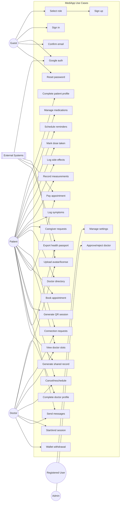

## 4.2 DFD Level 0 (Context Diagram)

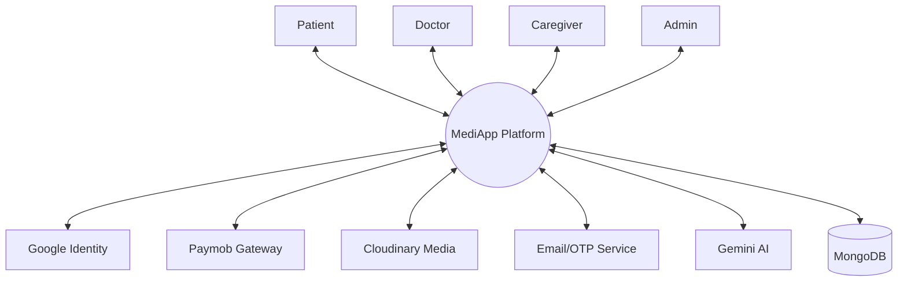

## 4.3 DFD Level 1

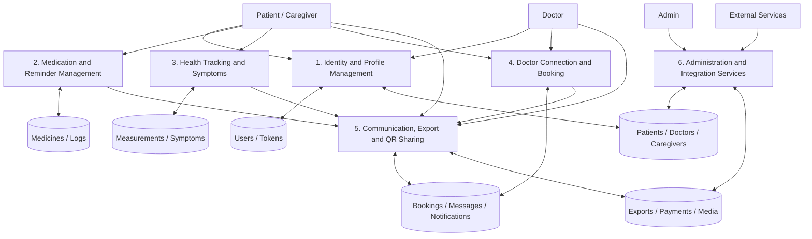

## 4.4 Entity Relationship Diagram (ERD)

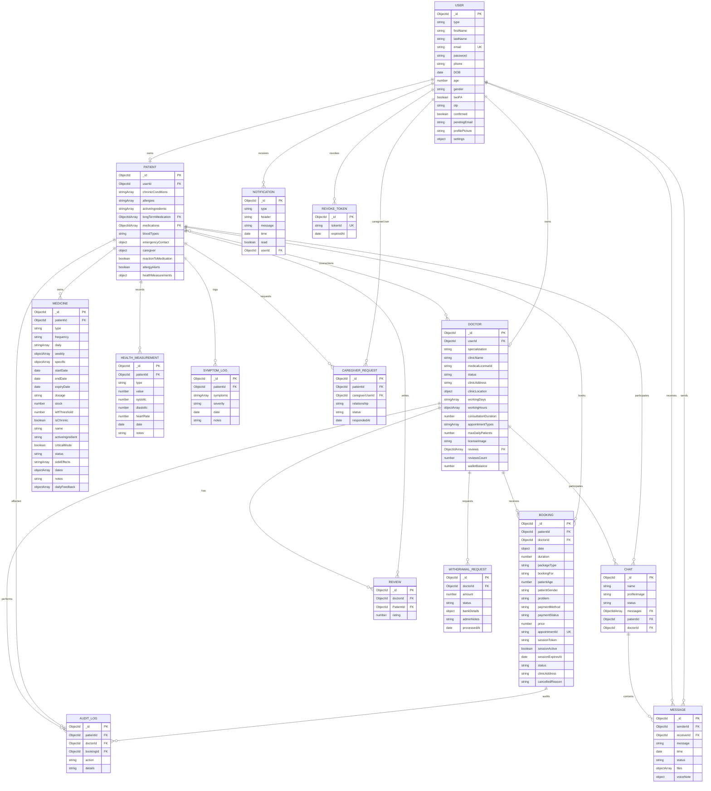

## 4.5 Sequence Diagrams

### 4.5.1 Registration, Confirmation, and Login

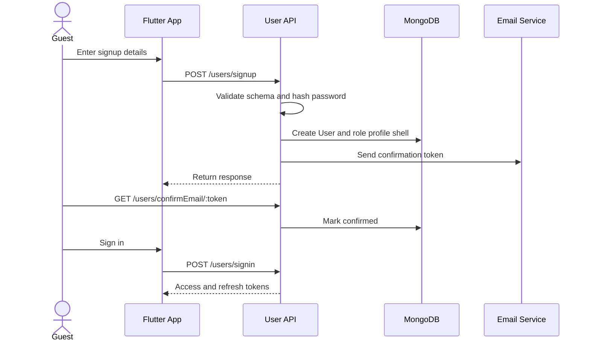

### 4.5.2 Patient Onboarding and Caregiver Setup

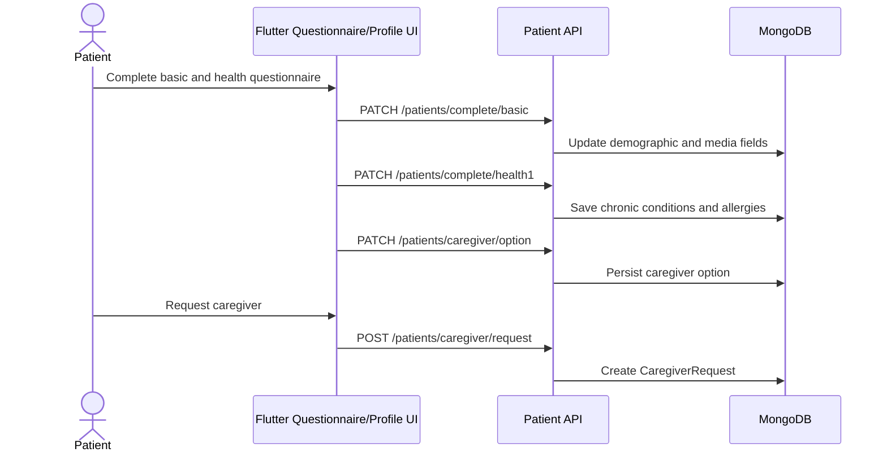

### 4.5.3 Doctor Onboarding and Admin Approval

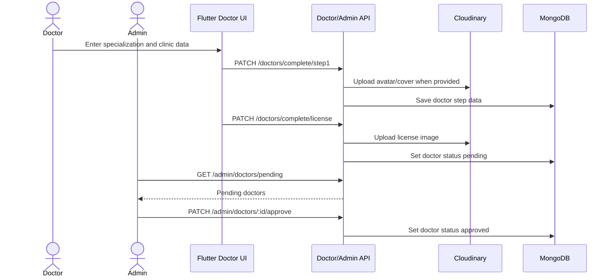

### 4.5.4 Medication Creation and Reminder Scheduling

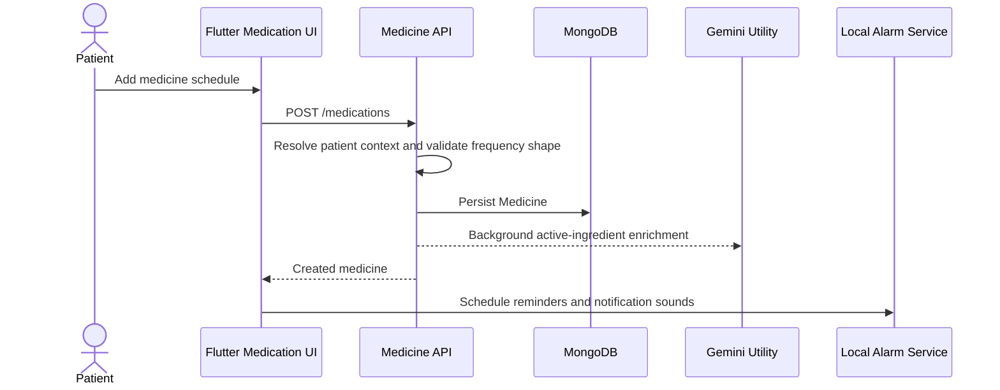

### 4.5.5 Dose Tracking and Stock Alert

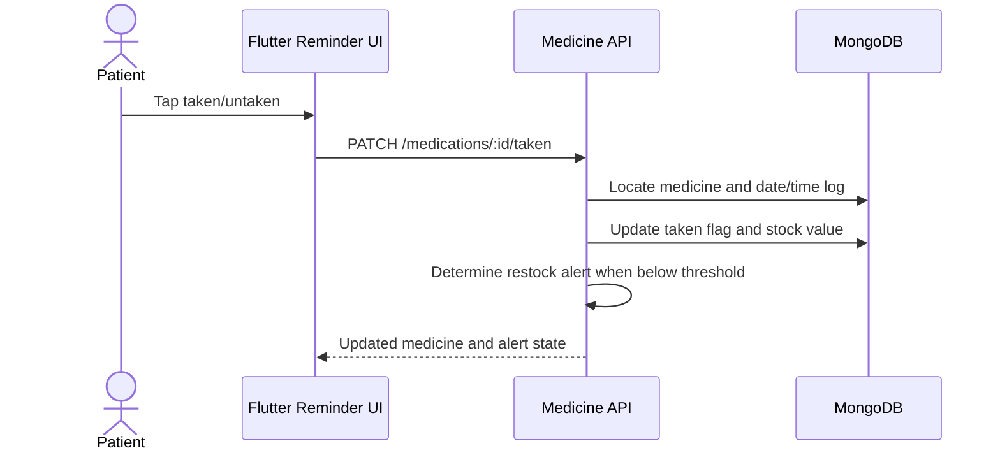

### 4.5.6 Health Measurement and Symptom Logging

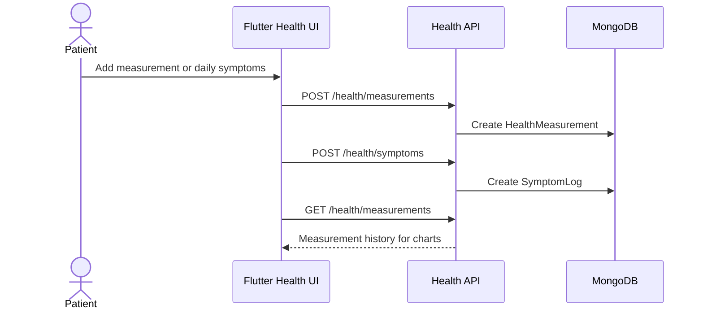

### 4.5.7 Booking, Paymob Payment, and Rescheduling

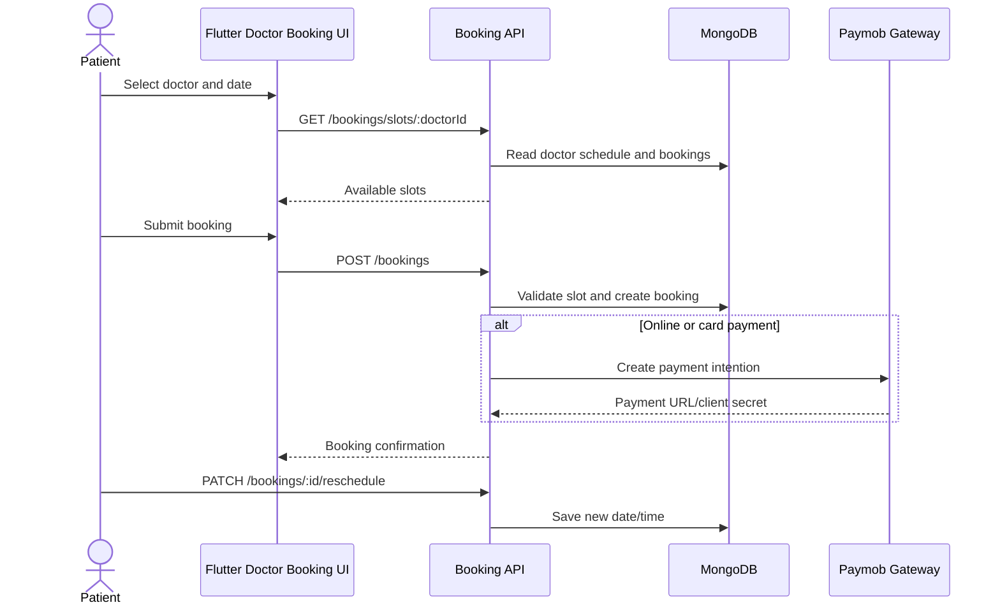

### 4.5.8 QR Session, Export, and Shared Record

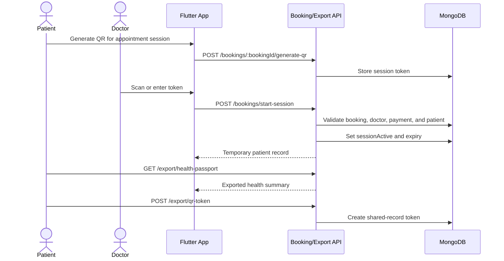

## 4.6 State Diagrams

### 4.6.1 Authentication State

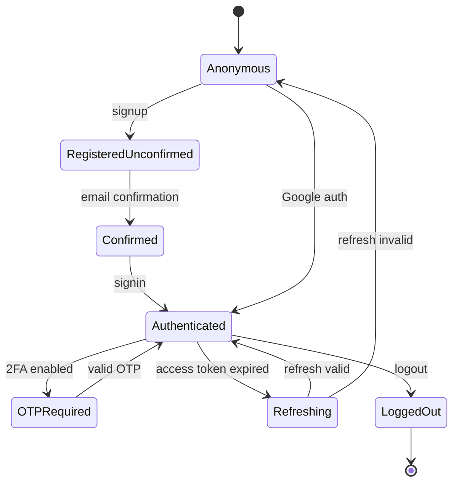

### 4.6.2 Patient Profile State

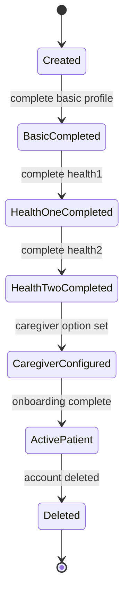

### 4.6.3 Doctor Verification State

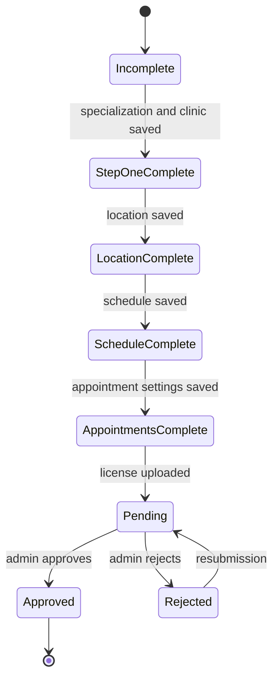

### 4.6.4 Medicine State

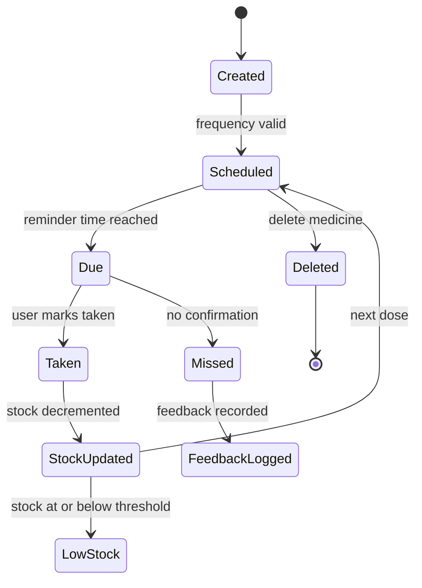

### 4.6.5 Booking and Payment State

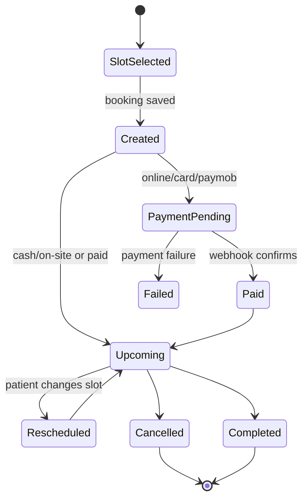

### 4.6.6 Consultation Session State

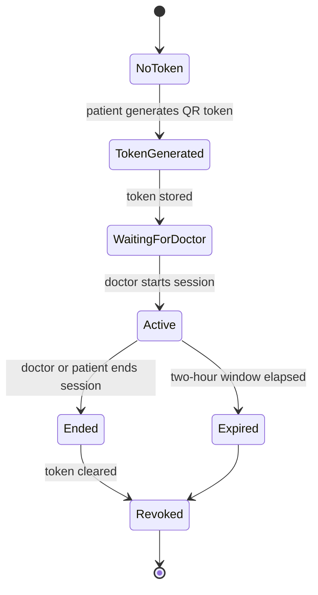

### 4.6.7 Caregiver Request State

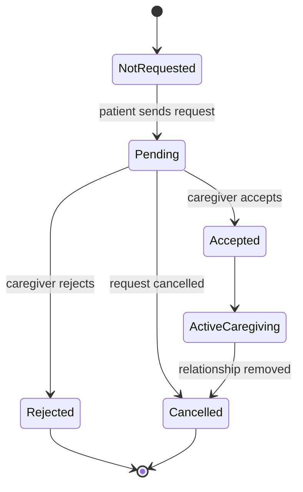

### 4.6.8 Notification State

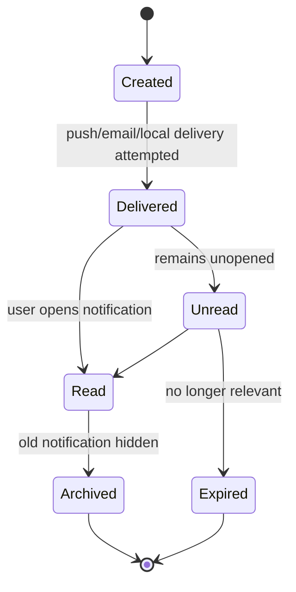

## 4.7 User Interface Design

### Splash and onboarding

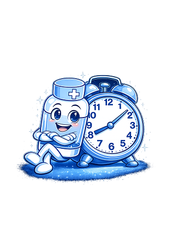

> **UI mapping:** This repository asset supports the splash and onboarding user flow. In a final academic submission, this figure should be replaced or supplemented with a full application screenshot captured from the running Flutter app.

### Medication management

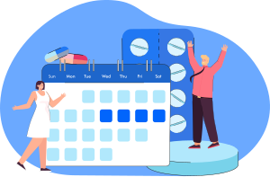

> **UI mapping:** This repository asset supports the medication management user flow. In a final academic submission, this figure should be replaced or supplemented with a full application screenshot captured from the running Flutter app.

### Doctor discovery

> **UI mapping:** This repository asset supports the doctor discovery user flow. In a final academic submission, this figure should be replaced or supplemented with a full application screenshot captured from the running Flutter app.

### Chat and support

> **UI mapping:** This repository asset supports the chat and support user flow. In a final academic submission, this figure should be replaced or supplemented with a full application screenshot captured from the running Flutter app.

### Health measurement - blood pressure

> **UI mapping:** This repository asset supports the health measurement - blood pressure user flow. In a final academic submission, this figure should be replaced or supplemented with a full application screenshot captured from the running Flutter app.

### Health measurement - heart rate

> **UI mapping:** This repository asset supports the health measurement - heart rate user flow. In a final academic submission, this figure should be replaced or supplemented with a full application screenshot captured from the running Flutter app.

### Profile

> **UI mapping:** This repository asset supports the profile user flow. In a final academic submission, this figure should be replaced or supplemented with a full application screenshot captured from the running Flutter app.

### Notifications

> **UI mapping:** This repository asset supports the notifications user flow. In a final academic submission, this figure should be replaced or supplemented with a full application screenshot captured from the running Flutter app.

> **[PLACEHOLDER: Insert Screenshot of Patient Dashboard Here]**

> **[PLACEHOLDER: Insert Screenshot of Add Medication Flow Here]**

> **[PLACEHOLDER: Insert Screenshot of Doctor Profile and Booking Flow Here]**

> **[PLACEHOLDER: Insert Screenshot of Health Measurements Chart Here]**

# Chapter 5: Conclusion and Future Work

## 5.1 Conclusion

### Chapter Summary

This documentation analyzed MediApp as a complete senior-project healthcare system, covering domain motivation, survey analysis, related work, tools, requirements, system design, UI assets, and future evolution.

### Key Findings from User Research

The extracted charts show strong need for reminders, caregiver mode, QR record sharing, multi-payment support, chatbot support, and structured reports. The most decisive values include 67.3% chronic-condition relevance, 70.4% memory-based medication tracking, 74.1% dose-forgetting challenges, 92.6% conditional/full QR sharing acceptance, 84% chatbot demand, and 54% beta interest.

### Review of Existing Research

Related medication-adherence, telemedicine, and personal-health-record concepts confirm that adherence, remote care, and data portability are complementary rather than isolated problems.

### Comparison with Existing Applications

The feature matrix shows that existing competitors usually specialize in medication reminders, clinic booking, telehealth, or health records. MediApp's academic value is its integration of all of these categories in one modular codebase.

### Technology Background Summary

The frontend uses Flutter, Bloc/Cubit, GoRouter, Dio, Hive, SharedPreferences, local notifications, alarms, charts, audio, and geolocation packages. The backend uses Express, Mongoose, Joi, JWT, bcrypt, Cloudinary, Paymob, Nodemailer, PDFKit, QRCode, and Gemini AI tooling.

### Business and Methodological Considerations

The system can support patient engagement, clinic digitization, appointment monetization, and caregiver collaboration. Agile Scrum fits because features can be delivered as separate increments while preserving integrated system behavior.

### Functional Requirements Consolidation

The FR-1 through FR-70 list consolidates authentication, profile management, patient care, doctor governance, medication scheduling, health logging, connections, booking, payments, sessions, exports, notifications, and integrations.

### Non-Functional Quality Requirements

Performance, reliability, security, usability, scalability, compatibility, maintainability, and availability are supported through rate limits, health checks, modular services, token security, reusable UI, and cloud-ready deployment patterns.

### System Behavior and Interaction Overview

The sequence and state diagrams describe how users register, complete profiles, schedule medicines, track doses, log health data, book appointments, activate sessions, export records, and receive notifications.

### Data Flow and Structure Design

The DFDs and ERD show a document-oriented architecture with users, patients, doctors, medicines, bookings, measurements, symptoms, messages, chats, notifications, caregiver requests, audits, withdrawals, and revoked tokens.

### User Interface Design Summary

The repository includes healthcare-themed assets for onboarding, medication, doctors, chat, measurements, profile, and notifications, and the Flutter structure supports the major user journeys.

### Overall Project Outcome

MediApp demonstrates a substantial full-stack healthcare solution with real-world workflows, external integrations, secure access patterns, and a code organization suitable for continued development.

### System Value and Impact

The project can reduce missed doses, improve caregiver confidence, support doctors with structured reports, shorten consultation preparation, and create a foundation for future intelligent clinical support.

## 5.2 Future Work

1. Implement production-grade real-time chat, push notifications, and video consultation using WebSockets and a secure video SDK.
2. Harden healthcare compliance by adding consent history, audit dashboards, webhook signature verification, secure mobile token storage, and expanded field-level encryption.
3. Expand AI capabilities to include drug-interaction warnings, allergy conflict detection, abnormal vital-sign alerts, and explainable chatbot triage with clinician-reviewed safety boundaries.
4. Introduce scalable background workers for reminders, e-mails, PDF generation, payment reconciliation, AI enrichment, and notification retries.

# References

1. World Health Organization. *Adherence to Long-Term Therapies: Evidence for Action*. WHO, 2003.
2. World Health Organization. *Global Strategy on Digital Health 2020–2025*. WHO, 2021.
3. Haynes, R. B., et al. “Interventions for Enhancing Medication Adherence.” *Cochrane Database of Systematic Reviews*, 2008.
4. Vrijens, B., et al. “A New Taxonomy for Describing and Defining Adherence to Medications.” *British Journal of Clinical Pharmacology*, 2012.
5. Dorsey, E. R., and Topol, E. J. “State of Telehealth.” *New England Journal of Medicine*, 2016.
6. Kruse, C. S., et al. “Telehealth and Patient Satisfaction: A Systematic Review.” *BMJ Open*, 2017.
7. Tang, P. C., et al. “Personal Health Records: Definitions, Benefits, and Strategies.” *Journal of the American Medical Informatics Association*, 2006.
8. HL7 International. *FHIR Release 4 Documentation*. https://hl7.org/fhir/
9. MongoDB. *MongoDB Manual and Data Modeling Documentation*. https://www.mongodb.com/docs/
10. Mongoose. *Mongoose ODM Documentation*. https://mongoosejs.com/docs/
11. Express.js. *Express 5 API Reference*. https://expressjs.com/
12. Flutter. *Flutter Documentation*. https://docs.flutter.dev/
13. Dart Team. *Dart Language Tour*. https://dart.dev/language
14. Bloc Library. *flutter_bloc Documentation*. https://bloclibrary.dev/
15. Vercel. *Vercel Functions Documentation*. https://vercel.com/docs/functions
16. Cloudinary. *Image and Video API Documentation*. https://cloudinary.com/documentation
17. Paymob. *Payment API Documentation*. https://developers.paymob.com/
18. Google AI for Developers. *Gemini API Documentation*. https://ai.google.dev/
19. OWASP Foundation. *OWASP API Security Top 10*. https://owasp.org/API-Security/
