# MediApp Enterprise Technical Documentation

**Document status:** Source-derived technical analysis  
**Repository scope:** `backend/` Node.js API and `frontend/` Flutter application  
**Primary domain:** Medication management, patient/doctor onboarding, bookings, health records, caregiving, messaging, and medical data export

---

## 1. Executive Technical Overview

MediApp is a full-stack healthcare application composed of a Flutter client and an Express/MongoDB backend. The product supports patient medication tracking, health measurements, doctor discovery, appointment booking, doctor-patient session access, caregiver workflows, authentication, OTP flows, payment initiation, and exportable health records.

### 1.1 Project Purpose

The system is designed to solve the operational gap between medication adherence, patient health telemetry, and doctor/caregiver collaboration. It gives patients a single mobile interface to manage medications, reminders, chronic medication indicators, symptoms, doctor connections, appointment booking, and health records. Doctors can complete professional profiles, expose schedules, accept patient connections, inspect records during approved sessions, and request wallet withdrawals.

### 1.2 Core Capabilities

| Capability | Backend Implementation | Frontend Implementation |
|---|---|---|
| Identity and authentication | Email/password, Google auth, OTP, 2FA challenge token, access/refresh JWTs, token revocation | Auth screens, Cubits, Hive token persistence, Dio refresh retry interceptor |
| Patient profile | Patient model, profile completion, caregiver mode, emergency contact, SOS | Patient onboarding, questionnaire, profile management |
| Doctor profile | Doctor model, multi-step profile completion, schedule, license upload, approval status | Doctor onboarding flow, location, schedule, license upload, settings |
| Medication management | Medicine model, CRUD, schedule generation, taken logs, AI enrichment, audit logging | Add/edit medication flow, reminders, local Hive cache |
| Health tracking | HealthMeasurement and SymptomLog models with patient-only APIs | Health measurement screens and daily log flow |
| Booking | Slot generation, booking creation, cancellation, rescheduling, payment webhook, QR session tokens | Doctor browsing, package selection, patient details flow |
| Messaging | Message API with approved doctor guard | Chat UI scaffolding for doctor/patient communication |
| Export | Health passport, patient record, QR token, public shared record | Export-oriented profile/records UX hooks |
| Admin review | Pending doctor list and approve/reject actions | No complete admin frontend detected |

### 1.3 High-Level Architecture

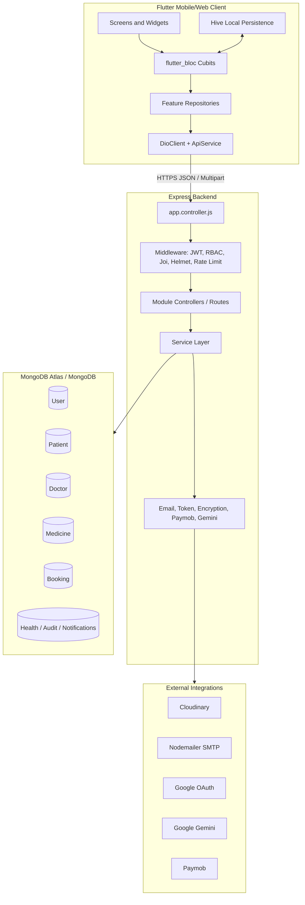

### 1.4 Technologies Used

| Layer | Technology | Purpose |
|---|---|---|
| Backend runtime | Node.js ES modules | API execution |
| HTTP framework | Express 5 | Routing, middleware, JSON API |
| Database | MongoDB | Document persistence |
| ODM | Mongoose 9 | Models, schema constraints, indexes |
| Validation | Joi | Request schema validation |
| Auth | JWT, bcrypt, nanoid | Access/refresh tokens, password hashing, token IDs |
| Security | Helmet, CORS, express-rate-limit | Baseline API security |
| Uploads | Multer, Cloudinary | Avatar, cover, license assets |
| Payments | Paymob REST | Card/online booking payment initiation and webhook |
| AI | Google Gemini SDK / REST | Medication active ingredient and warning enrichment |
| Notifications/email | Nodemailer | Confirmation, OTP, email-change workflows |
| Frontend | Flutter / Dart | Cross-platform UI |
| State management | flutter_bloc Cubit | Feature state orchestration |
| HTTP client | Dio | API transport and token refresh |
| Local storage | Hive, shared_preferences | Tokens, user data, medications, settings |
| Navigation | GoRouter | Declarative routes |
| Device services | local notifications, alarm, audio, geolocation | Reminders, sounds, location flows |

### 1.5 Engineering Philosophy and Scale Assumptions

The codebase follows a modular monolith backend with one Express application split by domain modules. The frontend uses feature-first Clean Architecture conventions: `data`, `domain`, and `presentation` folders are common inside feature modules. The current system is appropriate for MVP-to-growth-stage workloads, assuming moderate traffic, low write contention per doctor schedule, and MongoDB as the operational data store. The architecture is not yet fully enterprise hardened because transactions, centralized observability, environment validation consistency, admin UI, and comprehensive tests are incomplete.

---

## 2. Complete Project Structure Analysis

### 2.1 Repository Tree

```text
mediApp/
├── ENTERPRISE_TECHNICAL_DOCUMENTATION.md
├── backend/
│   ├── index.js
│   ├── package.json
│   ├── package-lock.json
│   ├── vercel.json
│   ├── README.md
│   ├── MediApp_Complete_API.postman_collection.json
│   ├── MediApp_Final_Collection.json
│   └── src/
│       ├── app.controller.js
│       ├── config/
│       │   ├── DB.js
│       │   ├── CONSTANTS.js
│       │   ├── cloudinary.js
│       │   └── env.js
│       ├── middlewares/
│       │   ├── authentication.js
│       │   ├── restrictTo.js
│       │   ├── validation.js
│       │   ├── errorHandler.js
│       │   ├── notFound.js
│       │   ├── cloudinary.js
│       │   ├── upload.js
│       │   ├── multer.js
│       │   └── isApprovedDoctor.js
│       ├── models/
│       │   ├── user.model.js
│       │   ├── patient.model.js
│       │   ├── doctor.model.js
│       │   ├── medicine.model.js
│       │   ├── booking.model.js
│       │   ├── message.model.js
│       │   ├── chat.model.js
│       │   ├── notification.model.js
│       │   ├── health-measurement.model.js
│       │   ├── symptom-log.model.js
│       │   ├── caregiver-request.model.js
│       │   ├── audit-log.model.js
│       │   ├── review.model.js
│       │   ├── withdrawal-request.model.js
│       │   ├── revoke-token.model.js
│       │   └── index.js
│       ├── modules/
│       │   ├── userModel/
│       │   ├── patientModel/
│       │   ├── doctorModel/
│       │   ├── medicineModel/
│       │   ├── healthModel/
│       │   ├── bookingModel/
│       │   ├── messageModel/
│       │   ├── adminModel/
│       │   └── exportModel/
│       └── utils/
│           ├── ai.util.js
│           ├── paymob.js
│           ├── sendEmail.js
│           ├── sendEmail-events/
│           ├── templates/
│           ├── token/
│           ├── hash/
│           ├── encryption/
│           └── index.js
└── frontend/
    ├── pubspec.yaml
    ├── analysis_options.yaml
    ├── README.md
    ├── assets/
    ├── android/ ios/ macos/ linux/ windows/ web/
    └── lib/
        ├── main.dart
        ├── core/
        │   ├── constants/
        │   ├── enums/
        │   ├── network/
        │   ├── services/
        │   ├── utils/
        │   └── widgets/
        └── features/
            ├── shared/
            │   ├── auth/
            │   └── splash/
            ├── patient/
            │   └── features/
            │       ├── add_medication/
            │       ├── doctors/
            │       ├── health_measurements/
            │       ├── home/
            │       ├── notification_sound/
            │       ├── profile/
            │       └── questionnaire/
            └── doctor/
                └── features/
                    ├── complete_profile/
                    ├── home/
                    └── settings/
```

### 2.2 Folder Responsibilities

| Folder | Responsibility | Cohesion Evaluation |
|---|---|---|
| `backend/src/config` | Database connection, constants, environment schema, Cloudinary config | High cohesion, but `env.js` validates `MONGODB_URI` while `DB.js` reads `MONGO_URI_ONLINE`/`MONGO_URI`, creating configuration drift |
| `backend/src/models` | Mongoose persistence schemas | High domain cohesion; schema constraints are meaningful but some fields used by services are absent from schemas |
| `backend/src/modules/*Model` | Route/controller, Joi validation, service per bounded context | Good modularity; naming mixes “Model” with controller/service concerns |
| `backend/src/middlewares` | Cross-cutting HTTP concerns | Clear separation for auth, RBAC, validation, upload, and error handling |
| `backend/src/utils` | External service clients and reusable primitives | Mixed cohesion: token/hash/encryption are clean, while `index.js` combines OTP and cron scheduling |
| `frontend/lib/core` | Cross-feature constants, networking, DI, router, shared widgets/services | Strong foundation but contains some hard-coded URLs and comments from older Dio implementations |
| `frontend/lib/features/shared` | Auth and splash feature modules | Cleanly separated reusable application flows |
| `frontend/lib/features/patient/features` | Patient-specific domain features | Feature-first structure supports maintainability |
| `frontend/lib/features/doctor/features` | Doctor onboarding, home, settings | Good separation; admin feature is absent |

### 2.3 Layer Separation Analysis

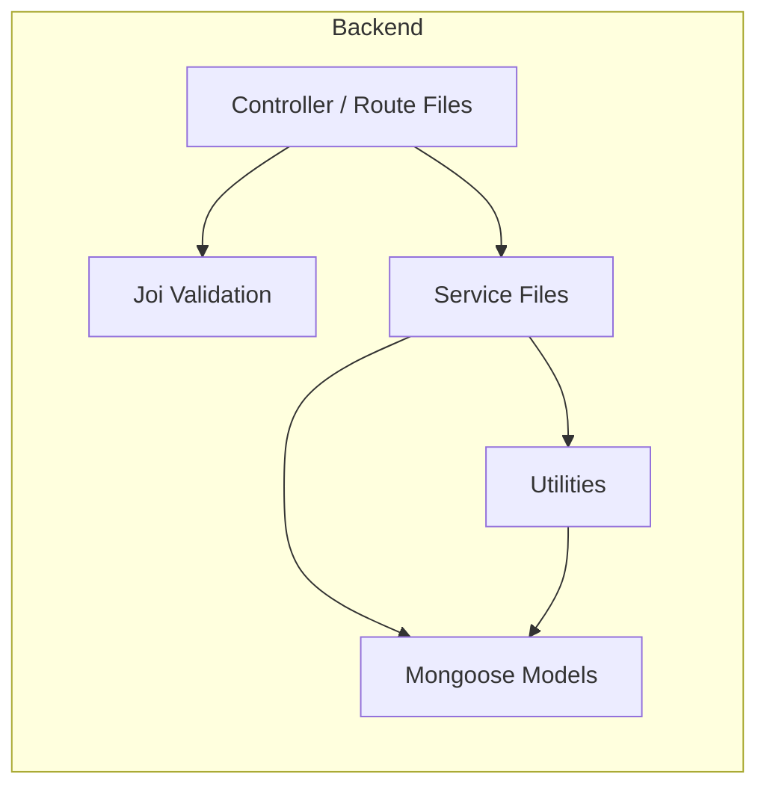

Backend route files correctly delegate most business logic to service files. The main coupling risks are:

- Service functions directly write Express responses, which couples business logic to HTTP and makes unit testing harder.
- Some controllers call service methods as pass-through wrappers, but others export routers directly, resulting in inconsistent controller style.
- Several service methods perform authorization checks inline rather than using reusable policy functions.

Frontend modules use Cubits and repositories, which improves testability and state isolation. The main coupling risks are hard-coded backend base URLs and mixed local/remote medication persistence.

---

## 3. System Architecture Documentation

### 3.1 Backend Architecture

The backend initializes through `index.js`, which imports environment variables and exports a Vercel-compatible handler after awaiting `bootstrap()`. `app.controller.js` creates the Express app, connects MongoDB, starts a weekly cron reset, applies JSON parsing, CORS, Morgan, Helmet, rate limiting, health endpoints, and mounts domain routers.

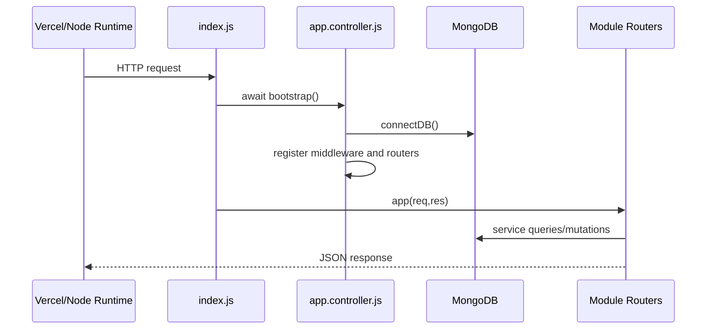

### 3.2 Frontend Architecture

The Flutter app starts in `main.dart`, builds a `MaterialApp.router`, applies ScreenUtil sizing, and uses `AppRouter.router`. Core networking is centralized in `DioClient`, which injects bearer tokens from Hive and attempts refresh-token recovery on HTTP 401.

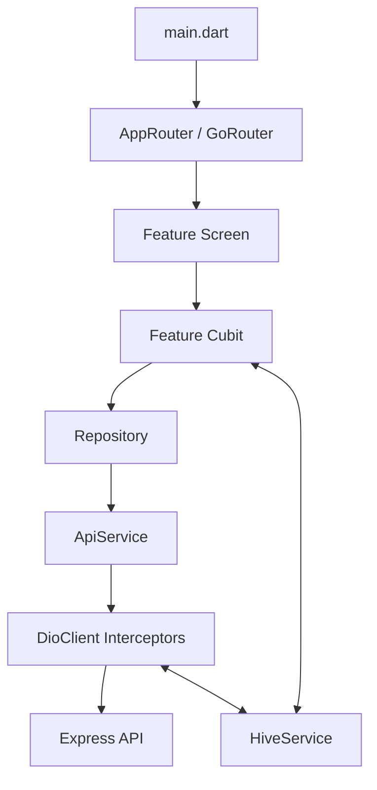

### 3.3 Request Lifecycle

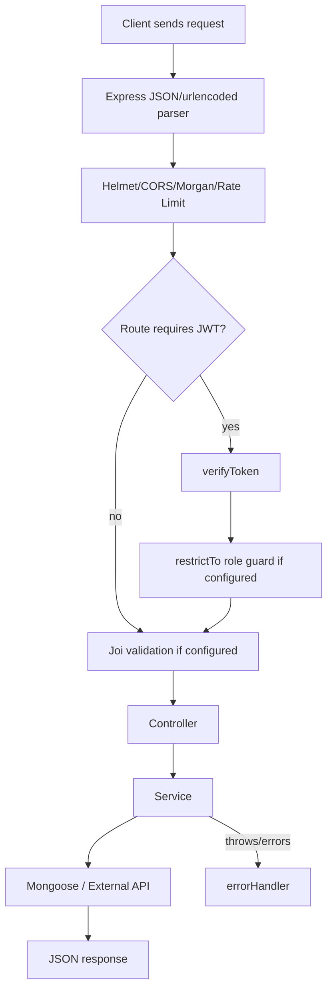

### 3.4 Authentication Flow

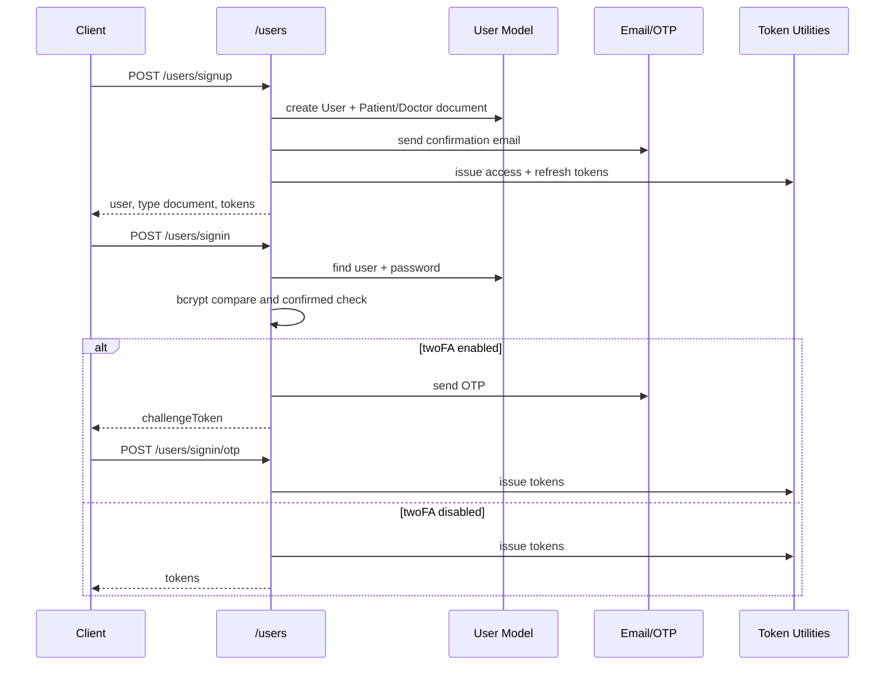

---

## 4. Database Engineering Documentation

### 4.1 Database Overview

| Attribute | Implementation |
|---|---|
| Database type | MongoDB document database |
| ODM | Mongoose |
| Migration system | No explicit migration framework detected |
| Connection strategy | Single Mongoose connection using `MONGO_URI_ONLINE` or `MONGO_URI`, `autoIndex` disabled in production |
| Scaling approach | Vertical scaling / managed MongoDB scaling; application is mostly stateless except cron and local uploads path |

### 4.2 Entity Relationship Diagram

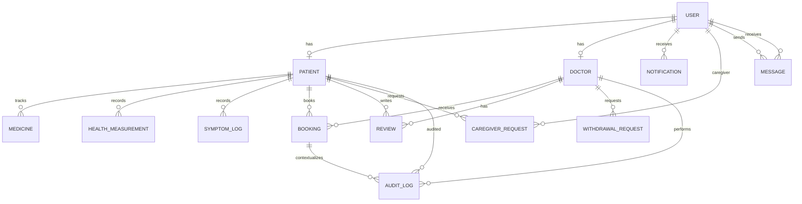

### 4.3 Schema Analysis

| Model | Purpose | Key Fields | Constraints / Indexes |
|---|---|---|---|
| `User` | Global identity and authentication root | `type`, `firstName`, `lastName`, `email`, `password`, `phone`, `twoFA`, `otp`, `confirmed`, token IDs, `settings` | `email` unique/indexed, `type` indexed, password/OTP/token IDs excluded by default |
| `Patient` | Patient medical profile and relationship container | `userId`, `chronicConditions`, `allergies`, `activeIngredients`, `medications`, `connectedDoctors`, card fields, emergency contact, caregiver, healthMeasurements | `userId` unique/indexed; embedded connected doctor status indexed |
| `Doctor` | Doctor profile, schedule, license, status, wallet | `userId`, `specialization`, `status`, `clinicLocation`, `workingDays`, `workingHours`, `appointmentTypes`, `licenseImage`, `connectedPatients`, `walletBalance` | `userId` unique/indexed, `specialization` indexed, enum status, license hidden by default |
| `Medicine` | Medication regimen and adherence data | `patientId`, `type`, `frequency`, `daily`, `weekly`, `specific`, `dosage`, `stock`, `isChronic`, `status`, `dates`, `dailyFeedback` | Frequency/type/status enums; pre-validate enforces daily/weekly/specific shape; `patientId` and `status` indexed |
| `Booking` | Appointment and live-session record | `patientId`, `doctorId`, `date`, `duration`, `packageType`, `paymentStatus`, `appointmentId`, `sessionToken`, `status` | `appointmentId` unique/indexed; compound index on doctor/date/time; patient/doctor/status indexes |
| `Message` | Point-to-point chat message | `senderId`, `receiverId`, `message`, `time`, `status`, `files`, `voiceNote` | sender/receiver/time/status indexed; file type enum |
| `Chat` | Chat conversation metadata | `name`, `profileImage`, `status`, `messages`, `patientId`, `doctorId` | patient/doctor indexed |
| `Notification` | In-app notification | `type`, `header`, `message`, `time`, `read`, `userId` | type/time/read/user indexed |
| `HealthMeasurement` | Patient health telemetry | `patientId`, `type`, `value`, `systolic`, `diastolic`, `heartRate`, `date`, `notes` | patient indexed; type enum |
| `SymptomLog` | Patient symptom journal | `patientId`, `symptoms`, `severity`, `date`, `notes` | patient indexed; severity enum |
| `CaregiverRequest` | Caregiver access workflow | `patientId`, `caregiverUserId`, `relationship`, `status`, `respondedAt` | compound unique `{patientId, caregiverUserId, status}`; status indexed |
| `AuditLog` | Doctor changes to patient records | `patientId`, `doctorId`, `bookingId`, `action`, `details` | patient/doctor/booking indexed; action enum |
| `Review` | Patient rating of doctor | `doctorId`, `PatientId`, `rating` | unique `{doctorId, PatientId}` |
| `WithdrawalRequest` | Doctor payout request | `doctorId`, `amount`, `status`, `bankDetails`, `adminNotes`, `processedAt` | doctor indexed; amount min 10; status enum |
| `RevokeToken` | JWT revocation and TTL cleanup | `tokenId`, `expiredAt` | tokenId unique/indexed; TTL index on `expiredAt` |

### 4.4 Relationship and Cascade Analysis

Mongoose references are used extensively, but there are no database-level cascades because MongoDB does not enforce foreign keys. Deletion workflows must manually clean dependent documents. The `deleteAccount` service should be treated as the canonical lifecycle cleanup point. High-value cascading requirements include User → Patient/Doctor, Patient → Medicine/Booking/HealthMeasurement/SymptomLog, Doctor → Booking/WithdrawalRequest, and Booking → AuditLog.

### 4.5 Query Analysis and Optimization Risks

| Query Area | Current Pattern | Risk | Recommendation |
|---|---|---|---|
| Doctor slots | Fetch all bookings for doctor/day, then in-memory reserved slot filtering | O(B + S) per request; acceptable for daily load but race-prone | Add transaction/unique reservation guard for concurrent booking attempts |
| Booking listings | Populate patient/doctor and sort by date/time | Large historical lists may grow without pagination | Add `limit`, `cursor`, and compound indexes for date windows |
| Patient attachment | `attachTypeDoc` populates medications and loads all health measurements | Payload can become large | Paginate measurements and medication history |
| Medicine schedule | Iterates medicines and generated date windows | Can become CPU-heavy with long date ranges | Cap schedule range, precompute occurrences, or use recurrence library/cache |
| Directory search | Doctor directory service likely filters approved/specialization | Needs compound indexes | Add `{status:1, specialization:1}` and location index if geo-search is enabled |

---

## 5. Backend Engineering Documentation

### 5.1 Mounted API Modules

| Mount Path | Router | Domain |
|---|---|---|
| `/users` | `user.controller.js` | Identity, auth, profile, settings |
| `/patients` | `patient.controller.js` | Patient onboarding, caregivers, doctor links, SOS |
| `/doctors` | `doctor.controller.js` | Doctor directory, onboarding, patient links, wallet |
| `/medications` | `medicine.controller.js` | Medication CRUD and schedules |
| `/health` | `health.controller.js` | Measurements and symptom logs |
| `/bookings` | `booking.routes.js` | Appointment slots, bookings, sessions, payment callbacks |
| `/messages` and `/users/:id/messages` | `message.controller.js` | Messaging and chat verification |
| `/admin` | `admin.controller.js` | Doctor approval queue |
| `/export` | `export.routes.js` | PDF/QR/shared health records |

### 5.2 Endpoint Inventory

| Method | Route | Auth | Roles | Purpose |
|---|---|---|---|---|
| GET | `/health`, `/api/v1/health` | No | Public | Service and DB readiness |
| POST | `/users/signup` | No | Public | Create user plus patient/doctor profile and email confirmation token |
| POST | `/users/signin` | No | Public | Password login; may return 2FA challenge |
| POST | `/users/google` | No | Public | Google ID token login/signup |
| POST | `/users/signin/otp` | No | Public | Complete OTP/2FA login |
| GET | `/users/confirmEmail/:token` | No | Public | Confirm email token |
| GET | `/users/confirmEmailChange/:token` | No | Public | Confirm pending email change |
| POST | `/users/refreshToken` | No | Public token endpoint | Rotate access/refresh token pair |
| POST | `/users/requestOTP` | No | Public | Request generic OTP |
| POST | `/users/checkOTP` | No | Public | Verify generic OTP |
| POST | `/users/forgetPassword` | No | Public | Start password reset |
| POST | `/users/forgetPassword/verify` | No | Public | Verify reset OTP and issue reset token |
| POST | `/users/resetPassword` | No | Public | Reset password by reset token |
| GET | `/users/profile/:id` | No | Public | Read public profile |
| GET | `/users/me` | Yes | user/patient/doctor | Current account and type document |
| POST | `/users/logout` | Yes | user/patient/doctor | Revoke current token ID |
| PATCH | `/users/email/change` | Yes | user/patient/doctor | Request email change |
| PATCH | `/users/email/cancel` | Yes | user/patient/doctor | Cancel pending email change |
| PATCH | `/users/2fa` | Yes | user/patient/doctor | Toggle 2FA |
| PATCH | `/users/updateProfile` | Yes | user/patient/doctor | Update profile fields |
| PATCH | `/users/changePassword` | Yes | user/patient/doctor | Change password after old password verification |
| POST | `/users/resendConfirmEmail` | Yes | user/patient/doctor | Re-send confirmation token |
| PATCH | `/users/settings` | Yes | user/patient/doctor | Update notification/privacy settings |
| DELETE | `/users/me` | Yes | user/patient/doctor | Delete account |
| PATCH | `/patients/complete` | Yes | patient | Complete full patient profile with uploads |
| PATCH | `/patients/complete/basic` | Yes | patient | Basic profile step |
| PATCH | `/patients/complete/health1` | Yes | patient | Health questionnaire step 1 |
| PATCH | `/patients/complete/health2` | Yes | patient | Health questionnaire step 2 |
| PATCH | `/patients/caregiver/option` | Yes | patient | Enable/disable caregiver option |
| POST | `/patients/caregiver/request` | Yes | patient | Request caregiver |
| GET | `/patients/caregiver/requests` | Yes | patient | List caregiver requests |
| PATCH | `/patients/caregiver/requests/:requestId/accept` | Yes | patient | Accept caregiver request |
| PATCH | `/patients/caregiver/requests/:requestId/cancel` | Yes | patient | Cancel caregiver request |
| POST | `/patients/connect-doctor` | Yes | patient | Request doctor connection |
| GET | `/patients/connected-doctors` | Yes | patient | List approved/pending doctors |
| GET | `/patients/doctor-requests` | Yes | patient | List doctor-originated requests |
| PATCH | `/patients/connected-doctors/accept/:doctorId` | Yes | patient | Accept doctor connection |
| PATCH | `/patients/connected-doctors/reject/:doctorId` | Yes | patient | Reject doctor connection |
| PATCH | `/patients/connected-doctors/cancel/:doctorId` | Yes | patient | Cancel doctor request |
| PATCH | `/patients/emergency-contact` | Yes | patient | Set SOS contact |
| POST | `/patients/sos` | Yes | patient | Trigger emergency notification action |
| GET | `/doctors/directory` | Yes | any verified | Browse doctors |
| PATCH | `/doctors/complete/step1` | Yes | doctor | Specialization/profile media step |
| PATCH | `/doctors/complete/location` | Yes | doctor | Clinic location step |
| PATCH | `/doctors/complete/schedule` | Yes | doctor | Working days/hours step |
| PATCH | `/doctors/complete/appointments` | Yes | doctor | Appointment type/duration step |
| PATCH | `/doctors/complete/license` | Yes | doctor | License upload step |
| PATCH | `/doctors/complete` | Yes | doctor | Unified doctor completion |
| PATCH | `/doctors/schedule` | Yes | doctor | Update post-onboarding schedule |
| POST | `/doctors/patients/connect-patient` | Yes | doctor | Request patient connection |
| PATCH | `/doctors/patients/accept/:patientId` | Yes | doctor | Accept patient connection |
| PATCH | `/doctors/patients/reject/:patientId` | Yes | doctor | Reject patient connection |
| PATCH | `/doctors/patients/cancel/:patientId` | Yes | doctor | Cancel patient connection request |
| GET | `/doctors/patients` | Yes | doctor | List connected patients |
| GET | `/doctors/wallet` | Yes | doctor | Wallet summary |
| POST | `/doctors/wallet/withdraw` | Yes | doctor | Create withdrawal request |
| PATCH | `/doctors/wallet/withdraw/:id/process` | Yes | doctor route + nested admin guard | Process withdrawal; routing guard likely prevents admin access because doctor router already restricts to doctor |
| POST | `/medications` | Yes | patient/doctor | Add medicine, optionally audit doctor change |
| GET | `/medications` | Yes | patient/doctor | List medicines by context/filter |
| GET | `/medications/schedule` | Yes | patient/doctor | Generate adherence schedule |
| PUT | `/medications/:id` | Yes | patient/doctor | Update medicine |
| DELETE | `/medications/:id` | Yes | patient/doctor | Delete medicine |
| PATCH | `/medications/:id/taken` | Yes | patient/doctor | Mark dose as taken |
| POST | `/medications/:id/log` | Yes | patient/doctor | Add daily feedback/log |
| POST | `/health/measurements` | Yes | patient | Add measurement |
| GET | `/health/measurements` | Yes | patient | List measurements |
| POST | `/health/symptoms` | Yes | patient | Add symptom log |
| GET | `/health/symptoms` | Yes | patient | List symptom logs |
| GET | `/bookings/slots/:doctorId` | No | Public | Return available slots for doctor/date |
| POST | `/bookings` | Yes | patient | Create booking and optional Paymob payment intent |
| GET | `/bookings/patient` | Yes | patient | Patient booking list |
| GET | `/bookings/doctor` | Yes | doctor | Doctor booking list |
| GET | `/bookings/:id` | Yes | patient/doctor | Booking detail with ownership check |
| PATCH | `/bookings/:id/cancel` | Yes | patient/doctor route, service enforces patient | Cancel booking |
| PATCH | `/bookings/:id/reschedule` | Yes | patient | Reschedule upcoming booking |
| POST | `/bookings/webhook/paymob` | No | Paymob | Payment status webhook |
| GET | `/bookings/webhook/paymob` | No | Browser/Paymob | Deep-link callback redirect |
| POST | `/bookings/:bookingId/generate-qr` | Yes | patient | Generate session QR token |
| POST | `/bookings/start-session` | Yes | doctor | Doctor scans token and starts session |
| POST | `/bookings/:bookingId/end-session` | Yes | patient/doctor | End session and revoke elevated access |
| GET | `/bookings/:bookingId/call-token` | Yes | patient/doctor | Return video room name if session active |
| POST | `/messages` or `/users/:id/messages` | Yes | approved doctor middleware | Send message |
| GET | `/messages/verify/:targetUserId` | Yes | verified user | Verify chat availability |
| GET | `/admin/doctors/pending` | Yes | admin | Pending doctor queue |
| PATCH | `/admin/doctors/:id/approve` | Yes | admin | Approve doctor |
| PATCH | `/admin/doctors/:id/reject` | Yes | admin | Reject doctor |
| GET | `/export/health-passport` | Yes | patient/doctor | Generate health passport PDF/export |
| GET | `/export/patient-record` | Yes | patient/doctor | Generate patient record PDF/export |
| POST | `/export/qr-token` | Yes | patient | Generate shared-record QR token |
| GET | `/export/shared/:qrToken` | No | Public token | Read shared record by QR token |

### 5.3 Middleware Analysis

| Middleware | Responsibility | Observations |
|---|---|---|
| `verifyToken` | Parses/validates JWT and attaches `req.user` | Central auth gate; should ensure revoked tokens are checked consistently |
| `restrictTo` | Role/type allowlist | Simple RBAC guard used per router/endpoint |
| `validation` | Joi validation of body/params/query | Good schema boundary; some endpoints intentionally lack validation |
| `isApprovedDoctor` | Messaging guard for approved doctors | Domain-specific authorization |
| `cloudinaryUploadAvatarAndCover` | Multer upload and Cloudinary forwarding | Used in profile completion |
| `errorHandler` / `notFound` | Terminal error handling | Response normalization is limited; several services catch and respond manually |
| Helmet/rate-limit | Security headers and global throttling | Baseline hardening; CSP disabled |

### 5.4 Background and Async Processing

| Process | Implementation | Risk |
|---|---|---|
| Weekly availability reset | `node-cron` scheduled Saturday 23:59 | In serverless/Vercel environments cron inside runtime is unreliable and may run on multiple instances |
| Email sending | Async `sendEmailEvent`, `sendOTPEvent`, `sendEmailChangeConfirmEvent` | No durable queue or retry store |
| AI medication enrichment | Background promise calling Gemini and updating medicine/patient | No queue, idempotency key, or failure retry |
| Paymob webhook | Public POST updates booking payment and doctor wallet | Should verify Paymob signature/HMAC before trust |

---

## 6. Frontend Engineering Documentation

### 6.1 UI Architecture

The Flutter client uses a feature-first organization. Shared visual atoms such as primary/secondary buttons, text fields, date/time pickers, phone/gender fields, bottom navigation, avatar, toggles, and app bars live in `core/widgets`. Patient and doctor features own their screens and feature-specific widgets.

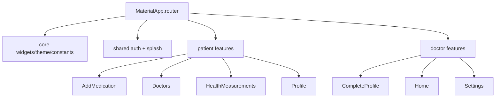

### 6.2 Routing System

Routes are centralized in `AppRouter`. Major route families include:

| Family | Representative Routes |
|---|---|
| Common onboarding/auth | `/`, `/selectRole`, `/onboarding`, `/login/patient`, `/signUp/patient`, `/forgetPassword`, `/otp`, `/setPassword` |
| Patient shell | `/patient/main`, `/home`, `/completeProfile`, `/caregiverForm`, `/notificationSound`, `/chooseSound` |
| Patient medication | `/patient/addMedication`, `/patient/addMedication/stock`, `/medicine/dailySymptoms`, `/patient/editMedication`, `/patient/medicineInfo` |
| Patient doctors/booking | `/doctors/profile`, `/doctors/profile/book` |
| Patient profile | `/patient/accountInfo`, `/patient/caregiverMode`, `/patient/changeEmail`, `/patient/changePassword` |
| Doctor auth/onboarding | `/login/doctor`, `/signUp/doctor`, `/doctor/completeProfile`, `/doctor/allowLocation`, `/doctor/qFlow`, `/doctor/uploadLicense` |
| Doctor app/settings | `/doctor/mainLayout`, `/doctor/availability`, `/doctor/accountInformation`, `/doctor/payoutWithdrawal` |
| Health | `/healthMeasurements`, `/health/dailyLog` |

### 6.3 State Management

The frontend uses `flutter_bloc` with Cubits. `get_it` registers factories and repositories in `service_locator.dart`. State is split by feature: authentication Cubits, medication Cubits, profile Cubits, doctor profile Cubits, schedule Cubits, sound Cubits, and navigation Cubits.

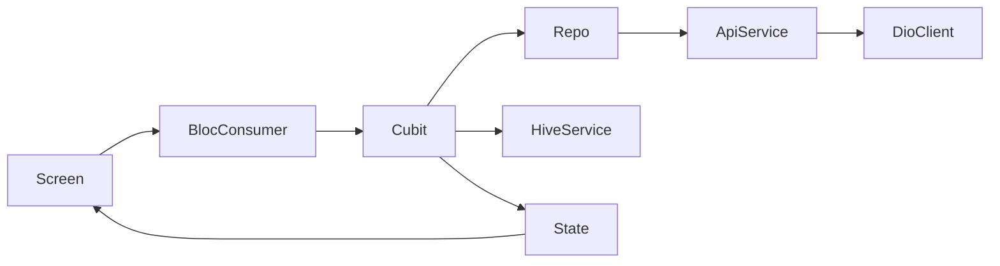

### 6.4 Networking

`ApiService` exposes generic `get`, `post`, `put`, `patch`, and `delete` methods that call `DioClient`. `DioClient` adds `Authorization: Bearer <accessToken>` from Hive and handles 401 by calling `/users/refreshToken` with the refresh token. Concurrent refreshes are coordinated with `Completer` objects.

### 6.5 Local Persistence

Hive stores authentication tokens, challenge token, user/patient/doctor data, onboarding state, settings, and local medication records. This supports offline or fast local UI rendering, but the medication cache can diverge from backend state unless synchronization rules are defined.

### 6.6 Performance Analysis

| Area | Current Position | Recommendation |
|---|---|---|
| Navigation | Central GoRouter configuration | Consider route-level lazy module loading if web bundle becomes large |
| State updates | Cubit-based state updates | Use Equatable consistently and avoid broad rebuilds |
| API retries | Interceptor retries after token refresh | Add retry markers to prevent refresh loops on replayed requests |
| Assets | Images/SVG/sounds included | Compress image assets and avoid bundling unused sounds |
| Local medication list | Hive list operations use linear searches | Acceptable for small lists; index by backend ID for scale |

---

## 7. Authentication & Authorization Analysis

### 7.1 Token Strategy

The backend issues JWT access tokens and refresh tokens using token utilities. Token payloads include user identity and role/type. Token IDs (`jti`) are generated with `nanoid` and stored for confirmation/reset/email-change workflows or revocation. The frontend stores access and refresh tokens in Hive and sends access tokens as bearer tokens.

### 7.2 Role System

| Role/Type | Backend Meaning |
|---|---|
| `patient` | Patient profile holder; can manage medicines, health logs, bookings, caregivers |
| `doctor` | Doctor profile holder; can complete doctor profile, manage patients, wallet, sessions |
| `admin` | Admin can approve/reject doctors through `/admin` routes |
| `user` | Legacy/general type allowed in some user routes |

### 7.3 Access Control Observations

- Router-level RBAC is used heavily and is readable.
- Domain ownership is often enforced inside services by comparing `req.user.id` to patient/doctor profile ownership.
- Doctor elevated access to patient records is modeled by active booking sessions and QR session tokens.
- The withdrawal processing endpoint is nested under a doctor-restricted router before an admin-only endpoint guard, making admin access likely unreachable without route refactoring.

### 7.4 Security Weaknesses

| Risk | Severity | Explanation | Recommendation |
|---|---:|---|---|
| Refresh token stored in Hive | High | Mobile local storage can be extracted on compromised devices | Consider secure storage/keychain and refresh-token rotation with device binding |
| Paymob webhook trust | Critical | Webhook does not visibly verify HMAC/signature | Verify Paymob HMAC and reject unsigned payloads |
| Slot booking race | High | Slot availability checked before insert without transaction/unique date/time booking constraint for active states | Add transaction or unique active booking lock |
| Public profile endpoint | Medium | `/users/profile/:id` public route may leak excessive user data depending service response | Return minimal public projection |
| CSP disabled | Medium | Helmet CSP disabled | Enable CSP for web deployment where feasible |
| Config drift | Medium | `env.js` validates different names than `DB.js` reads | Standardize environment contract |

---

## 8. Business Logic Documentation

### 8.1 User Registration

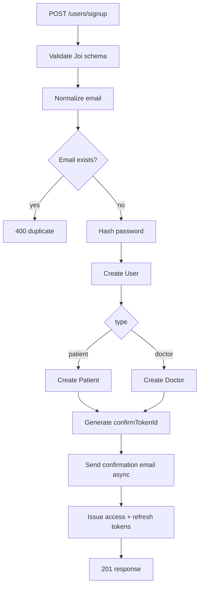

### 8.2 Sign-In with Optional 2FA

1. Find user by normalized email and include password.
2. Reject unknown or unconfirmed users.
3. Compare bcrypt password.
4. If `twoFA` is enabled, generate OTP, encrypt/store it, email the OTP, and return a challenge token.
5. If `twoFA` is disabled, issue access/refresh tokens and attach the patient/doctor document.

### 8.3 Doctor Onboarding

Doctor completion is split into step endpoints:

1. Step 1: profile basics/media/specialization.
2. Location: clinic address/geolocation.
3. Schedule: working days and working hours.
4. Appointments: consultation duration, package types, daily capacity.
5. License: license upload and pending status.
6. Unified `/doctors/complete`: single request alternative.

### 8.4 Booking Creation

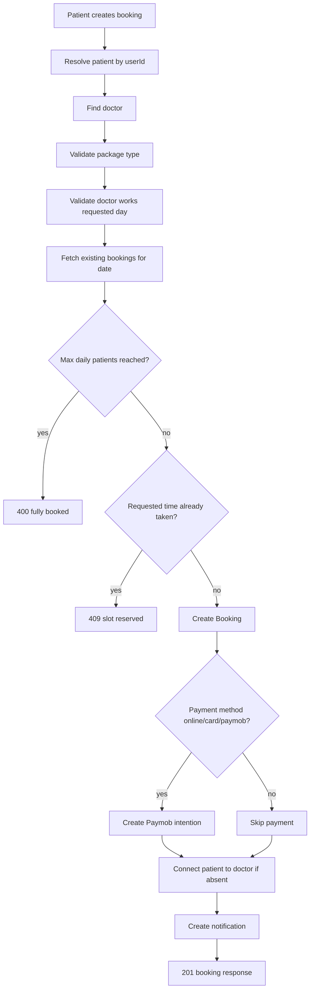

### 8.5 QR Session Access

A patient generates a QR/session token for a booking after payment validation. The doctor scans/submits the token, and the backend verifies doctor ownership, marks the session active, sets a two-hour expiration, and returns the patient record with medications and measurements. Ending the session clears token state and immediately expires elevated access.

### 8.6 Medication Addition and AI Enhancement

1. Resolve request context: patient self, connected doctor, or active session.
2. Create medicine with patient ID and initial active ingredient fallback.
3. Push medicine ID into patient medications.
4. Start background AI enrichment to infer active ingredient, side effects, chronic status, and corrected type.
5. If a doctor made the change, write an audit log.
6. Return immediate response before AI completion.

### 8.7 Caregiver and Doctor Connection Workflows

Connection workflows are modeled as pending/approved/rejected statuses embedded in Patient/Doctor documents and/or caregiver request documents. The system supports patient-initiated doctor connections, doctor-initiated patient connections, caregiver requests, accept/cancel paths, and notification opportunities.

---

## 9. Algorithm & Complexity Analysis

| Function / Operation | Purpose | Time Complexity | Space Complexity | Risk Level | Notes |
|---|---|---:|---:|---|---|
| `getDoctorSlots` | Generate available slots from working hours minus bookings | O(B + H*S) | O(B + S) | Medium | B bookings for day, H working blocks, S generated slots |
| `createBooking` slot conflict check | Prevent duplicate bookings | O(B) | O(B) | High | Race condition under concurrent requests |
| `rescheduleBooking` | Move booking to new date/time | O(B) | O(B) | Medium | Excludes current booking from conflicts |
| Medicine frequency pre-validation | Enforce daily/weekly/specific exclusive shape | O(1) to O(n) by array length | O(1) | Low | Clean schema-level invariant |
| Medicine schedule generation | Build dose schedule from recurrence fields | O(M*D*T) | O(M*D*T) | Medium | M medicines, D days in requested period, T times/day |
| Hive medication update/delete | Find local item by equality/fallback matching | O(N) | O(N) | Low | Acceptable for small patient medication lists |
| Attach patient type doc | Populate medications and measurements | O(M + L) | O(M + L) | Medium | No pagination for measurements |
| Gemini medication enrichment | Parse model JSON and update patient arrays | O(P + W) | O(P + W) | Medium | Depends on LLM latency and JSON validity |
| Token refresh queue | Coordinate parallel 401s | O(R) | O(R) | Low | R waiting requests; prevents refresh storm |

---

## 10. Real-Time & Async Systems

No WebSocket, Socket.IO, Firebase realtime, or SignalR implementation was detected. Messaging is HTTP-based. Async behavior exists through background promises, webhook callbacks, cron, and local notifications/alarms on the Flutter side.

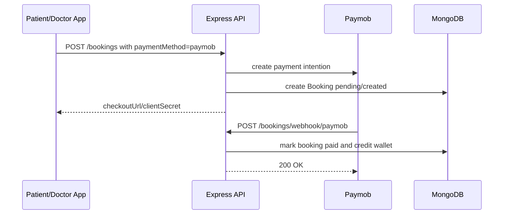

---

## 11. Security Audit Documentation

### 11.1 Security Score

**Overall security score: 6.5 / 10**

The project has a solid baseline with bcrypt, JWT, rate limiting, Helmet, Joi validation, role guards, token IDs, and sensitive field projections. Enterprise readiness requires stronger webhook verification, secure local token storage, transaction-safe booking, stricter input coverage, and observability.

### 11.2 Risk Matrix

| Severity | Finding | Impact | Remediation |
|---|---|---|---|
| Critical | Paymob webhook lacks visible HMAC verification | Fraudulent payment status updates and wallet credit | Validate Paymob HMAC/signature before mutation |
| High | Booking slot race condition | Double bookings under concurrency | Add unique lock or MongoDB transaction with conflict handling |
| High | Refresh tokens in non-secure Hive box | Token theft from compromised client | Use platform secure storage and rotate refresh tokens |
| High | No durable queue for medical AI/email jobs | Lost tasks during process shutdown | Add BullMQ/SQS/Cloud Tasks with retries |
| Medium | Multiple endpoints lack Joi validation | Injection/shape drift and inconsistent error behavior | Add schemas to every mutating endpoint |
| Medium | No centralized audit for auth/admin changes | Compliance gaps | Add audit log entries for login, admin approval, profile changes |
| Medium | Error responses sometimes expose raw messages | Information disclosure | Normalize service errors through centralized error middleware |
| Low | Commented legacy code remains in production files | Maintainability and confusion risk | Remove dead code |

---

## 12. Performance Engineering Report

### 12.1 Bottlenecks

| Layer | Bottleneck | Recommendation |
|---|---|---|
| API | Global JSON body limit is small enough for safety but uploads handled separately | Keep files multipart; document max image/license sizes |
| DB | Booking and measurement list endpoints lack pagination | Add cursor pagination and date range filters |
| DB | In-memory slot conflict checks | Use indexed unique reservation collection or transaction |
| Backend async | Gemini calls can be slow and currently background best-effort | Move to queue with retry/backoff and result status |
| Frontend | Central router imports many screens eagerly | Use deferred imports for web/large app builds |
| Frontend local state | Medication Hive operations use full-list rewrite | Use keyed Hive objects by medication ID |

### 12.2 API Latency Risks

- Population of nested documents can inflate response time.
- AI should remain asynchronous and never block medication CRUD responses.
- Paymob creation adds external latency to booking creation; consider separate payment-intent creation endpoint for retries.

---

## 13. Scalability Analysis

| Dimension | Current Readiness | Enterprise Recommendation |
|---|---|---|
| Horizontal API scaling | Mostly stateless, compatible with multiple Node instances | Move cron to external scheduler; avoid local uploads path |
| Database scaling | Uses indexes on major foreign keys | Add compound query indexes and monitor slow queries |
| Caching | No server cache detected | Cache doctor directory and static reference data with Redis/CDN |
| Queues | None | Add queue for emails, Gemini analysis, exports, notifications |
| Files | Cloudinary used for profile assets | Ensure all upload paths use Cloudinary, not local filesystem |
| Search | Basic Mongo filtering likely | Add Atlas Search or dedicated search if doctor directory grows |
| Microservice readiness | Domain modules provide initial boundaries | Extract auth, notifications, payments, AI workers only after modular monolith stabilizes |

---

## 14. DevOps & Deployment Documentation

### 14.1 Runtime Setup

Backend scripts:

| Script | Purpose |
|---|---|
| `npm run dev` | Nodemon development server |
| `npm start` | Node production start |
| `npm test` | Jest with experimental VM modules |
| `npm run lint` | Placeholder |
| `npm run format` | Placeholder |

### 14.2 Required Environment Variables

| Variable | Used For |
|---|---|
| `MONGO_URI_ONLINE` / `MONGO_URI` | MongoDB connection in `DB.js` |
| `MONGODB_URI` | Validated by `env.js`, currently not used by `DB.js` |
| `JWT_ACCESS_SECRET`, `JWT_REFRESH_SECRET` | JWT signing/verification |
| `JWT_EXPIRES_IN`, `JWT_ACCESS_TTL`, `JWT_REFRESH_TTL` | Token lifetimes |
| `SALT_ROUNDS`, `BCRYPT_ROUNDS` | Password hashing cost |
| `GOOGLE_CLIENT_ID` | Google auth validation |
| `GEMINI_API_KEY` | AI medication analysis |
| `PAYMOB_API_KEY`, `PAYMOB_INTEGRATION_ID` | Payment integration |
| Cloudinary credentials | Upload destination configuration |
| SMTP credentials | Nodemailer email delivery |

### 14.3 Deployment Architecture

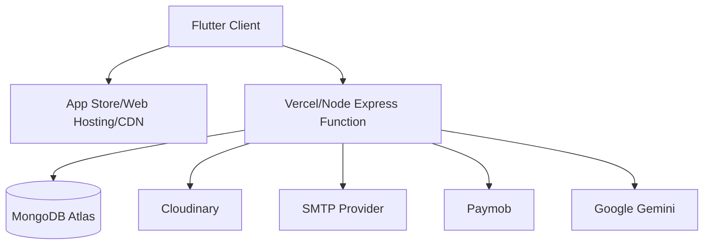

### 14.4 CI/CD Readiness

The repository has package manifests and tests, but no CI pipeline file was detected. Recommended pipeline:

1. Backend install: `npm ci`.
2. Backend tests: `npm test`.
3. Backend lint/type check once ESLint is added.
4. Flutter install: `flutter pub get`.
5. Flutter static analysis: `flutter analyze`.
6. Flutter tests: `flutter test`.
7. Build artifacts for target platforms.
8. Deploy backend only after tests and migration checks pass.

---

## 15. Dependency & Package Analysis

### 15.1 Backend Dependencies

| Package | Purpose | Risk / Notes |
|---|---|---|
| `express` | API framework | Express 5 behavior differs from Express 4; validate middleware compatibility |
| `mongoose` | MongoDB ODM | Ensure version compatibility with Node runtime |
| `jsonwebtoken` | JWT auth | Secrets and token rotation must be managed carefully |
| `bcrypt` | Password hashing | Good baseline; cost must be tuned |
| `joi` | Request validation | Use on all mutating endpoints |
| `helmet`, `cors`, `express-rate-limit` | Security controls | CSP disabled; CORS should be environment-specific |
| `multer`, `cloudinary` | Upload handling | Enforce file type/size and malware considerations |
| `nodemailer` | Email | Add retry queue and bounce handling |
| `node-cron` | Scheduled task | Not reliable in serverless multi-instance deployment |
| `pdfkit`, `qrcode` | Export and QR generation | Suitable for records export |
| `@google/generative-ai`, `google-auth-library` | Gemini and Google OAuth | Handle rate limits and JSON parse failures |
| `twilio` | SMS/WhatsApp potential | Package present; integration should be audited if used |

### 15.2 Frontend Dependencies

| Package | Purpose | Risk / Notes |
|---|---|---|
| `flutter_bloc` | State management | Good production choice |
| `dio` | HTTP client | Interceptor logic should be tested under concurrent 401s |
| `go_router` | Navigation | Centralized routing is maintainable |
| `hive`, `hive_flutter` | Local persistence | Use secure storage for tokens if possible |
| `get_it` | Dependency injection | Keep registration centralized and deterministic |
| `flutter_local_notifications`, `alarm`, `android_alarm_manager_plus` | Reminder and alarm functionality | Platform permission complexity |
| `geolocator`, `geocoding` | Location | Requires explicit permission handling and privacy policy |
| `google_sign_in` | Google auth | Ensure backend ID token audience matches app client |
| `image_picker` | Profile/license image selection | Validate uploads server-side |
| `fl_chart` | Health visualization | Monitor rendering performance with large datasets |

---

## 16. Code Quality Review

### 16.1 Scorecard

| Category | Score | Rationale |
|---|---:|---|
| Architecture | 7.0/10 | Modular monolith and feature-first frontend are sound |
| Backend maintainability | 6.5/10 | Service/HTTP coupling and commented legacy code reduce clarity |
| Frontend maintainability | 7.0/10 | Clean feature layout but route file/import growth is significant |
| Validation | 6.5/10 | Joi is present but not universal |
| Security hygiene | 6.5/10 | Good baseline but webhook/token/transaction gaps remain |
| Testability | 5.5/10 | Some Jest tests exist, but service functions are response-coupled |
| Observability | 4.5/10 | Morgan/log statements but no structured logs/metrics/tracing |

### 16.2 Technical Debt

- Remove large commented legacy service/controller blocks.
- Refactor services to return domain results and throw typed errors; controllers should own HTTP responses.
- Standardize route/controller style across modules.
- Normalize environment variable names.
- Add request validation to currently unvalidated endpoints.
- Extract authorization policies for patient/doctor/active-session checks.

---

## 17. Error Handling & Logging System

The backend has `notFound` and `errorHandler` middleware, but many services catch errors and return responses directly. This creates inconsistent error shapes. Morgan provides request logging, while several services use `console.log`/`console.error` for external integrations.

Recommended enterprise error taxonomy:

| Error Type | HTTP Status | Example |
|---|---:|---|
| ValidationError | 400 | Joi schema mismatch |
| AuthenticationError | 401 | Missing/expired token |
| AuthorizationError | 403 | User not owner/role denied |
| NotFoundError | 404 | Doctor/patient/booking not found |
| ConflictError | 409 | Slot already reserved |
| ExternalServiceError | 502 | Paymob/Gemini/SMTP failure |
| RateLimitError | 429 | Too many requests |

Frontend error handling wraps Dio failures into `ServerFailure`, but screens should consistently distinguish validation, auth expiration, network outage, and server errors.

---

## 18. Testing Architecture

### 18.1 Current Tests

Detected backend tests include:

- `backend/src/modules/healthModel/health.service.test.js`
- `backend/src/modules/medicineModel/medicine.service.test.js`

No full Flutter test inventory was inspected beyond standard `flutter_test` dependency.

### 18.2 Testing Recommendations

| Test Type | Priority | Scope |
|---|---|---|
| Unit tests | Critical | Token utilities, slot generation, medicine schedule generation, validation schemas |
| Integration tests | Critical | Auth, booking, medication CRUD, session QR flow, Paymob webhook |
| Security tests | High | RBAC access denial, revoked tokens, unconfirmed accounts, invalid JWTs |
| Frontend Cubit tests | High | Auth, medication, profile, refresh-token behavior |
| E2E tests | Medium | Patient signup → medication → booking; doctor onboarding → approval → session |
| Load tests | Medium | Doctor slots and booking creation concurrency |

---

## 19. Engineering Recommendations

### Critical

1. Verify Paymob webhook signatures before mutating bookings or wallet balances.
2. Make booking slot reservation transaction-safe or enforce a unique active doctor/date/time lock.
3. Move cron/email/AI tasks to a durable job system.
4. Store refresh tokens using platform secure storage and implement refresh-token rotation/reuse detection.

### High

1. Add pagination to booking, measurement, symptom, medicine, notification, and audit endpoints.
2. Add consistent Joi validation to every mutating endpoint.
3. Standardize environment variables and fail fast with one config module.
4. Refactor service functions away from direct `res` usage.
5. Add structured logging, request IDs, and external error monitoring.

### Medium

1. Add a complete admin frontend or remove admin-only assumptions from client scope.
2. Introduce Redis caching for doctor directory and reference data.
3. Add OpenAPI documentation generated from route schemas.
4. Remove commented legacy code and normalize module naming.
5. Add feature flags for AI medication enrichment.

### Low

1. Improve typo consistency in field names such as `duraction` and widget names such as `Scetion`.
2. Add Mermaid diagrams to developer docs in smaller module-specific files if this document becomes too large.
3. Add pre-commit formatting and linting.

---

## 20. Final Technical Evaluation

| Dimension | Score | Evaluation |
|---|---:|---|
| Architecture | 7.0/10 | Strong modular baseline with clear domain modules and Flutter feature separation |
| Security | 6.5/10 | Good foundations; webhook verification, secure token storage, and concurrency controls are required |
| Performance | 6.5/10 | Acceptable MVP performance; pagination and query limits are needed |
| Scalability | 6.0/10 | Stateless direction is good; serverless cron and missing queues constrain scale |
| Maintainability | 6.8/10 | Feature modularity helps; dead code and inconsistent service patterns hurt clarity |
| Production readiness | 6.2/10 | Suitable for controlled beta; not yet enterprise production-ready without hardening |

### Final Engineering Verdict

MediApp is a promising modular healthcare platform with meaningful domain coverage: patient medication management, health telemetry, doctor onboarding, appointment scheduling, session-limited record access, caregiver support, and export workflows. The implementation demonstrates solid architectural instincts through separated backend modules, Mongoose schemas, Joi validators, Flutter feature modules, Cubit state management, and centralized networking.

The main blockers for enterprise readiness are security and operational hardening rather than core product architecture. Payment webhooks must be verified, booking writes must be concurrency-safe, background tasks need durable queues, environment configuration should be unified, and observability/testing must be expanded. With these improvements, the system can evolve from a strong MVP codebase into a production-grade healthcare application architecture.

### Suggested Roadmap

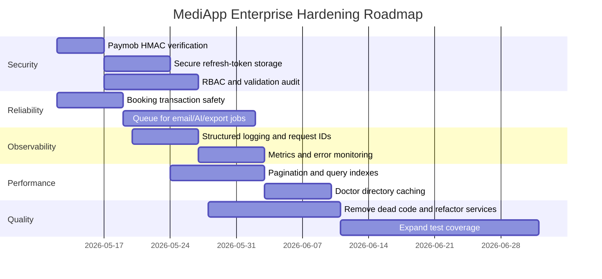
