# MediApp Technical Documentation

**Document status:** Source-derived technical analysis  
**Repository scope:** `backend/` Node.js API and `frontend/` Flutter application  
**Primary domain:** Medication management, patient/doctor onboarding, bookings, health records, caregiving, messaging, payments, and medical data export

---

## 1. Introduction

### a. Motivation

MediApp is built to centralize medication adherence, patient health tracking, doctor collaboration, appointment booking, caregiver support, and shareable medical records in one healthcare platform. The inspected repository contains a Flutter client and an Express/MongoDB backend that together implement patient and doctor onboarding, authentication, health measurement logging, medication scheduling, doctor discovery, booking, session-based medical record access, messaging, exports, and administrative doctor approval.

The main motivation is to reduce fragmentation in patient care. A patient often uses separate reminder apps, messaging tools, clinic booking channels, paper records, and caregiver communication methods. MediApp combines these concerns into a single architecture where medications, health records, doctors, caregivers, and appointments are linked through one authenticated patient identity.

### b. Problem Statement

Patients who take multiple medications or manage chronic conditions need reliable reminders, medication context, health measurements, access to doctors, and caregiver involvement. Doctors need structured access to patient information during approved care sessions without permanent unrestricted access. Caregivers need permission-based visibility into patients they support. Existing fragmented tools make it difficult to coordinate medication adherence, health data, appointments, and medical history securely.

The implementation addresses this problem through:

| Problem Area | Implemented Response |
|---|---|
| Medication adherence | Medicine CRUD, schedules, taken-dose tracking, local reminders, notification sounds |
| Health tracking | Health measurements and symptom logs |
| Doctor access | Doctor directory, connection workflows, bookings, QR session token, two-hour elevated access window |
| Caregiver coordination | Caregiver option, caregiver requests, accepted/cancelled request flow |
| Identity/security | Email/password auth, Google auth, OTP, optional 2FA, JWT access/refresh tokens, role guards |
| Medical record portability | Health passport, patient record, QR shared-record endpoints |
| Doctor governance | Admin pending-doctor queue and approve/reject endpoints |

### c. Goals of the Project

The project goals derived from the current implementation are:

1. Provide patients with a mobile-first medication and health tracking experience.
2. Allow doctors to onboard, define clinic information, define schedules, and receive bookings.
3. Support secure role-based access for patients, doctors, admins, and general users.
4. Support doctor-patient and caregiver-patient relationship workflows.
5. Provide appointment booking, payment initiation, cancellation, rescheduling, and live-session access.
6. Enable medical data export through PDF/record endpoints and public QR-token shared records.
7. Use a maintainable modular monolith backend and feature-first Flutter frontend.
8. Identify hardening work required for enterprise readiness, including webhook verification, booking concurrency controls, queue-backed background jobs, observability, and secure token storage.

### d. Currently Available Solutions (Applications)

The repository does not include market research artifacts, but the feature domain overlaps with several common healthcare application categories:

| Existing Solution Category | Typical Capability | Gap Addressed by MediApp |
|---|---|---|
| Medication reminder apps | Dose reminders, refill alerts, adherence logs | MediApp links medication data with doctors, caregivers, symptoms, and health exports |
| Telehealth/doctor booking apps | Doctor directory, appointments, online consultation | MediApp adds medication schedules, health measurements, QR session medical record access, and caregiver workflows |
| Personal health record apps | Health records and basic exports | MediApp adds active medication management, booking, doctor approval, and role-based collaboration |
| Clinic management systems | Doctor schedules and patient appointments | MediApp is patient-centered and mobile-first, with medication reminders and caregiver support |
| Messaging apps | Patient-doctor communication | MediApp gates messaging through authenticated healthcare roles and approved doctor context |

### e. Features Matrix

| Feature | Medication Reminder Apps | Telehealth Apps | Personal Health Record Apps | MediApp Proposed Solution |
|---|---:|---:|---:|---:|
| Email/password login | Partial | Yes | Yes | Yes |
| Google authentication | Partial | Yes | Partial | Yes |
| OTP / 2FA flow | Rare | Partial | Partial | Yes |
| Patient profile | Partial | Yes | Yes | Yes |
| Doctor profile and approval | No | Yes | No | Yes |
| Medication CRUD | Yes | Rare | Partial | Yes |
| Medication schedule generation | Yes | Rare | Partial | Yes |
| Taken-dose tracking | Yes | Rare | Rare | Yes |
| AI medication enrichment | Rare | Rare | Rare | Implemented asynchronously |
| Health measurements | Partial | Partial | Yes | Yes |
| Symptom logs | Partial | Partial | Yes | Yes |
| Doctor directory | No | Yes | No | Yes |
| Appointment booking | No | Yes | Rare | Yes |
| Payment initiation | No | Yes | No | Paymob integration |
| QR session token | No | Rare | Rare | Yes |
| Caregiver workflow | Partial | Rare | Partial | Yes |
| Medical record export | Partial | Partial | Yes | Yes |
| Admin doctor approval | No | Yes | No | Yes |

### f. Software Development Methodology Used and Rationale

The repository structure and implementation maturity indicate an **Iterative and Incremental / Agile-style methodology** rather than a strict Waterfall delivery model. The backend is divided by domain modules (`userModel`, `patientModel`, `doctorModel`, `medicineModel`, `bookingModel`, `healthModel`, `exportModel`, `adminModel`), and the Flutter frontend is organized by feature slices (`shared/auth`, `patient/features/*`, `doctor/features/*`). This supports incremental delivery of one feature at a time.

This methodology is suitable because healthcare applications require repeated validation of workflows such as onboarding, reminders, bookings, caregiver access, and medical record sharing. The codebase also shows iterative evolution through commented legacy code, `.bak` service files, newly uncommented endpoints, and MVP-oriented notes. An iterative approach allows the team to stabilize critical flows first and then harden security, scalability, testing, and DevOps.

---

## 2. Requirements Analysis

### a. Surveys, Questionnaires, Interviews, etc.

No survey, questionnaire, or interview result files were present in the inspected repository. Therefore, this requirements analysis is derived from implemented source code, backend route inventory, database schemas, frontend routes, feature modules, and project behavior.

For future enterprise documentation, the following stakeholder discovery methods are recommended:

| Method | Target Stakeholders | Purpose |
|---|---|---|
| Patient survey | Chronic patients, caregivers, general medication users | Validate reminder, medication schedule, and caregiver needs |
| Doctor interviews | General practitioners and specialists | Validate profile, scheduling, record access, and wallet workflows |
| Admin interview | Clinic/platform operations team | Validate doctor approval, compliance, and escalation needs |
| Usability testing | Patient and doctor users | Validate onboarding, booking, and health tracking UX |
| Security workshop | Engineering and compliance stakeholders | Validate privacy, token storage, audit, and medical record sharing controls |

### b. Results of Part 2.a Represented as Charts

Because no source survey dataset exists, the following charts represent **implementation-derived feature coverage**, not real survey results.

#### Implementation Coverage by Domain

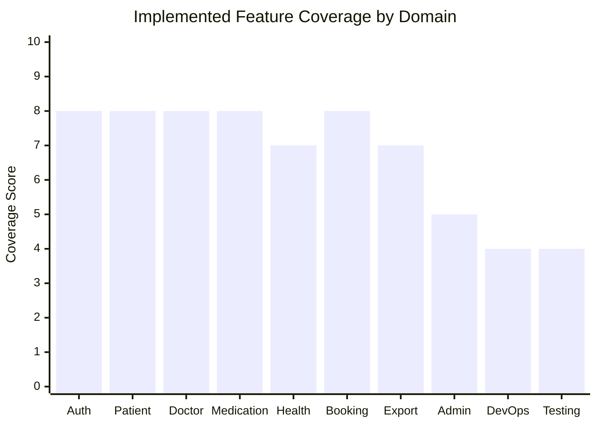

#### Production Hardening Priority Distribution

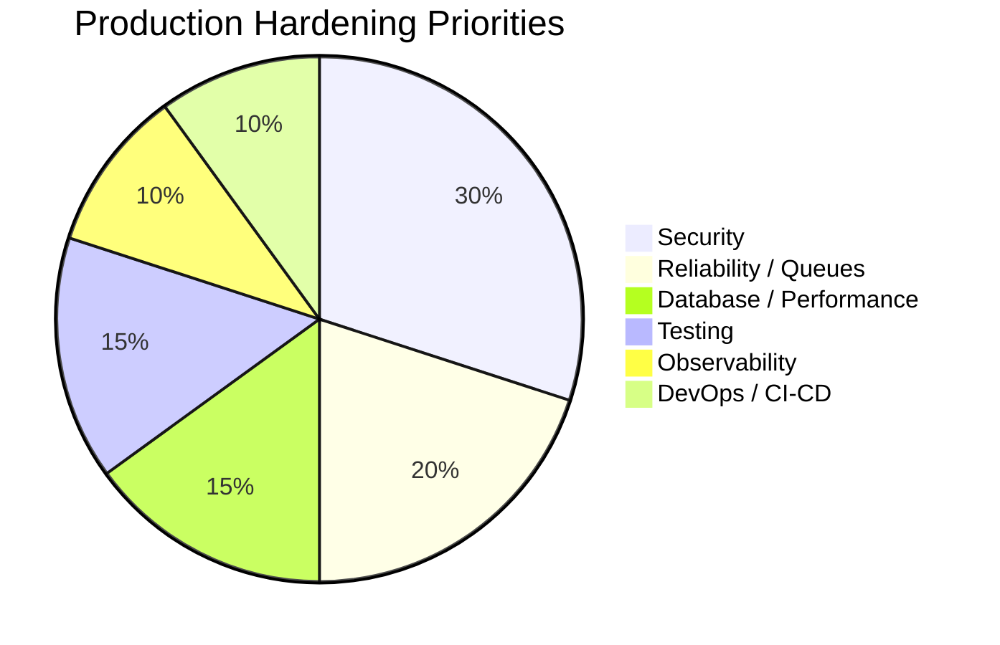

### c. Discussion of Results in Part 2.b

The implementation coverage chart shows strong feature progress in authentication, patient workflows, doctor onboarding, medication management, and booking. Export functionality exists, but operational hardening remains required. Admin support is currently backend-focused and lacks a complete frontend. DevOps and testing receive lower scores because the repository contains only placeholder lint/format scripts, limited backend tests, no CI pipeline, and no observed Flutter test suite beyond dependencies.

The production hardening chart emphasizes security because the app handles medical data, identity tokens, payment webhooks, doctor approvals, and shared records. Reliability is also important because email, AI analysis, exports, and notifications currently run as best-effort asynchronous work rather than durable queued jobs.

### d. Functional Requirements

#### Authentication and User Management

| ID | Requirement | Implemented By |
|---|---|---|
| FR-AUTH-01 | Users shall sign up with email/password and a role/type | `/users/signup`, `user.model.js` |
| FR-AUTH-02 | Users shall sign in with email/password | `/users/signin` |
| FR-AUTH-03 | Users shall authenticate through Google ID token | `/users/google` |
| FR-AUTH-04 | The system shall support email confirmation | `/users/confirmEmail/:token` |
| FR-AUTH-05 | The system shall support OTP and optional 2FA | `/users/signin/otp`, `/users/2fa` |
| FR-AUTH-06 | The system shall issue and refresh JWT tokens | `/users/refreshToken`, token utilities |
| FR-AUTH-07 | Users shall update profile, password, email, settings, and delete account | protected `/users/*` routes |

#### Patient Requirements

| ID | Requirement | Implemented By |
|---|---|---|
| FR-PAT-01 | Patient shall complete profile in full or step-based flow | `/patients/complete`, `/patients/complete/basic`, `/patients/complete/health1`, `/patients/complete/health2` |
| FR-PAT-02 | Patient shall set caregiver option and request caregiver | `/patients/caregiver/option`, `/patients/caregiver/request` |
| FR-PAT-03 | Patient shall accept/cancel caregiver requests | `/patients/caregiver/requests/:requestId/*` |
| FR-PAT-04 | Patient shall connect with doctors | `/patients/connect-doctor`, `/patients/connected-doctors/*` |
| FR-PAT-05 | Patient shall set emergency contact and trigger SOS | `/patients/emergency-contact`, `/patients/sos` |

#### Doctor Requirements

| ID | Requirement | Implemented By |
|---|---|---|
| FR-DOC-01 | Doctor shall appear in a searchable directory for verified users | `/doctors/directory` |
| FR-DOC-02 | Doctor shall complete profile, location, schedule, appointments, and license | `/doctors/complete/*` |
| FR-DOC-03 | Doctor shall update schedule after onboarding | `/doctors/schedule` |
| FR-DOC-04 | Doctor shall request/accept/reject/cancel patient connections | `/doctors/patients/*` |
| FR-DOC-05 | Doctor shall view wallet and request withdrawal | `/doctors/wallet`, `/doctors/wallet/withdraw` |

#### Medication and Health Requirements

| ID | Requirement | Implemented By |
|---|---|---|
| FR-MED-01 | Patient/doctor shall add medication | `POST /medications` |
| FR-MED-02 | Patient/doctor shall list, update, delete medication | `GET/PUT/DELETE /medications` |
| FR-MED-03 | System shall generate medication schedule | `GET /medications/schedule` |
| FR-MED-04 | System shall mark medicine dose as taken | `PATCH /medications/:id/taken` |
| FR-MED-05 | System shall record medication logs/feedback | `POST /medications/:id/log` |
| FR-HEALTH-01 | Patient shall add and retrieve measurements | `/health/measurements` |
| FR-HEALTH-02 | Patient shall add and retrieve symptoms | `/health/symptoms` |

#### Booking, Payment, Session, Export, and Admin Requirements

| ID | Requirement | Implemented By |
|---|---|---|
| FR-BOOK-01 | User shall view doctor slots | `GET /bookings/slots/:doctorId` |
| FR-BOOK-02 | Patient shall create, list, cancel, and reschedule bookings | `/bookings` routes |
| FR-BOOK-03 | Doctor shall list assigned bookings | `GET /bookings/doctor` |
| FR-BOOK-04 | Online/card booking shall initiate Paymob payment | `createPaymentIntention` |
| FR-BOOK-05 | Paymob webhook shall update payment status and doctor wallet | `POST /bookings/webhook/paymob` |
| FR-SESSION-01 | Patient shall generate QR/session token | `POST /bookings/:bookingId/generate-qr` |
| FR-SESSION-02 | Doctor shall start session by token and receive patient context | `POST /bookings/start-session` |
| FR-SESSION-03 | Patient/doctor shall end session | `POST /bookings/:bookingId/end-session` |
| FR-EXPORT-01 | Patient/doctor shall export health passport and patient record | `/export/health-passport`, `/export/patient-record` |
| FR-EXPORT-02 | Patient shall generate shared QR token | `/export/qr-token` |
| FR-ADMIN-01 | Admin shall approve or reject pending doctors | `/admin/doctors/*` |

### e. Non-functional Requirements

| Category | Requirement | Current Implementation / Gap |
|---|---|---|
| Security | Passwords must be hashed | Implemented using bcrypt |
| Security | Sensitive token flows must use JWT secrets and token IDs | Implemented, but refresh-token storage should move to platform secure storage |
| Security | API must enforce role-based access | Implemented with `verifyToken` and `restrictTo` |
| Security | Payment webhooks must be verified | Gap: Paymob HMAC/signature verification should be added |
| Privacy | Doctor access to patient records must be limited | Implemented through session token and active session window |
| Performance | Lists should support pagination | Gap: booking, measurement, symptoms, notification, and medication list endpoints need pagination |
| Reliability | Background tasks should be durable | Gap: email, AI, export, and notification jobs should use queues |
| Scalability | API should be horizontally scalable | Mostly stateless; cron should move outside app runtime |
| Maintainability | Code should be modular | Implemented with backend modules and frontend feature folders |
| Observability | Logs, metrics, and traces should be structured | Gap: currently mostly Morgan and console logs |
| Testability | Critical flows should have automated tests | Partial backend tests exist; broader tests required |

### f. Use Case Diagrams

#### Patient Use Cases

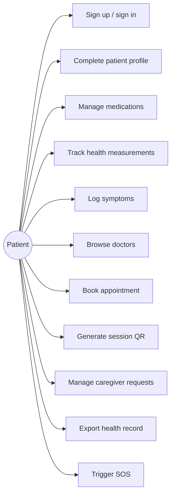

#### Doctor and Admin Use Cases

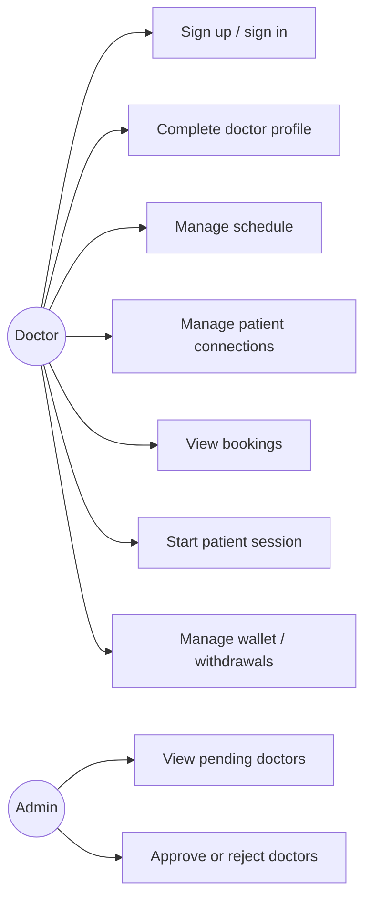

---

## 3. Design

### a. Sequence Diagrams

#### Authentication Sequence

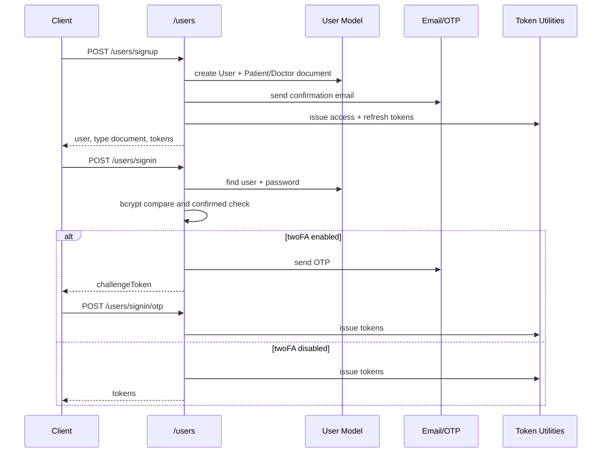

#### Booking and Payment Sequence

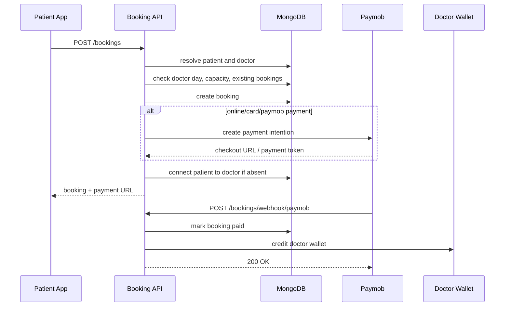

#### QR Session Access Sequence

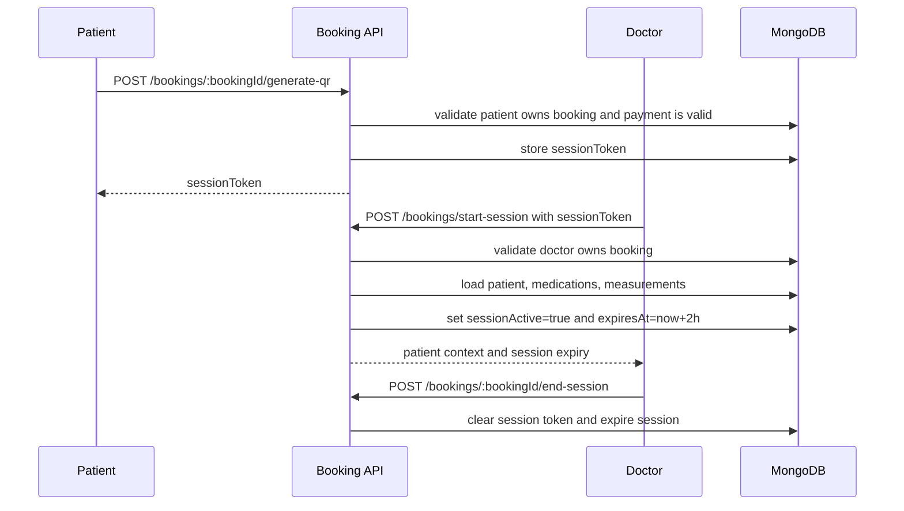

### b. ERD

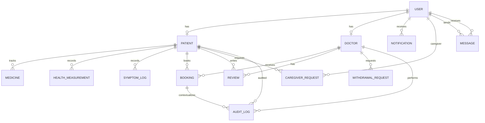

#### Schema Summary

| Model | Purpose | Key Fields | Constraints / Indexes |
|---|---|---|---|
| `User` | Global identity and authentication root | `type`, `firstName`, `lastName`, `email`, `password`, `phone`, `twoFA`, `otp`, `confirmed`, token IDs, `settings` | `email` unique/indexed, `type` indexed, password/OTP/token IDs excluded by default |
| `Patient` | Patient medical profile and relationship container | `userId`, `chronicConditions`, `allergies`, `activeIngredients`, `medications`, `connectedDoctors`, card fields, emergency contact, caregiver, healthMeasurements | `userId` unique/indexed; embedded connected doctor status indexed |
| `Doctor` | Doctor profile, schedule, license, status, wallet | `userId`, `specialization`, `status`, `clinicLocation`, `workingDays`, `workingHours`, `appointmentTypes`, `licenseImage`, `connectedPatients`, `walletBalance` | `userId` unique/indexed, `specialization` indexed, enum status, license hidden by default |
| `Medicine` | Medication regimen and adherence data | `patientId`, `type`, `frequency`, `daily`, `weekly`, `specific`, `dosage`, `stock`, `isChronic`, `status`, `dates`, `dailyFeedback` | Frequency/type/status enums; pre-validate enforces daily/weekly/specific shape; `patientId` and `status` indexed |
| `Booking` | Appointment and live-session record | `patientId`, `doctorId`, `date`, `duration`, `packageType`, `paymentStatus`, `appointmentId`, `sessionToken`, `status` | `appointmentId` unique/indexed; compound index on doctor/date/time; patient/doctor/status indexes |
| `Message` | Point-to-point chat message | `senderId`, `receiverId`, `message`, `time`, `status`, `files`, `voiceNote` | sender/receiver/time/status indexed; file type enum |
| `Notification` | In-app notification | `type`, `header`, `message`, `time`, `read`, `userId` | type/time/read/user indexed |
| `HealthMeasurement` | Patient health telemetry | `patientId`, `type`, `value`, `systolic`, `diastolic`, `heartRate`, `date`, `notes` | patient indexed; type enum |
| `SymptomLog` | Patient symptom journal | `patientId`, `symptoms`, `severity`, `date`, `notes` | patient indexed; severity enum |
| `CaregiverRequest` | Caregiver access workflow | `patientId`, `caregiverUserId`, `relationship`, `status`, `respondedAt` | compound unique `{patientId, caregiverUserId, status}`; status indexed |
| `AuditLog` | Doctor changes to patient records | `patientId`, `doctorId`, `bookingId`, `action`, `details` | patient/doctor/booking indexed; action enum |
| `Review` | Patient rating of doctor | `doctorId`, `PatientId`, `rating` | unique `{doctorId, PatientId}` |
| `WithdrawalRequest` | Doctor payout request | `doctorId`, `amount`, `status`, `bankDetails`, `adminNotes`, `processedAt` | doctor indexed; amount min 10; status enum |
| `RevokeToken` | JWT revocation and TTL cleanup | `tokenId`, `expiredAt` | tokenId unique/indexed; TTL index on `expiredAt` |

### c. Data Flow Diagrams

#### DFD Level 0

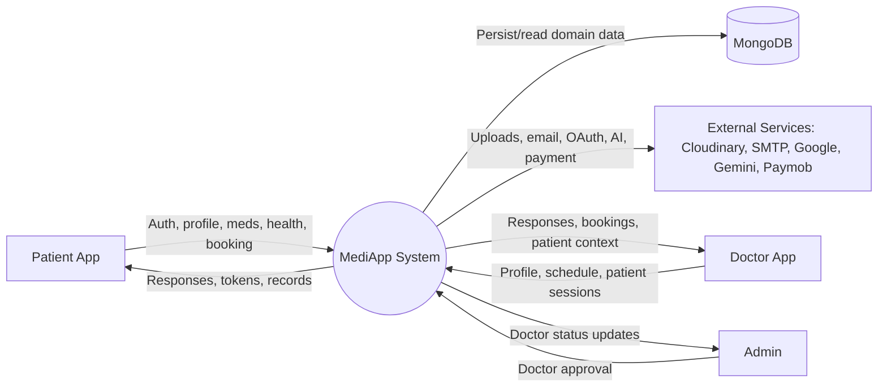

#### DFD Level 1

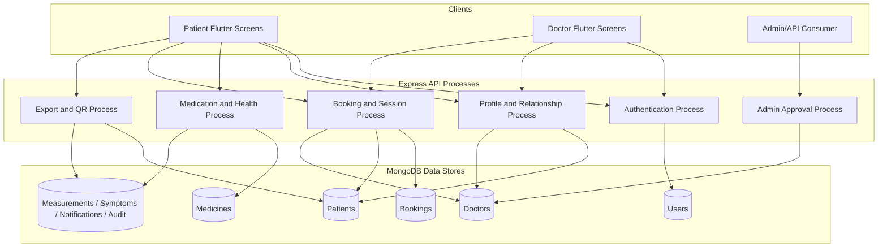

### d. State Diagram

#### Booking State Diagram

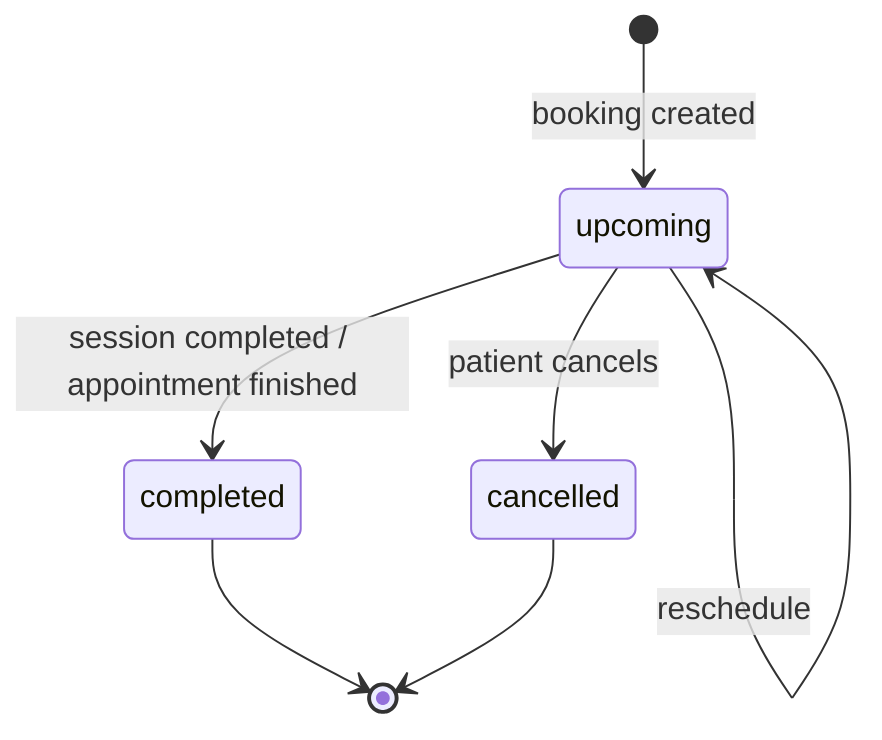

#### Doctor Approval State Diagram

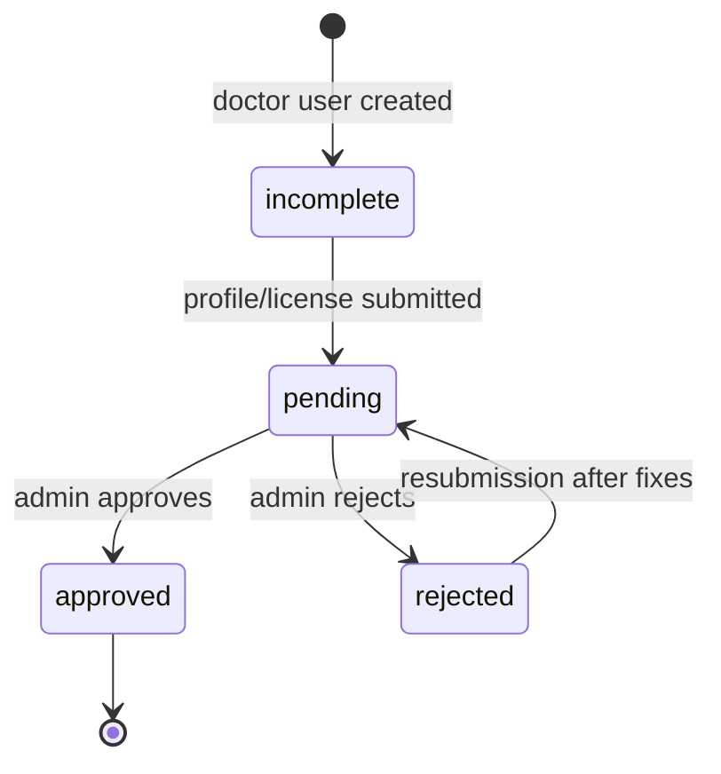

### e. Algorithms or Pseudocode

#### Slot Generation Pseudocode

```text
FUNCTION getDoctorSlots(doctorId, date):
    doctor = find doctor by id
    IF doctor not found: return 404
    dayName = weekday(date)
    IF dayName not in doctor.workingDays: return []

    existingBookings = find bookings for doctor between startOfDay and endOfDay
    IF existingBookings.count >= doctor.maxDailyPatients: return []

    reservedTimes = existingBookings.map(date.time)
    duration = doctor.consultationDuration OR 30
    slots = []

    FOR EACH workingHourBlock IN doctor.workingHours:
        start = convert HH:mm to minutes
        end = convert HH:mm to minutes
        FOR t FROM start TO end-duration STEP duration:
            time = convert minutes to HH:mm
            IF time not in reservedTimes:
                slots.push(time)

    RETURN slots
```

#### Booking Creation Pseudocode

```text
FUNCTION createBooking(patientUserId, payload):
    patient = find patient by userId
    doctor = find doctor by doctorId
    validate doctor supports packageType
    validate doctor works on requested weekday
    existingBookings = find active bookings for doctor and day
    reject if maxDailyPatients exceeded
    reject if requested time is already taken
    create booking document
    IF payment method is online/card/paymob:
        create Paymob payment intention
    connect patient to doctor if missing
    create notification
    return booking and payment information
```

#### Complexity Analysis

| Function / Operation | Purpose | Time Complexity | Space Complexity | Risk Level |
|---|---|---:|---:|---|
| `getDoctorSlots` | Generate available slots from working hours minus bookings | O(B + H*S) | O(B + S) | Medium |
| `createBooking` slot conflict check | Prevent duplicate bookings | O(B) | O(B) | High |
| `rescheduleBooking` | Move booking to new date/time | O(B) | O(B) | Medium |
| Medicine frequency validation | Enforce daily/weekly/specific exclusive shape | O(n) by array length | O(1) | Low |
| Medicine schedule generation | Build dose schedule from recurrence fields | O(M*D*T) | O(M*D*T) | Medium |
| Hive medication update/delete | Find local item by equality/fallback matching | O(N) | O(N) | Low |
| Attach patient type document | Populate medications and measurements | O(M + L) | O(M + L) | Medium |
| Gemini medication enrichment | Parse model JSON and update patient arrays | O(P + W) | O(P + W) | Medium |
| Token refresh queue | Coordinate parallel 401s | O(R) | O(R) | Low |

### f. UML Class Diagrams

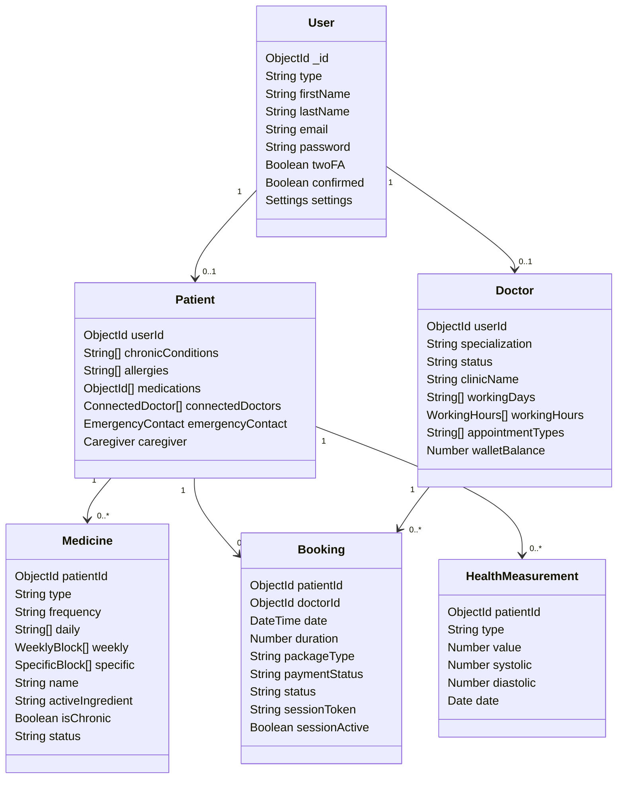

---

## 4. Implementation Aspects

### a. Overall System Architecture (Blocks Diagram)

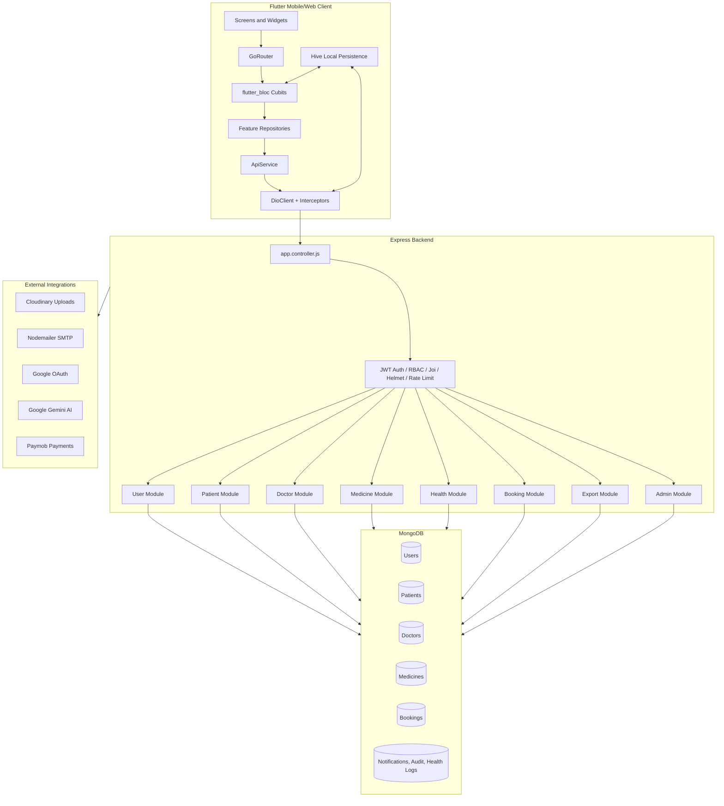

#### Backend Request Lifecycle

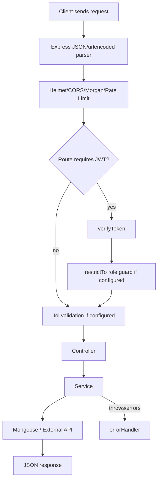

#### Frontend Runtime Architecture

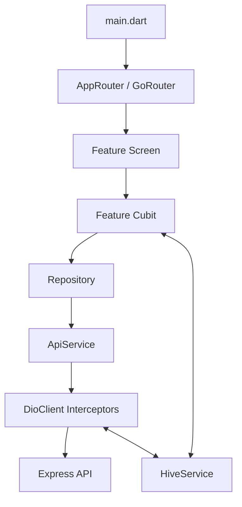

### b. Tools, Technologies and/or Programming Languages Illustrated on the Diagram in Part 4.a

| Layer | Technology | Purpose |
|---|---|---|
| Backend language/runtime | Node.js ES modules | API execution |
| HTTP framework | Express 5 | Routing, middleware, JSON API |
| Database | MongoDB | Document persistence |
| ODM | Mongoose 9 | Models, schema constraints, indexes |
| Validation | Joi | Request schema validation |
| Authentication | JWT, bcrypt, nanoid | Tokens, password hashing, token IDs |
| Security middleware | Helmet, CORS, express-rate-limit | Baseline HTTP hardening |
| File uploads | Multer, Cloudinary | Avatar, cover, license uploads |
| Payments | Paymob REST | Payment intention and webhook flow |
| AI | Google Gemini SDK / REST | Medication enrichment and warning analysis |
| Email | Nodemailer | Confirmation, OTP, email-change flows |
| PDF/QR | PDFKit, QRCode | Health exports and shared records |
| Frontend language/framework | Dart / Flutter | Cross-platform application UI |
| State management | flutter_bloc Cubit | Feature state orchestration |
| HTTP client | Dio | API transport and token refresh |
| Local storage | Hive, shared_preferences | Tokens, user data, settings, medication cache |
| Navigation | GoRouter | Declarative application routing |
| Dependency injection | get_it | Repository and Cubit registration |
| Device services | local notifications, alarm, audio, geolocation | Reminders, alarm sounds, location flows |

### c. Prototype (Screens of the Proposed System)

The repository contains Flutter screens that represent the current prototype. The following table maps prototype areas to implemented route families and screen modules.

| Prototype Area | Routes / Screens Present in Code |
|---|---|
| Splash and role selection | `/`, `/selectRole`, `/onboarding` |
| Patient authentication | `/login/patient`, `/signUp/patient`, `/forgetPassword`, `/otp`, `/setPassword`, `/passwordChanged` |
| Doctor authentication | `/login/doctor`, `/signUp/doctor`, `/doctorOtp` |
| Patient profile completion | `/completeProfile`, questionnaire/profile screens |
| Patient home shell | `/patient/main`, `/home` |
| Medication flow | `/patient/addMedication`, `/patient/addMedication/stock`, `/medicine/dailySymptoms`, `/patient/editMedication`, `/patient/medicineInfo` |
| Doctor browsing and booking | `/doctors/profile`, `/doctors/profile/book` |
| Patient health measurements | `/healthMeasurements`, `/health/dailyLog` |
| Patient profile/settings | `/patient/accountInfo`, `/patient/caregiverMode`, `/patient/changeEmail`, `/patient/changePassword` |
| Notification sounds | `/notificationSound`, `/chooseSound` |
| Doctor profile completion | `/doctor/completeProfile`, `/doctor/allowLocation`, `/doctor/manualLocation`, `/doctor/qFlow`, `/doctor/uploadLicense`, `/doctor/allowNotification`, `/doctorAllSetScreen` |
| Doctor main app | `/doctor/mainLayout` |
| Doctor schedule/settings | `/doctor/availability`, `/doctor/accountInformation`, `/doctor/payoutWithdrawal` |

### Complete Project Structure Analysis

```text
mediApp/
├── ENTERPRISE_TECHNICAL_DOCUMENTATION.md
├── backend/
│   ├── index.js
│   ├── package.json
│   ├── package-lock.json
│   ├── vercel.json
│   ├── README.md
│   ├── MediApp_Complete_API.postman_collection.json
│   ├── MediApp_Final_Collection.json
│   └── src/
│       ├── app.controller.js
│       ├── config/
│       │   ├── DB.js
│       │   ├── CONSTANTS.js
│       │   ├── cloudinary.js
│       │   └── env.js
│       ├── middlewares/
│       ├── models/
│       ├── modules/
│       │   ├── userModel/
│       │   ├── patientModel/
│       │   ├── doctorModel/
│       │   ├── medicineModel/
│       │   ├── healthModel/
│       │   ├── bookingModel/
│       │   ├── messageModel/
│       │   ├── adminModel/
│       │   └── exportModel/
│       └── utils/
└── frontend/
    ├── pubspec.yaml
    ├── analysis_options.yaml
    ├── assets/
    ├── android/ ios/ macos/ linux/ windows/ web/
    └── lib/
        ├── main.dart
        ├── core/
        │   ├── constants/
        │   ├── enums/
        │   ├── network/
        │   ├── services/
        │   ├── utils/
        │   └── widgets/
        └── features/
            ├── shared/
            ├── patient/
            └── doctor/
```

| Folder | Responsibility | Cohesion Evaluation |
|---|---|---|
| `backend/src/config` | Database connection, constants, environment schema, Cloudinary config | High cohesion, but environment variable names should be standardized |
| `backend/src/models` | Mongoose persistence schemas | High domain cohesion; constraints and indexes are implemented in schemas |
| `backend/src/modules/*Model` | Route/controller, Joi validation, service per bounded context | Good modularity; naming mixes “Model” with service/controller concerns |
| `backend/src/middlewares` | Cross-cutting HTTP concerns | Clear separation for auth, RBAC, validation, upload, and error handling |
| `backend/src/utils` | External service clients and reusable primitives | Useful but mixed; OTP and cron share `utils/index.js` |
| `frontend/lib/core` | Cross-feature constants, networking, DI, router, shared widgets/services | Strong foundation; base URL configuration should be environment-based |
| `frontend/lib/features/shared` | Auth and splash feature modules | Cleanly separated reusable flows |
| `frontend/lib/features/patient/features` | Patient-specific feature modules | Feature-first structure supports maintainability |
| `frontend/lib/features/doctor/features` | Doctor onboarding, home, settings | Good separation; complete admin frontend was not detected |

### Backend API Inventory

| Method | Route | Auth | Roles | Purpose |
|---|---|---|---|---|
| GET | `/health`, `/api/v1/health` | No | Public | Service and DB readiness |
| POST | `/users/signup` | No | Public | Create user plus patient/doctor profile and email confirmation token |
| POST | `/users/signin` | No | Public | Password login; may return 2FA challenge |
| POST | `/users/google` | No | Public | Google ID token login/signup |
| POST | `/users/signin/otp` | No | Public | Complete OTP/2FA login |
| GET | `/users/confirmEmail/:token` | No | Public | Confirm email token |
| GET | `/users/confirmEmailChange/:token` | No | Public | Confirm pending email change |
| POST | `/users/refreshToken` | No | Public token endpoint | Rotate access/refresh token pair |
| POST | `/users/requestOTP` | No | Public | Request generic OTP |
| POST | `/users/checkOTP` | No | Public | Verify generic OTP |
| POST | `/users/forgetPassword` | No | Public | Start password reset |
| POST | `/users/forgetPassword/verify` | No | Public | Verify reset OTP and issue reset token |
| POST | `/users/resetPassword` | No | Public | Reset password by reset token |
| GET | `/users/profile/:id` | No | Public | Read public profile |
| GET | `/users/me` | Yes | user/patient/doctor | Current account and type document |
| POST | `/users/logout` | Yes | user/patient/doctor | Revoke current token ID |
| PATCH | `/users/email/change` | Yes | user/patient/doctor | Request email change |
| PATCH | `/users/email/cancel` | Yes | user/patient/doctor | Cancel pending email change |
| PATCH | `/users/2fa` | Yes | user/patient/doctor | Toggle 2FA |
| PATCH | `/users/updateProfile` | Yes | user/patient/doctor | Update profile fields |
| PATCH | `/users/changePassword` | Yes | user/patient/doctor | Change password after old password verification |
| POST | `/users/resendConfirmEmail` | Yes | user/patient/doctor | Re-send confirmation token |
| PATCH | `/users/settings` | Yes | user/patient/doctor | Update notification/privacy settings |
| DELETE | `/users/me` | Yes | user/patient/doctor | Delete account |
| PATCH | `/patients/complete` | Yes | patient | Complete full patient profile with uploads |
| PATCH | `/patients/complete/basic` | Yes | patient | Basic profile step |
| PATCH | `/patients/complete/health1` | Yes | patient | Health questionnaire step 1 |
| PATCH | `/patients/complete/health2` | Yes | patient | Health questionnaire step 2 |
| PATCH | `/patients/caregiver/option` | Yes | patient | Enable/disable caregiver option |
| POST | `/patients/caregiver/request` | Yes | patient | Request caregiver |
| GET | `/patients/caregiver/requests` | Yes | patient | List caregiver requests |
| PATCH | `/patients/caregiver/requests/:requestId/accept` | Yes | patient | Accept caregiver request |
| PATCH | `/patients/caregiver/requests/:requestId/cancel` | Yes | patient | Cancel caregiver request |
| POST | `/patients/connect-doctor` | Yes | patient | Request doctor connection |
| GET | `/patients/connected-doctors` | Yes | patient | List approved/pending doctors |
| GET | `/patients/doctor-requests` | Yes | patient | List doctor-originated requests |
| PATCH | `/patients/connected-doctors/accept/:doctorId` | Yes | patient | Accept doctor connection |
| PATCH | `/patients/connected-doctors/reject/:doctorId` | Yes | patient | Reject doctor connection |
| PATCH | `/patients/connected-doctors/cancel/:doctorId` | Yes | patient | Cancel doctor request |
| PATCH | `/patients/emergency-contact` | Yes | patient | Set SOS contact |
| POST | `/patients/sos` | Yes | patient | Trigger emergency notification action |
| GET | `/doctors/directory` | Yes | any verified | Browse doctors |
| PATCH | `/doctors/complete/step1` | Yes | doctor | Specialization/profile media step |
| PATCH | `/doctors/complete/location` | Yes | doctor | Clinic location step |
| PATCH | `/doctors/complete/schedule` | Yes | doctor | Working days/hours step |
| PATCH | `/doctors/complete/appointments` | Yes | doctor | Appointment type/duration step |
| PATCH | `/doctors/complete/license` | Yes | doctor | License upload step |
| PATCH | `/doctors/complete` | Yes | doctor | Unified doctor completion |
| PATCH | `/doctors/schedule` | Yes | doctor | Update post-onboarding schedule |
| POST | `/doctors/patients/connect-patient` | Yes | doctor | Request patient connection |
| PATCH | `/doctors/patients/accept/:patientId` | Yes | doctor | Accept patient connection |
| PATCH | `/doctors/patients/reject/:patientId` | Yes | doctor | Reject patient connection |
| PATCH | `/doctors/patients/cancel/:patientId` | Yes | doctor | Cancel patient connection request |
| GET | `/doctors/patients` | Yes | doctor | List connected patients |
| GET | `/doctors/wallet` | Yes | doctor | Wallet summary |
| POST | `/doctors/wallet/withdraw` | Yes | doctor | Create withdrawal request |
| PATCH | `/doctors/wallet/withdraw/:id/process` | Yes | doctor route + nested admin guard | Process withdrawal; route guard should be refactored |
| POST | `/medications` | Yes | patient/doctor | Add medicine, optionally audit doctor change |
| GET | `/medications` | Yes | patient/doctor | List medicines by context/filter |
| GET | `/medications/schedule` | Yes | patient/doctor | Generate adherence schedule |
| PUT | `/medications/:id` | Yes | patient/doctor | Update medicine |
| DELETE | `/medications/:id` | Yes | patient/doctor | Delete medicine |
| PATCH | `/medications/:id/taken` | Yes | patient/doctor | Mark dose as taken |
| POST | `/medications/:id/log` | Yes | patient/doctor | Add daily feedback/log |
| POST | `/health/measurements` | Yes | patient | Add measurement |
| GET | `/health/measurements` | Yes | patient | List measurements |
| POST | `/health/symptoms` | Yes | patient | Add symptom log |
| GET | `/health/symptoms` | Yes | patient | List symptom logs |
| GET | `/bookings/slots/:doctorId` | No | Public | Return available slots for doctor/date |
| POST | `/bookings` | Yes | patient | Create booking and optional Paymob payment intent |
| GET | `/bookings/patient` | Yes | patient | Patient booking list |
| GET | `/bookings/doctor` | Yes | doctor | Doctor booking list |
| GET | `/bookings/:id` | Yes | patient/doctor | Booking detail with ownership check |
| PATCH | `/bookings/:id/cancel` | Yes | patient/doctor route, service enforces patient | Cancel booking |
| PATCH | `/bookings/:id/reschedule` | Yes | patient | Reschedule upcoming booking |
| POST | `/bookings/webhook/paymob` | No | Paymob | Payment status webhook |
| GET | `/bookings/webhook/paymob` | No | Browser/Paymob | Deep-link callback redirect |
| POST | `/bookings/:bookingId/generate-qr` | Yes | patient | Generate session QR token |
| POST | `/bookings/start-session` | Yes | doctor | Doctor scans token and starts session |
| POST | `/bookings/:bookingId/end-session` | Yes | patient/doctor | End session and revoke elevated access |
| GET | `/bookings/:bookingId/call-token` | Yes | patient/doctor | Return video room name if session active |
| POST | `/messages` or `/users/:id/messages` | Yes | approved doctor middleware | Send message |
| GET | `/messages/verify/:targetUserId` | Yes | verified user | Verify chat availability |
| GET | `/admin/doctors/pending` | Yes | admin | Pending doctor queue |
| PATCH | `/admin/doctors/:id/approve` | Yes | admin | Approve doctor |
| PATCH | `/admin/doctors/:id/reject` | Yes | admin | Reject doctor |
| GET | `/export/health-passport` | Yes | patient/doctor | Generate health passport PDF/export |
| GET | `/export/patient-record` | Yes | patient/doctor | Generate patient record PDF/export |
| POST | `/export/qr-token` | Yes | patient | Generate shared-record QR token |
| GET | `/export/shared/:qrToken` | No | Public token | Read shared record by QR token |

### Middleware and Services Analysis

| Middleware / Service Area | Responsibility | Observations |
|---|---|---|
| `verifyToken` | Parses/validates JWT and attaches `req.user` | Central authentication gate; revoked token checks should be verified consistently |
| `restrictTo` | Role/type allowlist | Simple RBAC guard used per router/endpoint |
| `validation` | Joi validation of body/params/query | Good schema boundary; some endpoints intentionally lack validation |
| `isApprovedDoctor` | Messaging guard for approved doctors | Domain-specific authorization |
| `cloudinaryUploadAvatarAndCover` | Multer upload and Cloudinary forwarding | Used in profile completion |
| `errorHandler` / `notFound` | Terminal error handling | Response normalization is limited because several services catch errors manually |
| User service | Signup, signin, OTP, 2FA, password reset, profile, settings, delete account | Central identity and account workflow |
| Patient service | Patient profile, caregiver, doctor connection, SOS | Patient domain workflow |
| Doctor service | Doctor onboarding, schedule, patient links, wallet | Doctor domain workflow |
| Medicine service | CRUD, schedule, taken logs, audit, AI enrichment | Medication workflow with async Gemini enrichment |
| Booking service | Slots, booking, payment, QR sessions, call token | Appointment and session-limited access workflow |
| Export service | Health passport, patient record, QR shared record | Medical record portability workflow |

### Background and Async Processing

| Process | Implementation | Risk |
|---|---|---|
| Weekly availability reset | `node-cron` scheduled Saturday 23:59 | Serverless/Vercel runtime may not run cron reliably and may duplicate work |
| Email sending | Async email functions for confirmation, OTP, email-change | No durable queue or retry store |
| AI medication enrichment | Background promise calling Gemini and updating medicine/patient | No queue, idempotency key, or failure retry |
| Paymob webhook | Public POST updates booking payment and doctor wallet | Should verify Paymob HMAC/signature before trust |

### Security Audit

**Overall security score: 6.5 / 10**

| Severity | Finding | Impact | Remediation |
|---|---|---|---|
| Critical | Paymob webhook lacks visible HMAC verification | Fraudulent payment status updates and wallet credit | Validate Paymob HMAC/signature before mutation |
| High | Booking slot race condition | Double bookings under concurrency | Add unique lock or MongoDB transaction with conflict handling |
| High | Refresh tokens in non-secure Hive box | Token theft from compromised client | Use platform secure storage and refresh-token rotation |
| High | No durable queue for medical AI/email jobs | Lost tasks during process shutdown | Add BullMQ/SQS/Cloud Tasks with retries |
| Medium | Multiple endpoints lack Joi validation | Injection/shape drift and inconsistent error behavior | Add schemas to every mutating endpoint |
| Medium | No centralized audit for auth/admin changes | Compliance gaps | Add audit log entries for login, admin approval, profile changes |
| Medium | Error responses sometimes expose raw messages | Information disclosure | Normalize service errors through centralized error middleware |
| Low | Commented legacy code remains in production files | Maintainability and confusion risk | Remove dead code |

### Performance and Scalability Analysis

| Area | Current Position | Recommendation |
|---|---|---|
| API lists | Booking, measurement, symptom, medication, and notification lists may grow | Add pagination, date windows, and cursor support |
| Database | Useful indexes exist on foreign keys and status fields | Add compound indexes for frequent query paths |
| Booking | Slot checking is in-memory after daily booking fetch | Add transaction-safe reservation mechanism |
| Async work | Email and AI are best-effort promises | Move to durable queues with retry/backoff |
| Frontend routing | Central GoRouter imports many screens | Consider deferred imports for web/large app builds |
| Local medication cache | Hive list rewrite and linear search | Store keyed by backend medication ID |
| Horizontal scaling | API is mostly stateless | Move cron outside app runtime and avoid local upload storage |
| Caching | No server cache detected | Cache doctor directory/reference data with Redis/CDN when traffic grows |

### DevOps and Deployment

| Concern | Current State | Recommendation |
|---|---|---|
| Backend start | `npm start` runs Node server/exported Vercel handler | Keep one deployment path documented |
| Development | `npm run dev` with nodemon | Good local workflow |
| Tests | Jest script exists | Expand backend and frontend test suites |
| Lint/format | Placeholder scripts | Add ESLint/Prettier and Flutter analysis gate |
| CI/CD | No pipeline file detected | Add install, lint, test, build, deploy workflow |
| Environment | Multiple env names used for Mongo and token config | Standardize one config module and fail fast |

Required environment categories include MongoDB URI, JWT secrets/TTLs, bcrypt rounds, Google client ID, Gemini API key, Paymob credentials, Cloudinary credentials, and SMTP credentials.

### Dependency Analysis

| Layer | Dependency | Purpose | Risk / Note |
|---|---|---|---|
| Backend | `express` | API framework | Express 5 compatibility should be verified |
| Backend | `mongoose` | MongoDB ODM | Monitor version/runtime compatibility |
| Backend | `jsonwebtoken`, `bcrypt`, `nanoid` | Auth and credentials | Secret handling and token lifecycle are critical |
| Backend | `joi` | Validation | Should cover every mutating endpoint |
| Backend | `helmet`, `cors`, `express-rate-limit` | Security | CSP disabled; CORS should be environment-specific |
| Backend | `multer`, `cloudinary` | Uploads | Enforce file type/size and avoid local file dependence |
| Backend | `nodemailer` | Email | Needs queue-backed retry |
| Backend | `node-cron` | Scheduled reset | Not ideal for serverless deployment |
| Backend | `pdfkit`, `qrcode` | Export/QR | Appropriate for medical record export |
| Backend | `@google/generative-ai`, `google-auth-library` | Gemini and Google OAuth | Handle model latency, rate limits, and JSON failures |
| Frontend | `flutter_bloc` | State management | Good production choice |
| Frontend | `dio` | HTTP client | Refresh retry logic should be tested under concurrent 401s |
| Frontend | `go_router` | Navigation | Centralized route management |
| Frontend | `hive`, `hive_flutter` | Local persistence | Use secure storage for tokens |
| Frontend | `get_it` | Dependency injection | Keep registrations deterministic |
| Frontend | `flutter_local_notifications`, `alarm` | Reminders | Requires platform permission handling |
| Frontend | `geolocator`, `geocoding` | Location | Requires privacy and permission clarity |
| Frontend | `google_sign_in` | Google auth | Backend audience must match app client |

### Code Quality and Testing Review

| Category | Score | Rationale |
|---|---:|---|
| Architecture | 7.0/10 | Modular monolith and feature-first frontend are sound |
| Backend maintainability | 6.5/10 | Service/HTTP coupling and commented legacy code reduce clarity |
| Frontend maintainability | 7.0/10 | Clean feature layout but route file/import growth is significant |
| Validation | 6.5/10 | Joi is present but not universal |
| Security hygiene | 6.5/10 | Good baseline but webhook/token/transaction gaps remain |
| Testability | 5.5/10 | Some Jest tests exist, but service functions are response-coupled |
| Observability | 4.5/10 | Morgan/log statements but no structured logs/metrics/tracing |

Detected backend tests include `backend/src/modules/healthModel/health.service.test.js` and `backend/src/modules/medicineModel/medicine.service.test.js`. Recommended testing expansion includes unit tests for token utilities and slot generation, integration tests for auth/booking/medication/session flows, RBAC security tests, Cubit tests, E2E patient/doctor workflows, and booking concurrency load tests.

### Engineering Recommendations

| Priority | Recommendation |
|---|---|
| Critical | Verify Paymob webhook signatures before mutating bookings or wallet balances |
| Critical | Make booking slot reservation transaction-safe or enforce a unique active doctor/date/time lock |
| Critical | Move cron/email/AI/export jobs to a durable queue system |
| Critical | Store refresh tokens using platform secure storage and implement refresh-token rotation/reuse detection |
| High | Add pagination to booking, measurement, symptom, medicine, notification, and audit endpoints |
| High | Add consistent Joi validation to every mutating endpoint |
| High | Standardize environment variables and fail fast with one config module |
| High | Refactor service functions away from direct `res` usage |
| High | Add structured logging, request IDs, metrics, and external error monitoring |
| Medium | Add a complete admin frontend or remove admin-only assumptions from client scope |
| Medium | Introduce Redis caching for doctor directory and reference data |
| Medium | Generate OpenAPI documentation from route schemas |
| Medium | Remove commented legacy code and normalize module naming |
| Low | Improve typo consistency and add pre-commit formatting/linting |

### Final Technical Evaluation

| Dimension | Score | Evaluation |
|---|---:|---|
| Architecture | 7.0/10 | Strong modular baseline with clear domain modules and Flutter feature separation |
| Security | 6.5/10 | Good foundations; webhook verification, secure token storage, and concurrency controls are required |
| Performance | 6.5/10 | Acceptable MVP performance; pagination and query limits are needed |
| Scalability | 6.0/10 | Stateless direction is good; serverless cron and missing queues constrain scale |
| Maintainability | 6.8/10 | Feature modularity helps; dead code and inconsistent service patterns hurt clarity |
| Production readiness | 6.2/10 | Suitable for controlled beta; not yet enterprise production-ready without hardening |

MediApp is a promising modular healthcare platform with meaningful domain coverage: patient medication management, health telemetry, doctor onboarding, appointment scheduling, session-limited record access, caregiver support, and export workflows. The main blockers for enterprise readiness are payment webhook verification, concurrency-safe booking, durable background processing, unified environment configuration, broader test coverage, and observability.

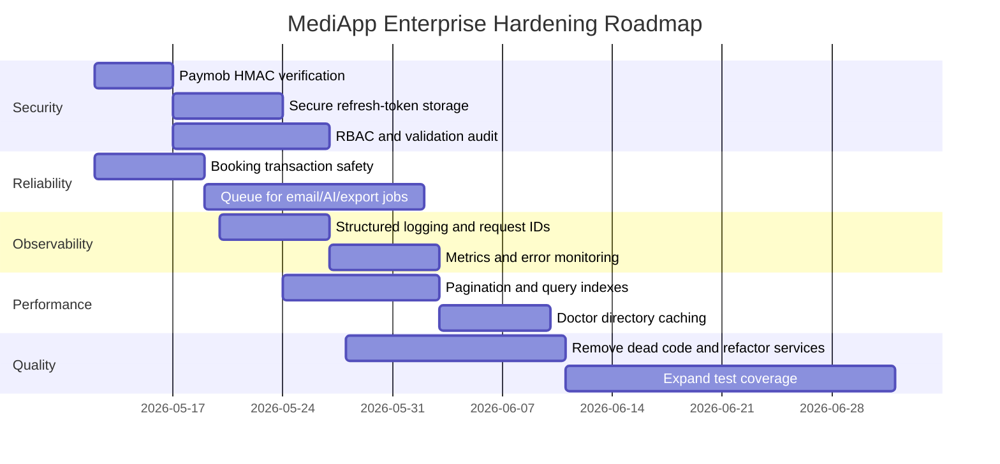
