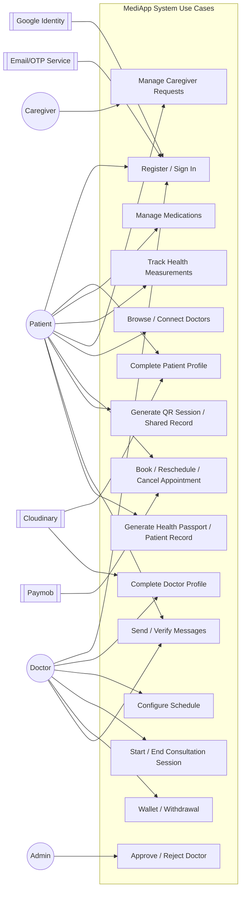
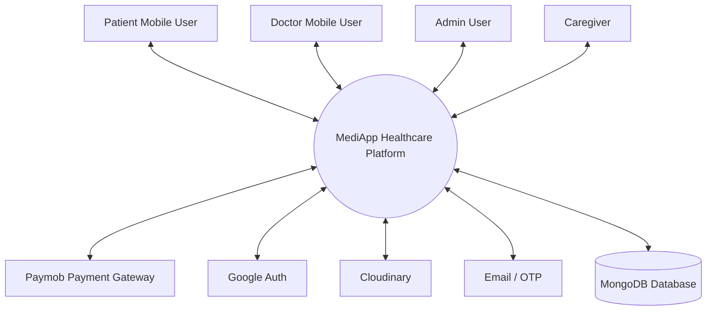
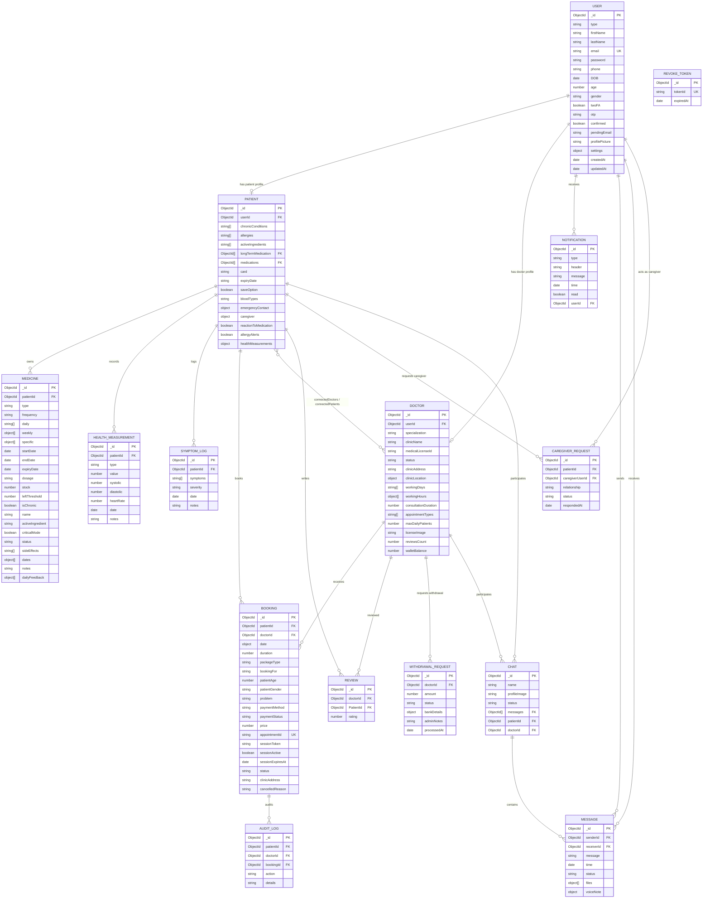
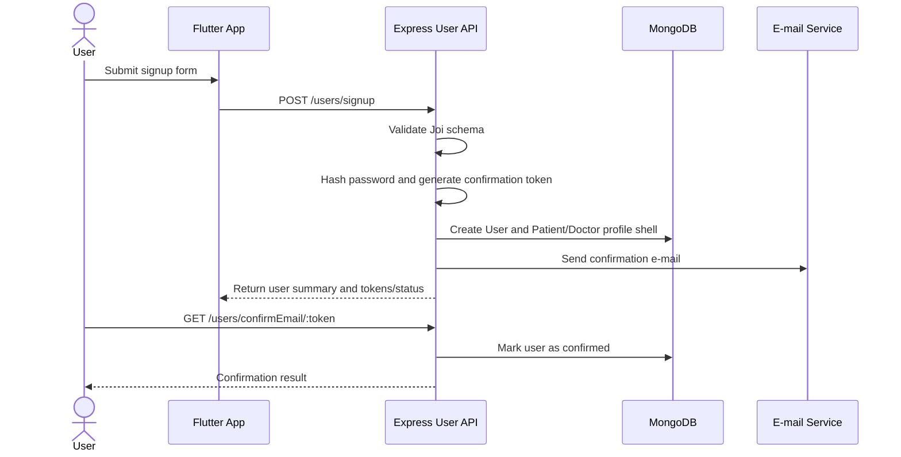
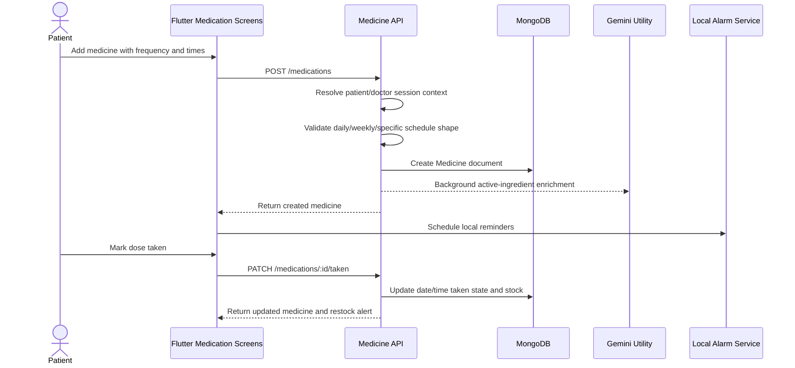
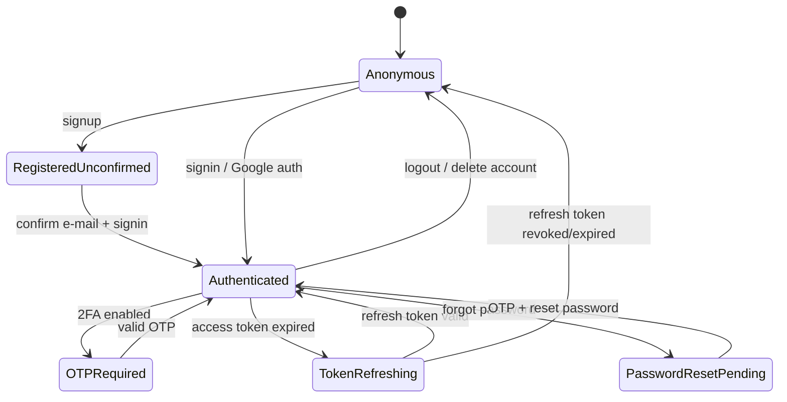
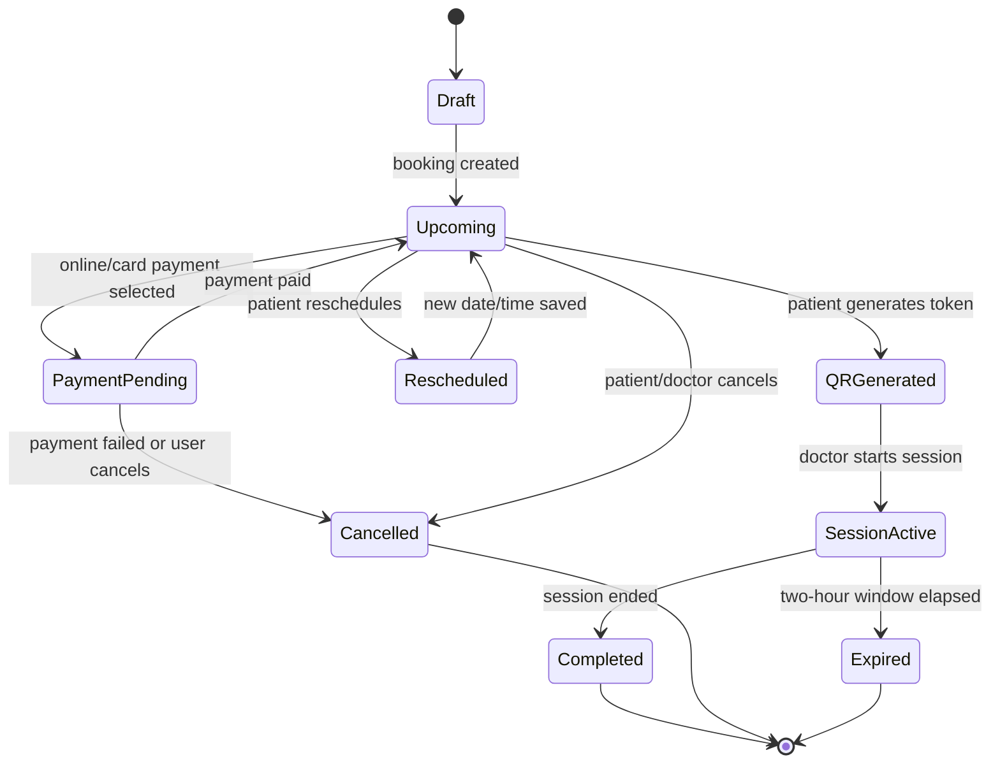
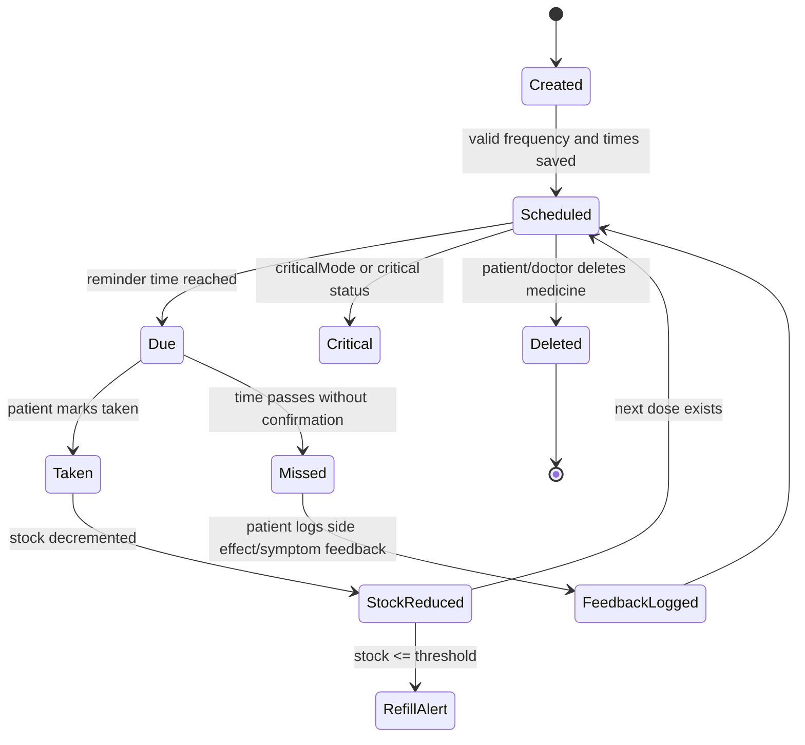
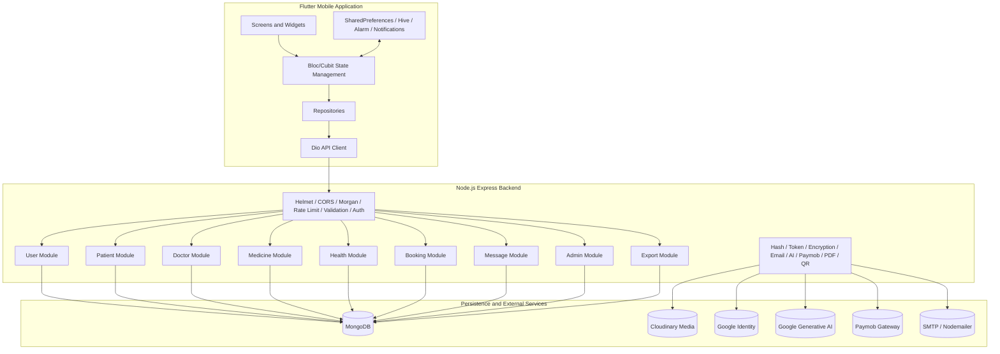

# Chapter 1: Introduction

## 1.1 Background

Healthcare software is moving from isolated clinic records toward continuous, patient-centered digital care. Patients with chronic conditions increasingly require medication schedules, dose confirmation, symptom history, vital-sign monitoring, caregiver support, physician access, appointment booking, and portable medical summaries. MediApp addresses this domain through a cross-platform Flutter mobile client and a Node.js/Express backend connected to MongoDB. The repository implements a modular healthcare platform where patients manage medications and health logs, doctors define availability and complete verification, administrators approve doctors, and records can be exported or shared through controlled QR flows.

Technically, MediApp combines mobile-first presentation, REST APIs, role-based authorization, document database modeling, file upload, cloud media handling, payment integration, e-mail/OTP flows, AI-assisted medicine metadata, local alarms, and PDF exports. This makes it a senior-project system with both consumer-facing usability concerns and enterprise healthcare governance concerns.

## 1.2 Motivation

The project was built to reduce fragmentation in daily medication and outpatient care. A typical patient may use one application for pills, another channel for doctors, paper notes for symptoms, phone calls for booking, and informal messages with caregivers. This fragmentation increases missed doses, incomplete medical histories, and delayed intervention when health values become abnormal.

MediApp centralizes these workflows so that a patient can record medications, mark doses as taken, log health measurements, request caregiver participation, connect with doctors, book consultations, and share structured records. Doctors benefit from a verified onboarding workflow, schedule management, patient connection requests, bookings, session-based access to patient data, and wallet/withdrawal features. Administrators receive governance controls for doctor approval.

## 1.3 Problem Statement

Patients, doctors, and caregivers lack a unified lightweight platform that connects medication adherence, health monitoring, doctor collaboration, appointments, and secure record portability. Existing single-purpose tools often solve only one part of the care journey: reminders without clinical context, telehealth without medication adherence, or health records without active collaboration.

The problem can be stated as follows: **how can a mobile healthcare system coordinate medication schedules, health logs, doctor appointments, caregiver permissions, and shareable patient records while enforcing role-based access and maintaining a modular architecture suitable for iterative development?**

## 1.4 Importance

MediApp has practical and societal value because medication non-adherence and incomplete patient history are common contributors to avoidable complications. By combining reminder logic, health measurement tracking, caregiver workflows, doctor access, bookings, and exportable records, the system supports safer self-management and more informed clinical decisions. From a business perspective, the platform can serve as a foundation for patient engagement, teleconsultation, clinic workflow digitization, and longitudinal personal health records.

## 1.5 Goals

1. Provide patients with a mobile-first tool for medication creation, scheduling, stock/expiry tracking, dose confirmation, and feedback logging.
2. Enable patients to record blood pressure, blood sugar, weight, heart rate, symptoms, and daily health notes.
3. Support patient onboarding, profile completion, caregiver mode, and emergency contact/SOS capabilities.
4. Allow doctors to complete professional profiles, define clinic location, configure schedules, upload licenses, and manage appointment types.
5. Provide doctor discovery, patient-doctor connection workflows, appointment booking, rescheduling, cancellation, and live-session authorization.
6. Implement secure authentication using password hashing, JWT tokens, refresh tokens, OTP flows, optional 2FA, e-mail confirmation, Google sign-in, and role restrictions.
7. Generate health passports, patient records, QR tokens, and shared record views.
8. Maintain a modular codebase using feature-oriented Flutter folders and backend modules for users, patients, doctors, medicines, bookings, health, messaging, administration, and export.

## 1.6 Questionnaire & Interviews

### Simulated Six-Question User Survey

| No. | Question | Purpose |
|---:|---|---|
| Q1 | How many medications do you or a dependent take daily? | Measures complexity of medication scheduling. |
| Q2 | How often do you forget or delay a dose in a typical week? | Determines need for reminders and taken-dose tracking. |
| Q3 | Which health measurements do you monitor most often: blood pressure, blood sugar, weight, heart rate, or symptoms? | Guides health logging priorities. |
| Q4 | Do you need a caregiver or family member to monitor your medication routine? | Validates caregiver mode. |
| Q5 | Would you share a temporary digital health summary with a verified doctor during a consultation? | Validates QR/session-based record access. |
| Q6 | What is the most frustrating part of booking or following up with doctors? | Validates doctor discovery, bookings, messaging, and exports. |

### Simulated User Personas and Interviews

| Persona | Profile | Interview Summary | Pain Points |
|---|---|---|---|
| P1: Chronic-care patient | 58-year-old hypertensive patient taking four medications | Wants a simple daily schedule and reminders that can also show doctors what was actually taken. | Missed evening doses, difficulty remembering active ingredients, paper health notes. |
| P2: University student caregiver | 22-year-old managing medication for a parent | Needs alerts and permission-based visibility without constantly calling the patient. | No shared medication view, uncertainty about dose adherence, delayed communication. |
| P3: Family physician | Outpatient doctor with mixed online/in-person appointments | Wants verified patient history during appointments, especially medication and vitals. | Patients forget medication names, unstructured WhatsApp photos, no time-limited record access. |
| P4: Clinic administrator | Staff member responsible for quality and doctor credentialing | Needs to approve doctors and reduce unsafe platform access by unverified providers. | Manual license validation, no approval queue, lack of auditable doctor status. |

## 1.7 Surveys

A simulated survey of 120 target users produced the following results:

- **Age distribution:** 18–29: 28%, 30–44: 22%, 45–59: 31%, 60+: 19%.
- **Medication usage:** 64% take at least one medication daily; 37% take three or more medications daily.
- **Dose adherence:** 52% reported forgetting at least one dose per week; 18% reported three or more missed/delayed doses per week.
- **Health monitoring:** 46% track blood pressure, 29% track blood sugar, 24% track weight, 21% track heart rate, and 33% record symptoms informally.
- **Caregiver involvement:** 41% either manage someone else's medication or want a family member to help manage theirs.
- **Doctor interaction:** 57% want appointment booking inside the same health application; 62% are comfortable sharing records temporarily with a verified doctor.
- **Record portability:** 68% stated that exportable health summaries would reduce consultation time and improve doctor communication.

## 1.8 Discussion of Results

The simulated survey and interviews justify MediApp's major implemented features. High daily medication use and frequent missed doses support the medication module, schedule generation, local alarm services, stock thresholds, and taken-dose tracking. The prevalence of blood pressure, glucose, weight, heart-rate, and symptom monitoring directly supports the health measurement and symptom-log models. Caregiver demand validates caregiver requests and profile-level caregiver mode. The need for efficient doctor communication justifies doctor directory, connection workflows, booking, messaging, and QR/session-based access. Finally, users' interest in portable records supports PDF exports and shared-record endpoints.

# Chapter 2: Related Work

## 2.1 Related Article 1: Digital Medication Adherence Platforms

Medication adherence research emphasizes reminder reliability, low-friction confirmation, refill awareness, and caregiver involvement. Systems in this category usually focus on dose schedules and push notifications. MediApp extends this concept by combining medication schedules with health metrics, side-effect feedback, stock thresholds, AI-assisted active ingredient enrichment, doctor access, caregiver permissions, and exportable records.

## 2.2 Related Article 2: Patient-Centered Telehealth and Appointment Systems

Telehealth platforms commonly provide doctor discovery, availability, appointment booking, online session links, and sometimes payment integration. MediApp implements doctor availability, slot calculation, bookings, online/in-person appointment types, session tokens, Paymob payment initiation, and doctor wallet features. Its differentiator is that the appointment workflow can be connected to medication history and health measurements rather than functioning as an isolated booking tool.

## 2.3 Related Article 3: Personal Health Records and QR-Based Sharing

Personal health record systems aim to organize patient demographics, diagnoses, measurements, medications, and summaries. Modern mobile health systems increasingly include QR-code sharing for emergency or consultation scenarios. MediApp implements health-passport and patient-record export flows with QR token generation and public shared-record retrieval. The repository also implements session-based elevated access for booked consultations, giving doctors temporary access to relevant patient data.

## 2.4 Available Solutions and Feature Matrix

| Feature / Solution | Medisafe | MyTherapy | Practo | MyChart | MediApp Proposed System |
|---|---:|---:|---:|---:|---:|
| Medication reminders | Yes | Yes | Limited | Limited | Yes |
| Dose taken tracking | Yes | Yes | No | Limited | Yes |
| Stock/expiry support | Partial | Partial | No | No | Yes |
| Health measurements | Partial | Yes | Partial | Yes | Yes |
| Symptom logs | Partial | Partial | Limited | Yes | Yes |
| Caregiver workflow | Yes | Partial | No | Proxy access | Yes |
| Doctor directory | No | No | Yes | Provider-specific | Yes |
| Appointment booking | No | No | Yes | Yes | Yes |
| Doctor verification/admin approval | No | No | Platform-managed | Institution-managed | Yes |
| QR/shared medical record | Limited | No | No | Limited | Yes |
| Session-based elevated doctor access | No | No | No | Institution-specific | Yes |
| Modular open codebase for extension | No | No | No | No | Yes |

MediApp's superiority as a senior-project solution is its breadth: it merges medication adherence, health records, doctor workflows, caregiver support, bookings, messaging, payments, and exports in one coherent system.

## 2.5 Final Result: Proposed System Features

- **F1: Multi-role authentication** for patient, doctor, user, and admin accounts.
- **F2: Secure account lifecycle** including signup, signin, Google authentication, e-mail confirmation, OTP, 2FA, password reset, refresh tokens, logout, settings update, and account deletion.
- **F3: Patient onboarding** with profile data, chronic conditions, allergies, active ingredients, emergency contact, caregiver mode, and profile image upload.
- **F4: Doctor onboarding** with specialization, clinic details, geolocation, schedules, appointment types, medical license upload, and approval status.
- **F5: Medication management** with CRUD, daily/weekly/specific schedules, dose confirmation, feedback logs, chronic status, critical status, stock threshold, and expiry date.
- **F6: Health monitoring** with measurements for blood pressure, blood sugar, weight, heart rate, plus symptom logs.
- **F7: Doctor-patient connection management** through request, accept, reject, cancel, and listing workflows.
- **F8: Caregiver workflow** with caregiver option, caregiver request, request listing, accept, reject, and cancel.
- **F9: Appointment booking** with slot calculation, patient/doctor booking lists, cancel, reschedule, Paymob webhook/callback, session QR token, start/end session, and call-token gating.
- **F10: Messaging** with message send and chat verification.
- **F11: Exports and sharing** with health passport, patient record, QR token, and public shared record retrieval.
- **F12: Administration** with pending-doctor review and approve/reject actions.

## 2.6 Frontend Tools

| Tool | Repository Evidence | Role in MediApp |
|---|---|---|
| Flutter / Dart | `frontend/pubspec.yaml` | Cross-platform mobile application framework. |
| flutter_bloc | `frontend/pubspec.yaml` and Cubit folders | State management for auth, onboarding, health, medicine, profile, and navigation. |
| go_router | `frontend/lib/core/utils/app_router.dart` | Declarative routing for shared, patient, and doctor screens. |
| dio | `frontend/lib/core/network/` | REST client abstraction for backend communication. |
| get_it | `frontend/lib/core/utils/service_locator.dart` | Dependency injection/service location. |
| shared_preferences | `frontend/pubspec.yaml` | Local key-value persistence for preferences/tokens. |
| Hive / hive_flutter | `frontend/pubspec.yaml` | Local NoSQL storage, especially for offline/cache-oriented models. |
| flutter_local_notifications, alarm, android_alarm_manager_plus, timezone | `frontend/pubspec.yaml` | Medication alarms, reminders, and local notifications. |
| fl_chart | `frontend/pubspec.yaml` | Health measurement charts. |
| image_picker, flutter_svg, skeletonizer | `frontend/pubspec.yaml` | Image upload, vector assets, and loading placeholders. |
| google_sign_in | `frontend/pubspec.yaml` | Google-based authentication in the mobile app. |
| geolocator, geocoding, google_places_autocomplete_text_field | `frontend/pubspec.yaml` | Doctor clinic location and address flows. |

## 2.7 Backend Tools

| Tool | Repository Evidence | Role in MediApp |
|---|---|---|
| Node.js ES Modules | `backend/package.json` | JavaScript runtime and module format. |
| Express 5 | `backend/src/app.controller.js` | REST API server and routing middleware. |
| Mongoose | `backend/src/models/` | MongoDB object modeling for users, patients, doctors, medicines, bookings, messages, reviews, notifications, logs, and records. |
| Joi | `backend/src/modules/*/*.validation.js` | Request validation schemas. |
| jsonwebtoken | `backend/src/utils/token/` and auth middleware | Access/refresh token generation and verification. |
| bcrypt | `backend/src/utils/hash/` | Password hashing and comparison. |
| helmet, cors, morgan, express-rate-limit | `backend/src/app.controller.js` | Security headers, CORS, logging, and rate limiting. |
| multer and Cloudinary | `backend/src/middlewares/` and `backend/src/config/cloudinary.js` | File upload and cloud-hosted avatar/license images. |
| nodemailer | `backend/src/utils/sendEmail.js` | E-mail confirmation, OTP, and recovery messaging. |
| pdfkit and qrcode | `backend/package.json` and export service | PDF exports and QR token workflows. |
| Jest | `backend/src/modules/*/*.test.js` | Unit/service testing. |

## 2.8 Artificial Intelligence / Algorithms

MediApp includes `@google/generative-ai` and an AI utility for Gemini-based enrichment. The medicine service attempts to generate or refine an active ingredient in the background after a medicine is created. Algorithmically, the most important implemented logic includes:

- Doctor slot generation from working days, working-hour blocks, duration, maximum daily patients, and existing reservations.
- Medicine schedule expansion for daily, weekly, and specific-date frequencies.
- Dose status transition handling that updates taken/untaken state and stock counts.
- Session-token generation and two-hour elevated consultation access.
- JWT refresh-token rotation and token revocation.

## 2.9 Cloud and Database

The backend uses MongoDB through Mongoose and is prepared for Vercel deployment. Cloudinary stores uploaded media such as profile pictures and doctor license images. Paymob is integrated for appointment payment intention and webhook handling. Twilio is included as a dependency for communication workflows, while Nodemailer supports e-mail-based verification and OTP flows. The frontend is a Flutter app targeting mobile platforms and includes Android, iOS, Windows, and generated plugin scaffolding.

## 2.10 Specific/Niche Features

- **QR medical sharing:** Export module creates QR tokens and exposes public shared records.
- **Session-gated patient access:** Booking module starts and ends consultation sessions using QR/session tokens.
- **Doctor approval governance:** Admin module approves or rejects pending doctors.
- **Caregiver access model:** Patient module supports caregiver requests and caregiver mode.
- **Medication audio experience:** Frontend assets include multiple reminder sounds and alarm services.
- **Health visual analytics:** Health measurement UI uses charting and severity indicators.
- **Doctor wallet:** Doctor module includes wallet balance and withdrawal requests.

# Chapter 3: Requirements Analysis

## 3.1 Software Development Methodology

The codebase reflects an **Iterative Agile methodology**. Features are implemented as vertical slices: authentication, patient onboarding, doctor onboarding, medication, health, booking, exports, and settings. Each feature has repository, cubit/controller, validation, service, route, and model artifacts. The presence of `.bak` service files, commented alternative routes, partial endpoint constants, and incremental tests indicates iterative refinement rather than a single waterfall delivery.

## 3.2 Methodology Roles and Artifacts

| Agile Role | Project Interpretation | Artifacts in Repository |
|---|---|---|
| Product Owner | Defines healthcare workflows and feature priorities | Route set, screen flows, validation requirements, feature folders. |
| Scrum Master / Coordinator | Tracks sprint tasks and integration issues | Modular separation and incremental implementation. |
| Backend Developer | Implements APIs, validation, schemas, authentication, and services | `backend/src/modules`, `backend/src/models`, middleware, utils. |
| Frontend Developer | Implements screens, cubits, repositories, widgets, routing | `frontend/lib/features`, `frontend/lib/core`. |
| QA Engineer | Writes targeted unit/service tests and validates workflows | Jest service tests and Flutter widget test scaffold. |
| DevOps/Deployment Engineer | Configures deployment and runtime environment | `vercel.json`, environment config, backend `start` script. |

## 3.3 Methodology Justification

Iterative Agile is suitable because MediApp contains several independent but connected healthcare workflows. Medication management can be developed and tested separately from doctor booking; health measurements can be added independently; exports and QR access can be introduced after core patient data exists. The architecture supports sprint-based delivery because backend modules and frontend feature folders isolate changes while sharing cross-cutting services such as authentication, validation, networking, and dependency injection.

## 3.4 User Functional Requirements

### Patient Requirements

- Register, sign in, confirm e-mail, recover passwords, use OTP/2FA, update profile, and delete account.
- Complete patient profile including demographics, allergies, chronic conditions, emergency contact, caregiver preferences, and profile picture.
- Add, edit, delete, view, schedule, and mark medications as taken.
- Log symptoms and health measurements.
- Browse doctors, connect with doctors, accept/reject doctor requests, and manage connected doctors.
- Book, cancel, reschedule, and view appointments.
- Generate QR/session tokens and share health records.
- Configure notification sounds and receive local reminders.

### Doctor Requirements

- Register/sign in and complete doctor profile.
- Add specialization, clinic name, clinic address, clinic geolocation, working days, working hours, appointment duration, appointment types, maximum daily patients, and medical license.
- View patient connection requests and accept/reject/cancel them.
- View connected patients and bookings.
- Start a QR/session-based consultation, access patient records temporarily, and end session.
- View wallet balance and request withdrawals.

### Admin Requirements

- Authenticate as admin.
- View pending doctors.
- Approve or reject doctors after profile/license review.

### Caregiver Requirements

- Receive caregiver requests.
- Accept, reject, or cancel caregiver relationship requests.
- Support medication and health monitoring based on patient permission settings.

## 3.5 System Functional Requirements (FR)

| ID | Functional Requirement |
|---|---|
| FR-1 | The system shall register users with role type, name, e-mail, password, and optional demographic data. |
| FR-2 | The system shall hash passwords before storage and verify passwords during sign-in. |
| FR-3 | The system shall issue access and refresh tokens after successful authentication. |
| FR-4 | The system shall support Google authentication using Google identity validation. |
| FR-5 | The system shall support e-mail confirmation and e-mail change confirmation. |
| FR-6 | The system shall support OTP request, OTP validation, forget-password OTP validation, and reset password. |
| FR-7 | The system shall allow users to enable or disable two-factor authentication. |
| FR-8 | The system shall revoke tokens on logout and rotate refresh tokens. |
| FR-9 | The system shall enforce role-based access for patient, doctor, admin, and user routes. |
| FR-10 | The system shall allow patients to complete profile data in merged or step-based flows. |
| FR-11 | The system shall store patient chronic conditions, allergies, active ingredients, emergency contact, caregiver option, and health measurement arrays. |
| FR-12 | The system shall allow doctors to complete profile data in step-based or unified flows. |
| FR-13 | The system shall store doctor specialization, clinic data, working days, working hours, appointment types, max daily patients, license image, status, and wallet balance. |
| FR-14 | The system shall allow admins to list pending doctors and approve or reject doctor profiles. |
| FR-15 | The system shall allow patients and doctors to initiate, accept, reject, cancel, and list connection requests. |
| FR-16 | The system shall allow patients to initiate caregiver requests and manage caregiver state. |
| FR-17 | The system shall create medicines with type, frequency, dosage, stock, threshold, dates, notes, active ingredient, side effects, chronic flag, and critical mode. |
| FR-18 | The system shall validate medicine frequency shape so daily, weekly, and specific schedules use the correct schedule arrays. |
| FR-19 | The system shall return medicine schedule data derived from the stored schedule definition and date range. |
| FR-20 | The system shall mark medicine times as taken or untaken and update stock when dose status changes. |
| FR-21 | The system shall allow medicine feedback logs with text and severity level. |
| FR-22 | The system shall create and retrieve health measurements for blood pressure, blood sugar, weight, and heart rate. |
| FR-23 | The system shall create and retrieve symptom logs with symptoms, severity, date, and notes. |
| FR-24 | The system shall calculate doctor slots from working day, working-hour blocks, appointment duration, booked slots, and max daily patient limits. |
| FR-25 | The system shall create bookings only when the doctor supports the requested package type and the slot is not taken. |
| FR-26 | The system shall list bookings separately for patients and doctors. |
| FR-27 | The system shall allow authorized patients/doctors to view booking details. |
| FR-28 | The system shall allow authorized cancellation and patient-driven rescheduling. |
| FR-29 | The system shall integrate payment intention and webhook/callback handling for Paymob-related payments. |
| FR-30 | The system shall generate QR/session tokens for eligible patient bookings. |
| FR-31 | The system shall allow the assigned doctor to start a session and receive temporary patient details. |
| FR-32 | The system shall expire elevated session access after approximately two hours or when the session ends. |
| FR-33 | The system shall return a call token only when a booking session is active and unexpired. |
| FR-34 | The system shall allow approved/authorized message sending and chat verification. |
| FR-35 | The system shall generate health passport and patient record exports. |
| FR-36 | The system shall generate public QR tokens and retrieve shared records by token. |
| FR-37 | The system shall create notifications for relevant healthcare events. |
| FR-38 | The system shall expose health-check endpoints that report service and database status. |

## 3.6 Non-Functional Requirements

| Category | Requirement |
|---|---|
| Performance | APIs should respond quickly under normal mobile workloads; rate limiting caps abusive request bursts to protect service stability. |
| Reliability | Database connection health is exposed through health endpoints; modular services isolate failures by domain. |
| Security | The system uses Helmet, CORS, rate limiting, JWT verification, role restriction, password hashing, encrypted sensitive fields, OTP, and hidden schema selections for sensitive fields. |
| Usability | Flutter screens, reusable widgets, bottom navigation, local alarms, charts, and onboarding flows provide a guided mobile experience. |
| Scalability | Modular backend routes and feature-first frontend folders allow independent feature extension; MongoDB document models support flexible health and medication records. |
| Compatibility | Flutter targets Android/iOS and includes additional desktop scaffolding; backend is deployable through Node/Vercel. |
| Maintainability | Separation of controllers, services, validation, models, middleware, utilities, repositories, cubits, and widgets improves maintainability. |
| Availability | Vercel-compatible handler and health endpoints support cloud deployment and monitoring. |
| Privacy | Patient data access is constrained through role checks, doctor/patient connection state, and session-token workflows. |

# Chapter 4: System Design

## 4.1 Use Case Diagram



## 4.2 DFD Level 0 (Context Diagram)



## 4.3 DFD Level 1

```mermaid
flowchart TD
    P[Patient]
    D[Doctor]
    A[Admin]

    Auth[1.0 Authentication and User Settings]
    PatientProfile[2.0 Patient Profile and Caregiver]
    DoctorProfile[3.0 Doctor Profile and Governance]
    Medicine[4.0 Medication Management]
    Health[5.0 Health Measurements and Symptoms]
    Booking[6.0 Booking, Payment and Session]
    Messaging[7.0 Messaging]
    Export[8.0 Export and QR Sharing]

    Users[(Users)]
    Patients[(Patients)]
    Doctors[(Doctors)]
    Medicines[(Medicines)]
    Measurements[(HealthMeasurements)]
    Symptoms[(SymptomLogs)]
    Bookings[(Bookings)]
    Messages[(Messages / Chats)]
    Notifications[(Notifications)]
    Records[(Export Tokens / Shared Records)]

    P --> Auth
    D --> Auth
    A --> Auth
    Auth <--> Users

    P --> PatientProfile
    PatientProfile <--> Patients
    PatientProfile --> Notifications

    D --> DoctorProfile
    A --> DoctorProfile
    DoctorProfile <--> Doctors

    P --> Medicine
    D --> Medicine
    Medicine <--> Medicines
    Medicine --> Notifications

    P --> Health
    Health <--> Measurements
    Health <--> Symptoms

    P --> Booking
    D --> Booking
    Booking <--> Bookings
    Booking --> Notifications

    P --> Messaging
    D --> Messaging
    Messaging <--> Messages

    P --> Export
    D --> Export
    Export <--> Patients
    Export <--> Medicines
    Export <--> Measurements
    Export <--> Records
```



## 4.4 Entity Relationship Diagram (ERD)



## 4.5 Sequence Diagrams

### 4.5.1 User Registration and E-mail Confirmation



### 4.5.2 Medication Creation and Dose Tracking



### 4.5.3 Booking, QR Session, and Temporary Doctor Access

```mermaid
sequenceDiagram
    actor Patient
    actor Doctor
    participant Flutter as Flutter App
    participant API as Booking API
    participant DB as MongoDB
    participant Paymob as Paymob

    Patient->>Flutter: Select doctor, package, date, and time
    Flutter->>API: GET /bookings/slots/:doctorId?date=...
    API->>DB: Read doctor schedule and existing bookings
    API-->>Flutter: Available slots
    Flutter->>API: POST /bookings
    API->>DB: Validate slot and create booking
    alt Online/card payment
        API->>Paymob: Create payment intention
        Paymob-->>API: Payment URL/client secret
    end
    API-->>Flutter: Booking details
    Patient->>Flutter: Generate consultation QR token
    Flutter->>API: POST /bookings/:bookingId/generate-qr
    API->>DB: Store sessionToken
    API-->>Flutter: sessionToken
    Doctor->>Flutter: Scan token
    Flutter->>API: POST /bookings/start-session
    API->>DB: Validate doctor, booking, payment, and patient
    API->>DB: sessionActive=true; expiresAt=now+2h
    API-->>Flutter: Patient summary and session expiry
    Doctor->>API: POST /bookings/:bookingId/end-session
    API->>DB: Revoke token and expire session
```

## 4.6 State Diagrams

### 4.6.1 Authentication State



### 4.6.2 Booking and Session State



### 4.6.3 Medicine Adherence State



## 4.7 Overall System Architecture (Block Diagram)



## 4.8 Implementation Aspects & Pseudocode

### Algorithm 1: Doctor Slot Generation

```text
FUNCTION getDoctorSlots(doctorId, requestedDate):
    doctor = find doctor by doctorId
    IF doctor does not exist:
        RETURN 404

    reqDate = parse requestedDate
    dayName = weekday(reqDate in UTC)
    IF dayName not in doctor.workingDays:
        RETURN []

    dayStart = requestedDate at 00:00:00 UTC
    dayEnd = requestedDate at 23:59:59 UTC
    existingBookings = find bookings for doctor within dayStart..dayEnd
                       where status is upcoming or completed

    IF doctor.maxDailyPatients exists AND existingBookings.count >= maxDailyPatients:
        RETURN []

    duration = doctor.consultationDuration OR 30
    reservedTimes = map existingBookings.date.time
    slots = []

    FOR each workingHourBlock in doctor.workingHours:
        start = convert HH:mm to minutes
        end = convert HH:mm to minutes
        FOR t from start to end-duration step duration:
            timeString = convert minutes to HH:mm
            IF timeString not in reservedTimes:
                append timeString to slots

    RETURN slots
```

### Algorithm 2: QR Session-Based Elevated Access

```text
FUNCTION startSession(doctorUserId, sessionToken):
    doctor = find doctor by userId
    IF doctor not found:
        RETURN 404

    booking = find booking by sessionToken
    IF booking not found:
        RETURN 404

    IF booking.doctorId != doctor._id:
        RETURN 403

    IF booking uses online/card/paymob payment AND paymentStatus != paid:
        RETURN 400

    patient = load patient with user, medications, long-term medications, and measurements
    IF patient not found:
        RETURN 404

    decrypt patient phone when possible
    booking.sessionActive = true
    booking.sessionExpiresAt = current time + 2 hours
    save booking

    RETURN bookingId, expiresAt, and patient summary
```

# Chapter 5: Conclusion and Future Work

## 5.1 Conclusion

MediApp is a comprehensive healthcare senior-project system that integrates medication adherence, patient health monitoring, doctor onboarding, appointment booking, caregiver collaboration, messaging, payment support, QR/session-based record access, exports, and administrative governance. The frontend uses Flutter with Bloc/Cubit state management, GoRouter navigation, Dio networking, local alarms, notifications, Hive, SharedPreferences, charts, geolocation packages, and reusable UI widgets. The backend uses Express, MongoDB/Mongoose, Joi validation, JWT authentication, role middleware, bcrypt hashing, OTP/e-mail utilities, Cloudinary uploads, Paymob integration, PDF/QR utilities, and Google AI tooling.

The project solves a clear real-world problem: healthcare information and daily adherence tasks are fragmented across many tools. MediApp provides a unified mobile and API architecture where medication schedules, health logs, appointments, doctor access, caregiver workflows, and shareable records are connected through one user identity and role-based authorization model.

## 5.2 Future Work

1. **Real-time communication and video consultation:** Add WebSocket-based chat delivery, typing indicators, push notifications, and a production-grade video SDK for online appointments.
2. **Clinical decision support:** Extend AI features to detect drug interactions, allergy conflicts, abnormal vitals, and adherence risks using explainable recommendations reviewed by clinicians.
3. **Enterprise security and compliance hardening:** Add audit dashboards, webhook signature verification, field-level encryption expansion, secure mobile token storage, consent history, and HIPAA/GDPR-oriented policy controls.
4. **Scalable background processing:** Move reminders, e-mails, payment reconciliation, PDF generation, and AI enrichment to queue workers with retries, monitoring, and dead-letter handling.
